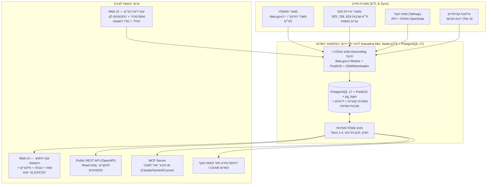

# חזון המוצר, ביקורת בונה וארכיטקטורה מוצעת — "ילדי היקר"

מסמך זה מתעד את הרעיונות והדרישות שהגדרת עבור הפאנל העתידי, מנתח אותם בעין ביקורתית (איפה האינטואיציה שלך מדויקת ואיפה מסתתרים מוקשים), ומציע ארכיטקטורה קונקרטית ומודל אמינות נתונים.

---

## 1. סיכום החזון שהגדרת (נקודת המוצא)

1. **שני ענפי ליבה ב-UI:**
   - **ענף הזנת מידע:** הורים מדווחים מידע על הגן של ילדיהם.
   - **ענף חיפוש ופילטור:** הורים מחפשים ומשווים גנים לפי מסננים מגוונים, כולל **ייצוא תוצאות לאקסל/CSV**.
2. **הנגשת דאטה פתוחה מעבר לממשק המשתמש:**
   - **מסד נתונים מרכזי** מאורגן ומנורמל.
   - **Public API** מתועד.
   - **MCP Server (Model Context Protocol)** לחיבור ישיר לסוכני AI וכלי מחקר.
3. **מודל אמינות והצלבת מקורות:**
   - הבחנה ברורה במאגר ובממשק בין: **מקור רשמי/אמין**, **דיווח הורה מאומת**, ו**דיווח הורה שלא אומת**.
   - ביצוע **הצלבה (Cross-Referencing)** בין דיווחי ההורים לבין המאגרים הרשמיים.

---

## 2. ביקורת בונה וניתוח מוקשים — איפה צריך לחדד או להיזהר?

הכיוון הכללי שלך מצוין ומתיישב ב-100% עם ה-DNA של הסדנא לידע ציבורי. עם זאת, מתוך ניתוח הקוד מההאקתון, גיליון האקסל של ת"א והמצב החוקי בישראל, יש **6 מוקשים קריטיים** שחייבים לפתור כבר בשלב התכנון:

### מוקש 1: בלבול מושגי בין "לא מסובסד" לבין "לא מפוקח" (אך גם ההזדמנות הגדולה ביותר!)
- **הביקורת:** רוב ההורים (ואפילו צוות ההאקתון ב-`gan-ster`, שבנה רק שדה `subsidized` מול `not_subsidized`) מבלבלים בין סבסוד מחיר לבין פיקוח בטיחותי/חינוכי.
- **המציאות הרגולטורית:** לפי *חוק הפיקוח על מעונות יום לפעוטות (2018)*, **כל מסגרת עם 7 פעוטות ומעלה (גילאי 0–3) חייבת ברישיון הפעלה ממשרד החינוך** — גם אם היא פרטית לחלוטין וגובה 6,500 ₪ בחודש! בפועל קיימות 4 קטגוריות שונות לגמרי לגילאי 0–3:
  1. **מעון/משפחתון סמל:** מפוקח + מחיר מפוקח ממשלתית + זכאות לדרגות סבסוד.
  2. **גן/מעון פרטי עם רישיון הפעלה:** מפוקח בטיחותית ופדגוגית ע"י משרד החינוך, אך **מחירו חופשי בשוק**.
  3. **משפחתון ביתי זעיר (עד 6 ילדים):** פטור מרישיון לפי חוק הפיקוח (לא מפוקח כחוק).
  4. **גן פרטי עם 7+ ילדים ללא רישיון הפעלה:** פועל **בניגוד לחוק / ללא פיקוח** (או בהליך זמני).
- **ההמלצה:** ההצלבה שהצעת היא "פיצ'ר המחץ" שמחבר את שתי מטרות הפרויקט! כשהורים מדווחים על גן של 20 ילדים שעולה 6,200 ₪ ואינו מופיע במרשם הרישוי הרשמי — המערכת חושפת גם את יוקר החינוך וגם את היעדר הפיקוח באותה תצוגה.

### מוקש 2: בעיית ה"ביצה והתרנגולת" (Cold-Start & Free-Riders) בשני הענפים
- **הביקורת:** אם מפרידים לחלוטין בין "ענף חיפוש" פתוח לבין "ענף הזנת מידע", 98% מהמשתמשים רק יחפשו ו-2% ידווחו. מצד שני, נעילה מוחלטת של החיפוש ("חובה לדווח כדי לראות") פוגעת בהורים לילד ראשון שעוד אין להם גן, וסותרת את עקרון המידע הפתוח (API/MCP).
- **ההמלצה (מודל היברידי):**
  1. **החיפוש פתוח לכולם מיום ההשקה**, ומאוכלס מראש בכל המסגרות הרשמיות (מפת הטף + משרד החינוך + GIS עירוני) + ייבוא גיליונות קהילתיים קיימים (מסומנים כמקור קהילתי היסטורי).
  2. **תמריץ מיידי להורה שמדווח ("מדד הגן שלי"):** הורה שמזין מחיר מקבל מיידית כרטיס אינפוגרפי אישי לשיתוף בווטסאפ של הגן: *"אתם משלמים 6,300 ₪ — זה יקר ב-11% מחציון הגנים ברדיוס 1 ק"מ לקבוצת הגיל שלכם (5,650 ₪)"*.
  3. **מיקרו-דיווח מתוך החיפוש:** על כל כרטיס של גן רשמי שחסר לו מחיר עדכני, מופיע כפתור מהיר *"יודעים כמה עולה הגן הזה בתשפ"ז? הוסיפו מחיר ב-15 שניות"*.

### מוקש 3: השוואת "תפוחים לתפוחים" במחיר
- **הביקורת:** בגיליון ת"א ובאפליקציית ההאקתון (`gan-ster`), "מחיר חודשי" הוצג כמספר בודד. בפועל, פער של 1,200 ₪ בין שני גנים באותו רחוב נובע לעיתים קרובות מכך שאחד כולל ימי שישי, אוכל מבושל ושעה 16:30, והשני הוא עד 16:00 ללא שישי וללא קייטרינג (עוד 500 ₪!).
- **ההמלצה (אושרה ב-D-12 ו-D-13):** טופס הדיווח חייב ללכוד במהירות את **משתני הנרמול המחייבים**:
  - **מחיר חודשי בש"ח** + **שנת לימודים** (`תשפ"ו` / `תשפ"ז`).
  - **קבוצת גיל (0–6 מלא):** תינוקייה `0–1` / פעוטות `1–2` / גנון `2–3` / גן `3–6` (במובחן בין גן פרטי מלא לצהרון בגן עירייה).
  - **שעת פתיחה ושעת סיום בימי א'–ה':** הן שעת פתיחה (`07:00` / `07:30` / `08:00`) והן שעת סיום (`13:00` / `16:00` / `16:30` / `17:00+`).
  - **ימי שישי ושעות פעילות בשישי:** כן / לא — ואם נבחר **"כן"**, נפתחת הזנת **שעת פתיחה ושעת סיום ליום שישי** (למשל `07:30–12:30`).
  - **הזנה (אוכל):** האם המחיר החודשי כולל אוכל או שיש תוספת הזנה נפרדת / ללא הזנה.
  *(בשלב שני אופציונלי: דמי הרשמה/ביטוח שנתיים ומספר חודשי תשלום — האם אוגוסט משולם מלא).*

### מוקש 4: החיכוך מול הפרטיות באימות הורים ("הורה מאומת")
- **הביקורת:** איך מאמתים שהמדווח הוא באמת הורה בגן ולא בעל הגן המתחרה או טרול? אם נבקש להעלות חוזה התקשרות או קבלה עם שם הילד — מעט מאוד הורים יעשו זאת, והסדנא תיחשף לחובות כבדות של **תיקון 13 לחוק הגנת הפרטיות (אוגוסט 2025)** בגין החזקת מאגר מידע רגיש.
- **ההמלצה (אושרה ב-`D-14`, `D-27`, `D-29` — מודל אימות מדורג לפי שלבי הפרויקט וללא שמירת מידע אישי מזהה `Zero-PII`):**
  1. **ב-`MVP1` — אימות חשבון Google (`OAuth 2.0 / OIDC`) + `Strictly Necessary Cookie` + `Cloudflare Turnstile` בעלות `0 ₪` (`D-29`):**
     - ההורה מזדהה בלחיצה אחת עם חשבון Google (Scope מינימלי `openid`). השרת מחלץ מה-Token את המזהה המספרי הקבוע (`sub`), מחשב בזיכרון **`HMAC-SHA256(google_sub, SECRET_PEPPER)`** (`reporter_hash`), ומוחק מיד את המייל והשם מהזיכרון (אפס PII ב-DB!).
     - במקביל נשמרת בדפדפן **עוגייה הכרחית לאבטחה ותפעול (`HttpOnly; Secure; SameSite=Lax`)** למניעת שליחה כפולה (פטורה מבאנר קוקיז כי אינה עוגיית מעקב/פרסום).
  2. **בשלב ב' (`Phase 2`) — הוספת ספק `SMS + Voice OTP` ישראלי יחיד במודל Prepaid (`D-14`, `D-27`):**
     - עבור מסלול אימות בעלי הגנים (`Owner Claim` מול טלפון נייד או קווי של הגן ב-`Voice OTP`) ועבור הורים ללא חשבון Google (כגון טלפונים כשרים), יתווסף בשלב ב' אימות חד-פעמי דרך ספק ישראלי יחיד (`019` / `InforU`, ~`20 ₪` ל-`1,000` הודעות, שרתים בישראל בלבד ללא העברה לחו"ל, לאחר פסילת `WhatsApp Cloud API`) עם שמירת `HMAC-SHA256` של המספר בלבד.
  3. **אימות קונצנזוס סטטיסטי:** כש-3 הורים שונים (`reporter_hash` נפרדים) מדווחים על אותו גן, הנתון עולה אוטומטית לדרגת **"אומת בקונצנזוס קהילתי"**.

### מוקש 5: מוקש לשון הרע ופרטיות בענף הזנת המידע וב-API/MCP
- **הביקורת:** בגיליון ת"א הורים כתבו בטקסט חופשי האשמות פליליות ושמיות קשות. אם נאפשר ביקורות מילוליות פתוחות ונפיץ אותן גם ב-API וב-MCP, הסדנא עלולה להיתבע בתביעות לשון הרע ולהפר את חוק הגנת הפרטיות (במיוחד כשמדובר ב**משפחתון ביתי** שבו כתובת הגן וטלפון המטפלת הם ביתה הפרטי של אישה פרטית).
- **ההמלצה (אושרה ב-D-08, D-21, D-22):**
  1. **ב-MVP אין שדה ביקורת פתוח (No Free-Text Reviews)!** אוספים רק עובדות מובנות ואובייקטיביות (מחיר, שעות פתיחה/סיום בא'-ה' ובשישי, הזנה, גודל מסגרת 7+ מול עד 6, ממ"ד/מקלט, מצלמות כחוק).
  2. **מדיניות פרטיות לגנים ומסגרות שנוצרו מדיווחי הורים (D-21):** הורים לעולם לא מזינים שם בעל/ת גן או טלפון. עבור מסגרות רשמיות מציגים כתובת מלאה וטלפון רשמי; עבור כל מסגרת שנוצרה מדיווחי הורים ואינה במאגר רשמי — מציגים בציבור (UI/API/MCP/Export) רק את שם הגן + שם הרחוב/מיקום מקורב (ללא מספר בית מדויק וללא טלפון), כאשר מספר הבית שההורה הזין נשמר ב-`app_private` אך ורק למניעת כפילויות ולאימות בעלים. רק בעל/ת הגן (`Opt-In`) רשאי לחשוף כתובת מדויקת וטלפון.
  3. **מסלול בעלי גנים שקוף ללא דריסת דיווחי הורים (D-22):** בעל גן שמאמת בעלות (באמצעות התאמת טלפון עיוורת מול המאגר הרשמי או התאמת מספר בית עיוורת בגן פרטי) יכול לערוך את הפרטים הראשיים מטעם הנהלת הגן, אך **אינו דורס דיווחי הורים**. בתחתית כרטיס הגן מוצגת רשימת כל דיווחי ההורים (עם תאריך ברמת חודש ושנה בלבד להגנה על אנונימיות ההורה), וכל סתירה מול הצהרת בעל הגן מסומנת אוטומטית בערכים הראשיים (`⚠️ פער מול דיווחי הורים`).

### מוקש 6: כתיבה מול קריאה ב-API וב-MCP
- **הביקורת:** פתיחת MCP ו-API לכתיבת דיווחים ללא אימות אנושי תאפשר לסוכנים אוטומטיים או בעלי עניין להזריק אלפי מחירים מזויפים.
- **ההמלצה:** ה-**Public API** וה-**MCP Server** יהיו **לקריאה ותחקור בלבד (Read-Only)** עם Rate Limiting סביר. הזנת דיווחי הורים תתבצע רק דרך ה-Web UI המוגן (OTP / Turnstile Captcha / Rate-limit).

---

## 3. מודל 4 שכבות האמינות המוצע (Data Trust Architecture)

במקום דורסנות של נתונים (שבה דיווח הורה מוחק נתון רשמי או להפך), כל מסגרת במאגר מחזיקה **שכבות מידע מקבילות עם חותמת מקור (`provenance`)**:

| דרגה | תווית ב-UI / ב-API | מה נכלל בה? | איך מוצג להורה בפאנל? |
|---|---|---|---|
| **Tier 1** | `official` — **מקור רשמי** | מרשם משרד החינוך / העבודה, GIS עירוני, רישוי עסקים, מפת הטף, תעריף מעונות סמל מפוקח | תג כחול/ירוק רשמי (`"מקור רשמי: משרד החינוך / עירייה"` + כתובת מלאה וטלפון רשמי). |
| **Tier 2** | `verified_crowd` — **מידע הורים מאומת** | קונצנזוס של $\ge 3$ דיווחי הורים עצמאיים (לאחר אימות OTP) | תג הורים מאומת (`"מידע הורים מאומת · קונצנזוס של X הורים"` — תמיד מובחן מתג מקור רשמי!). |
| **Tier 3** | `unverified_report` — **דיווח הורים (טרם אומת)** | `1–2` דיווחי הורים חדשים מהטופס (לאחר אימות OTP) | תג שקוף וברור (`"דיווח הורים (טרם אומת) · נוב׳ 2026"` + קריאה להורים נוספים לאמת). |
| **Tier 4** | `community_import` — **ייבוא גיליון קהילתי** | נתונים עובדתיים נקיים בלבד שיובאו מגיליונות אקסל שכונתיים (ללא טקסט חופשי, ללא טלפונים אישיים וללא מספר בית בגן לא-רשמי — `D-23`) | תג אפור (`"מקור: גיליון הורים קהילתי · דורש אימות מחדש"`). |
| **תג משלים** | `owner_verified` — **אומת ע"י הנהלת הגן** | בעל/ת הגן עבר אימות בעלות עיוור (`D-22`, עם תיעוד `Audit Log` ב-`app_private` לפי `D-23`) ועדכן פרטים ראשיים / אישר חשיפת כתובת וטלפון | תג הנהלת הגן לצד תג המקור + הצגת כל דיווחי ההורים בתחתית הכרטיס וסימון `⚠️ פער מול דיווחי הורים` בכל שדה שבו קיימת סתירה. |

### כללי הצלבה אוטומטיים (Cross-Referencing Engine)
1. **זיהוי מסגרת שלא אותרה במרשם הפיקוח — בהפרדה חוקית בין `0–3` ל-`3–6` (`D-23`, `D-24`):**
   - **לגילאי `0–3` (`חוק הפיקוח על מעונות יום`, רף `7+` פעוטות מול מרשם `GetMeonot`):** *"דיווחי הורים מציינים 7+ ילדים; המסגרת לא אותרה אוטומטית במרשם מעונות היום של משרד החינוך נכון ל-DD.MM.YYYY (ייתכן שפועלת תחת שם/סמל שונה או בהליך רישוי)"*.
   - **לגילאי `3–6` בגן פרטי (`חוק פיקוח על בתי ספר`, רף `11+` תלמידים מול מרשם `mosdot_edu`):** *"דיווחי הורים מציינים 11+ ילדים בגילאי 3–6; המסגרת לא אותרה אוטומטית במרשם מוסדות החינוך של משרד החינוך נכון ל-DD.MM.YYYY (ייתכן שרשומה תחת שם/סמל שונה)"*.
2. **זיהוי פער סטטוס ("נסגר בשטח"):** אם המסגרת מופיעה כפעילה במאגר הממשלתי (שמתעדכן באיטיות), אך התקבלו דיווחי הורים שהיא נסגרה -> מציגים את שניהם: *"רשום במאגר הרשמי | ⚠️ הורים דיווחו שהמסגרת נסגרה"*.
3. **זיהוי חריגת מחיר במסגרת מפוקחת:** השוואת המחיר המדווח לתעריף המקסימום הממשלתי במעון סמל (`0–3`, משרד העבודה) או בצהרון ציבורי של תוכנית `ניצנים` (`3–6`, משרד החינוך לפי אשכול למ"ס).

---

## 4. ארכיטקטורת המערכת המוצעת (High-Level Blueprint)

### כלים מוצעים בשרת ה-MCP העתידי (`yaldi-hayakar-mcp`)
כדי שסוכני AI יפיקו ערך מקסימלי לציבור, לעיתונאים ולהורים, שרת ה-MCP יחשוף 5 כלים ברורים (Read-Only):
1. `search_daycares` — חיפוש גנים לפי יישוב/כתובת+רדיוס, קבוצת גיל, טווח מחירים, סטטוס פיקוח/סבסוד, שעות וממ"ד (מחזיר גם `trust_tier` ומספר דיווחים לכל מחיר).
2. `get_daycare_details` — שליפת פרופיל מלא של מסגרת בודדת, כולל היסטוריית מחירים רב-שנתית והצלבה מול מאגרים רשמיים.
3. `get_area_price_stats` — סטטיסטיקת יוקר חינוך מרחבית (חציון, ממוצע, רבעונים `P25/P75`, קצב התייקרות שנתי, אחוז מסגרות מפוקחות מול לא מפוקחות בעיר או שכונה).
4. `check_supervision_status` — בדיקה האם מסגרת לפי שם וכתובת מופיעה במרשמי הפיקוח הממשלתיים/עירוניים.
5. `compare_regulated_vs_market_cost` — חישוב הפער הכספי השנתי למשפחה בין תעריף מעון מפוקח/מסובסד לבין מחיר השוק הפרטי באזור המגורים שלה.

### 4.1 דרישות ציות, דיוק מידע, אי-קישוריות (`Unlinkability`), חסימת זיהוי/בדיקת מייל, אבטחה, נגישות ותנאי שימוש בארכיטקטורה (`D-24`–`D-34`)
1. **שקיפות, אי-קישוריות דיווחי משפחה (`Unlinkable Per-Daycare Nullifier`), חסימת בדיקת נוכחות מייל (`No-Email sub` + `Blind Upsert` + מחיקה שנתית), ומניעת `Timing Attacks` (`D-34`):**
   - **הודעת יידוע לפי `סעיף 11`:** הצגת הודעת שקיפות מלאה בטופס ההורים (ובשלב ב' בטופס בעלי הגנים).
   - **אי-קישוריות מתמטית בין דיווחי אותו הורה על מספר ילדים/גנים (`Unlinkability`):** כדי למנוע לחלוטין יצירת פרופיל פיננסי/משפחתי של משק בית (למשל ידיעה שהורה מסוים משלם על 3 גנים שונים לילדיו), המערכת **אינה שומרת מזהה משתמש קבוע (`reporter_hash`)** בטבלת הדיווחים. במקום זאת, השרת גוזר בזיכרון **`Unlinkable Nullifier` תלוי-גן:** `dedup_token = HMAC-SHA256(google_sub || ":" || daycare_id || ":" || school_year, SECRET_PEPPER)`. מזהה זה מונע הצבעה כפולה על אותו גן באותה שנת לימודים (`UNIQUE (dedup_token)`), אך מייצר ערכי גיבוב שונים ובלתי-ניתנים לקישור בין גנים שונים.
   - **חסימת כל אפשרות לבדוק אם כתובת מייל מסוימת דיווחה במאגר (`Anti-Lookup / Anti-Enumeration` ב-4 שכבות):**
     1. **אי-בקשת כתובת המייל וגיבוב `sub` אטום בלבד:** באימות `Google OIDC` המערכת מבקשת Scope של `openid` בלבד (ללא `email` וללא `profile`). גוגל כלל אינה מעבירה לנו את כתובת המייל של ההורה אלא רק את המזהה המספרי הפנימי (`sub` בן 21 ספרות). למי שמחזיק בכתובת מייל של הורה אין שום דרך להמיר אותה ל-`sub` ללא ידיעת סיסמת ההורה.
     2. **מפתח סודי נפרד (`HMAC-SHA256` עם `SECRET_PEPPER`):** חישוב ה-`dedup_token` מחייב את מפתח ה-`SECRET_PEPPER` (256-bit) השמור ב-Kubernetes Secret נפרד מה-DB, כך שגם מי שמחזיק ב-DB אינו יכול לחשב גיבובים לבדיקת התאמה.
     3. **מנגנון "כתיבה בלבד" (`Blind Upsert` — ללא חיווי אם המשתמש כבר דיווח):** המערכת אינה חושפת בממשק האם חשבון מסוים כבר דיווח או לא. אם הורה שולח דיווח נוסף על אותו גן באותה שנה (למשל כדי לתקן טעות), המערכת מבצעת דריסה שקטה (`ON CONFLICT (dedup_token) DO UPDATE`) ומציגה תמיד את אותה הודעה גנרית (`"תודה, הדיווח נקלט"`), ללא אורקל בדיקת קיום.
     4. **מחיקת ה-`SECRET_PEPPER` ואיפוס ה-`dedup_token` בתום כל שנת לימודים:** בסיום שנת הלימודים נמחק המפתח הסודי השנתי ועמודת ה-`dedup_token` מתאפסת ל-`NULL`, כך שנותר רק המידע הסטטיסטי ללא כל יכולת אימות עתידית גם מצד בעל המאגר.
   - **הפרדת טבלת מכסת דיווחים (`Rate-Limit Quota`), מניעת `Timing Attacks` וצמצום זיהוי הקשרי:** למניעת הצפת דיווחים על גנים מרובים ע"י משתמש בודד, מונה המכסה (עד 5 דיווחים למשתמש לשנה) נשמר בטבלה נפרדת לחלוטין (`app_private.auth_rate_limits`) המכילה רק `quota_hash = HMAC-SHA256(auth_id || ":" || school_year, QUOTA_PEPPER_SEPARATE)` ומונה מספרי (`submissions_count`), ללא `daycare_id`, ללא מפתח זר וללא חותמת זמן. בנוסף, בטבלת הדיווחים (`survey_submissions`) **לא נשמרת חותמת זמן מדויקת (`HH:MM:SS`) ולא `IP`/`User-Agent`**, אלא חודש ושנה בלבד (`reported_month = 'YYYY-MM'`), ובתצוגה הציבורית של פירוט הדיווחים הבודדים בכרטיס הגן מוצגת **שנת הלימודים בלבד** (ללא הצגת חודש פרטני לכל דיווח בודד, לצמצום ניחוש הקשרי של הנהלת הגן).
   - **איסוף מחיר מחירון רגיל בלבד ומניעת `גרם הפרת חוזה` (`סעיף 62 לפקודת הנזיקין` — `D-34`):** טופס הדיווח מבקש אך ורק את **מחיר המחירון החודשי הרגיל של המסגרת (ללא הנחות אחים, מלגות או הסדרים אישיים)**, וכולל הצהרת הורה מפורשת כי המחיר המדווח הוא מחיר המחירון הכללי ולא הסדר הנחה אישי וכי אין עליו מניעה חוזית של סודיות למסור מידע זה, ומפעיל **בקרת חריגים (`Sanity Check`)**: חסימה קשיחה של ערכים בלתי אפשריים (`500–15,000 ₪`) והקפצת אישור כפול בחריגה מעל `40%` מהחציון האזורי לצמצום טעויות הקלדה והטעיות מכוונות.
2. **עוגיות הכרחיות בלבד (`Strictly Necessary Cookies` — פטור מבאנר קוקיז ב-`D-29`):** שימוש בעוגיית סשן ואבטחה הכרחית בלבד (`HttpOnly; Secure; SameSite=Lax`) למניעת שליחה כפולה, ללא שום עוגיות מעקב/פרסום צד ג' (כך שלא נדרש באנר הסכמה לעוגיות אלא יידוע בהודעת הפרטיות).
3. **חובת הצגת מחיר כולל לבעלי גנים ומניעת `Price Signaling` (שלב ב'):** בטופס `Owner Claim` (שיתווסף בשלב ב'), בעל הגן מצהיר ומזין מחיר חודשי כולל בהתאם ל`סעיף 17ב` לחוק הגנת הצרכן, לשנת הלימודים הנוכחית/הפתוחה לרישום בלבד (`חוק התחרות הכלכלית`).
4. **אירוח ב-`hasadna-k8s`, `רמת אבטחה בסיסית` ואימות מדורג (`תקנות אבטחת מידע, 2017` — `D-26`–`D-29`):** המערכת וה-DB מתארחים בקונטיינרים ב-`hasadna-k8s`, עם **פחות מ-10 מורשי גישה** ל-`app_private`, הפרדת ה-`Secret Pepper` של ה-`HMAC-SHA256` ב-Kubernetes Secret נפרד מה-DB, ומחיקת לוגי IP כל 30 יום (`תקנה 2`). ב-`MVP1` האימות מתבצע מול `Google OAuth 2.0 / OIDC` (`Zero-PII sub_hash`) בעלות `0 ₪` וללא ספק מיקור חוץ (`תקנה 15`). בשלב ב', עבור בעלי גנים ואוכלוסיות ללא Google, יופעל **ספק `SMS + Voice OTP` ישראלי יחיד ב-Prepaid** (שרתים בישראל, אפס העברה לחו"ל, נספח `תקנה 15(א)` בעברית, `IP Whitelisting` והגנת `Cloudflare Turnstile` + תקרת שליחה קשיחה בקוד, לאחר פסילת `WhatsApp Cloud API`).
5. **נגישות (`ת"י 5568 AA`), הסתייגות הסתמכות וייחוס `data.gov.il`:** תצוגת הטבלה/רשימה המלאה לצד המפה כחלופה נגישה לעיוורים + `הצהרת נגישות`, כתב ויתור והסתייגות הסתמכות (`Reliance Disclaimer`) בולט באתר וב-API/MCP, וייחוס מקורות ממשלתיים/עירוניים עם הבהרת אי-חסות ממשלתית בפוטר.
6. **מיפוי ו-Geocoding חינמיים ב-100% (`0 ₪`) וציות לתנאי השימוש (`D-25`, `D-26`):** בהתאם לתנאי השימוש ולהעדפת הסדנא לפתרון חינמי, `Google Maps Geocoding` ו-`GovMap` נפסלו; המערכת תשתמש בהשלמת כתובות מקומית ממילוני הרחובות של `data.gov.il` ב-DB + המרת `PostGIS` + ה-API החינמי של `OpenStreetMap / Nominatim` (`< 1 req/sec`, `User-Agent` וקרדיט `© OpenStreetMap contributors`), תפיץ את המאגר הציבורי ברישיון **`ODbL 1.0`**, ותחייב בדיקת תנאי שימוש לפני חיבור כל מקור עתידי (ראו [`research/06_data_sources_terms_of_use_audit.md`](../research/06_data_sources_terms_of_use_audit.md)).

### 4.2 פיצ'רים אנליטיים בליבת המוצר, פתרון סתירות מחירים, קרטוגרפיה והפרדת `MVP1` משלב ב' (`D-28`–`D-33`)

1. **הפרדת שלבים אסטרטגית — `MVP1` (מסגרות רשמיות + פיילוט ת"א) מול `שלב ב'` (`D-28`):**
   - **ב-`MVP1`:** המערכת מציגה ומאפשרת דיווח מחירים **אך ורק על מסגרות הקיימות במאגרים הרשמיים** (משרד החינוך, העבודה, הרווחה, מפת הטף ו-GIS עירוני), ללא הזדהות בעלי גנים (`Owner Claim`) וללא פרסום פומבי של גנים לא-רשומים (שנדחים לשלב ב'). בכך `MVP1` יוצא לדרך ב-**`0 ₪` עלות תפעולית** וללא המורכבות המשפטית של כתובות פרטיות ואימות בעלים.
   - **פיילוט גיליון תל אביב (`Google Sheets` — אפשרות ב'):** כ-Seed ראשוני לעיר תל אביב-יפו ב-`MVP1`, שואבים מגיליון הגנים הקהילתי של ת"א (`2024–2026`) **אך ורק את הגנים שמצטלבים עם רשומה רשמית** במאגרי הממשלה / מפת הטף / GIS עיריית ת"א, תוך סינון קשיח וזריקה מוחלטת של עמודות הטקסט החופשי וטלפונים אישיים.
2. **היסטוריית מחירי עבר לפי שנים ושינוי לאורך השנים (`Price History & YoY Trend` — `D-30`):**
   - בכל כרטיס גן תוצג היסטוריית המחירים הרב-שנתית של הגן (`תשפ"ה`, `תשפ"ו`, `תשפ"ז` וכו') ולצידה אחוז וסכום ההתייקרות השנתי והמצטבר (למשל `+350 ₪ / +6.2% לעומת אשתקד`).
   - בייבוא פיילוט גיליון ת"א יוטענו מיד 3 שנות היסטוריה (`2024–2026`), ובטופס הדיווח תינתן להורים אפשרות אופציונלית להזין גם את המחיר ששילמו באותו גן בשנים קודמות.
3. **השוואת מחיר של גן לעומת גנים אחרים (`Relative Price Benchmarking` — `D-30`):**
   - בכל כרטיס גן יוצג מד השוואה יחסי של מחיר הגן מול 3 קבוצות ייחוס:
     1. **אותה שכונה / רדיוס 1 ק"מ** *(מוצג רק כאשר יש לפחות `N >= 3` גנים עם מחיר מדווח באזור)*.
     2. **אותה עיר.**
     3. **גנים עם פרמטרים דומים בעיר ("תפוחים לתפוחים"):** אותה קבוצת גיל (`0–3` מול `3–6`), אותו סטטוס סבסוד (הפרדה מוחלטת בין מעונות סמל מסובסדים לגנים פרטיים בשוק החופשי), ואותה מתכונת שעות (יום מלא מול חצי יום).
4. **אלגוריתם הצגת מחיר כשיש מספר דיווחי הורים שאינם תואמים (`D-31`):**
   - החישוב מתבצע תמיד **לאחר קיבוץ לפי `(שנת לימודים + קבוצת גיל + מתכונת יום מלא/חצי יום)`**, ומוצג לפי מדרג גודל המדגם:
     - **`N = 1` (דיווח בודד):** מוצג המחיר המדווח + תגית `דיווח בודד`.
     - **`N = 2` (שני דיווחים):** אם הפער ביניהם עד `5%` מוצג הממוצע/העדכני; אם הפער **מעל `5%`** מוצג בכותרת הכרטיס **טווח (`X–Y ₪`)**, ועל סיכת המפה הקומפקטית מוצג **הדיווח העדכני ביותר עם סימן `~`** (`~Y ₪`).
     - **`N >= 3` (שלושה דיווחים ומעלה):** מוצג **החציון (`Median`)** כמספר הראשי (לנטרול דיווחי קיצון חריגים), ולצידו בכרטיס מוצגים **הטווח (`Min–Max` / `IQR`)**, מספר הדיווחים (`N`), וטבלת פירוט שקופה של הדיווחים הבודדים.
5. **קרטוגרפיה ותצוגת מפה (`D-32`):**
   - **אגרגציה בזום-אאוט (`Zoom-Out Clustering`):** בהתרחקות (רמת עיר/שכונה), גנים סמוכים מתאחדים לבועות מקבץ (`Supercluster`) המציגות את **חציון המחיר במקבץ + מספר הגנים** (למשל `₪5,400 · 38 גנים`) ונצבעות לפי גובה המחיר (מפת חום שכונתית).
   - **סיכות בזום-אין (`Price Pills`) ומתג צביעה:** ברמת רחוב מוצגות תוויות מחיר (`[ ₪4,200 ]` או `[ + הוסף מחיר ]`). כברירת מחדל הסיכות נצבעות לפי **רמת מחיר יחסית / סבסוד** (🔵 כחול = מסובסד/מחיר מפוקח; 🟢 ירוק = זול מחציון העיר; 🟡 כתום = סביב חציון העיר; 🔴 אדום = יקר מחציון העיר; ⚪ אפור = טרם דווח מחיר), עם מתג בחירה בראש המפה לצביעה לפי **סטטוס פיקוח/רישוי** או **מספר דיווחים**, וחיווי אמינות לפי עובי המסגרת ואייקון `✓` לקונצנזוס (`3+` דיווחים).
6. **ארכיטקטורת האינטגרציה שננעלה מול "מפת הטף" (חלופה א' — `D-33`, `D-36`) ו-Backlog המלצות/דירוג:**
   - **הכרעה נעולה (`D-36`, מול המוביל הטכנולוגי של "מפת הטף"):** "ילדי היקר" תפותח כ**מערכת עצמאית** על `hasadna-k8s` אשר **צורכת את המידע המעובד מ"מפת הטף"** (`facilities.csv` / `obudget`) ו**מאמצת/משכפלת ממנה את רכיבי המעטפת הטובים** (מסך Onboarding, תפריט, מבנה תנאי שימוש ופרטיות, לינק לגיט וכו'), ללא איחוד קוד או תלות ב-`Angular`/`Firestore`.
   - **Backlog עתידי (`Phase 3` — מחוץ ל-MVP):** הוספת אפשרות להורים להמליץ ולדרג גנים באמצעות מדדים כמותיים מובנים בלבד (כגון אחוז ממליצים / כוכבים ללא טקסט חופשי, למניעת חשיפה ללשון הרע).

---

## 5. מינוף העניין של ועד ההורים הארצי (מכפיל כוח אסטרטגי)

העובדה ש**ועד ההורים הארצי מתעניין מאוד בפרויקט** פותרת לנו שתיים מהבעיות הקשות ביותר במוצרי Crowdsourcing אזרחיים:
1. **פתרון בעיית ההפצה וה-Cold Start הארצי:** במקום להסתמך רק על ויראליות מקרית בתל אביב, ועד ההורים הארצי מחזיק בצינור הפצה ישיר להנהגות ההורים היישוביות בכל הארץ -> קבוצות הוואטסאפ העירוניות והגניות. קמפיין משותף של *"בואו נמפה יחד את מחירי הגנים בעיר שלנו לקראת פתיחת ההרשמה"* יכול להזרים אלפי דיווחים מאומתים תוך ימים.
2. **תוצרי דאטה ייעודיים עבורם ("דוח יוקר הגיל הרך ברשויות"):** באמצעות ה-API וייצוא האקסל שאנחנו בונים, נוכל לייצר עבור ועד ההורים הארצי דשבורד / דוח השוואתי לפי עיר ושכונה לדיוני ועדת החינוך בכנסת ולתקשורת.

