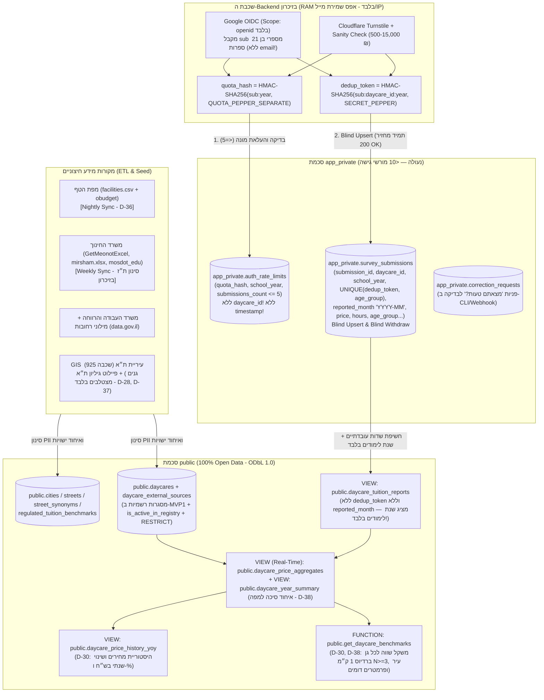

<div dir="rtl">

# איפיון מיקרו חלק א': סכמת מסד הנתונים, אי-קישוריות וצינור הנתונים (`Data Schema v1`)

> **מסמך:** `docs/04_data_schema_v1.md` (שלב 2 — איפיון מיקרו מפורט)  
> **מנוע בסיס נתונים:** `PostgreSQL 17` + תוספי `PostGIS 3.4`, `pg_trgm`, `pgcrypto` (בקונטיינר על `hasadna-k8s`)  
> **רישיון המאגר הפומבי (`public`):** `ODbL 1.0` (`Open Database License`)  
> **החלטות מוטמעות:** `D-01` עד `D-38` (כולל הפרדת `MVP1` משלב ב', צריכת הדאטה המעובד מ"מפת הטף" בחלופה א', מנגנון `Unlinkable Nullifiers` + `Blind Upsert` רב-גילאי + `Blind Withdraw`, הפרדת טבלת מכסה ומניעת `Timing Attacks`, הפרדת קונצנזוס `OIDC` מ-`Seed`, איחוד סיכה ברמת גן+שנה `daycare_year_summary`, היסטוריית מחירים רב-שנתית, השוואה מרחבית ללא הטיית משקל ופתרון אי-התאמות מחירים).

---

## 1. עקרונות ארכיטקטורת הנתונים והפרדת הרשאות (`Security & Privacy by Design`)

מסד הנתונים מחולק לשתי סכמות מופרדות הרמטית ברמת הרשאות השרת (`PostgreSQL Roles`), כך שגם במקרה של באג בשכבת ה-API הציבורי או בשאילתת ה-MCP, לא קיימת גישה פיזית לטבלאות האימות והבקרה:

| סכמה (`Schema`) | ייעוד | משתמשי DB מורשים (`Roles`) | מדיניות גישה ואבטחה (`תקנות אבטחת מידע — רמה בסיסית`) |
|---|---|---|---|
| **`public`** | כלל המידע הגלוי לציבור: מסגרות חינוך, סטטוס רישוי ואכיפה, מילוני יישובים ורחובות, דיווחי מחירים מותממים (שנת לימודים בלבד ללא חודש וללא מזהה מדווח), אגרגציות מחירים, היסטוריית שנים ומדדי השוואה. | • `app_public_ro` (`SELECT` בלבד — משמש את ה-REST API הציבורי, שרת ה-MCP ומנוע הייצוא ל-CSV/Excel).<br>• `app_etl` (`INSERT/UPDATE` בטבלאות המסגרות והמילונים). | • **100% Open Data (`ODbL 1.0`):** אין בסכמה זו שום מידע אישי מזהה של הורים או ילדים, ואין בה מספרי ת"ז מדליפת משרד החינוך (`semeL_BAALUT` מסונן בזיכרון ב-ETL).<br>• בגנים לא-רשמיים (שיתווספו בשלב ב'): מוצגים שם גן, שם רחוב וקואורדינטה מוקהית בלבד ללא מספר בית וטלפון עד ל-`Opt-In` של הבעלים. |
| **`app_private`** | טבלאות פנימיות ונעולות לאימות חד-כיווני תלוי-גן (`dedup_token`), בקרת מכסת דיווחים שנתית מנותקת (`auth_rate_limits`), תור פניות תיקון טעויות (`correction_requests`), והכנה לשלב ב' (אימות כתובת עיוור ו-`Audit Log` לבעלי גנים). | • `app_backend_write` (הרשאה מוגבלת לפונקציות `SECURITY DEFINER` ספציפיות בלבד לביצוע `Blind Upsert` ובדיקת מכסה — ללא הרשאת `SELECT` גורפת על הטבלאות!).<br>• עד **3–5 מורשי גישה אנושיים בלבד** בצוות התשתית (**פחות מ-10 מורשי גישה** לשמירה קשיחה על סיווג `רמת אבטחה בסיסית`). | • **אי-קישוריות (`Unlinkability` — `D-34`):** אין מפתח משתמש חוצה-גנים (`reporter_hash` אסור!).<br>• **הפרדת מפתחות ב-Vault (`vault:path:key`):** שני מפתחות ה-HMAC (`SECRET_PEPPER` לדיווחים ו-`QUOTA_PEPPER_SEPARATE` למכסה) שמורים ב-HashiCorp Vault של הסדנא ומוזרקים לזכרון ה-Backend כ-K8s Secrets נפרדים לחלוטין מה-DB והגיבויים.<br>• **מניעת `Timing Attacks`:** אין שדות `created_at` עם שניות ואין כתובות `IP` בטבלאות הדיווחים והמכסה.<br>• **איפוס שנתי (`Annual Rotation`):** בתום כל שנת לימודים נמחק ה-`SECRET_PEPPER` השנתי, עמודת `dedup_token` מתאפסת ל-`NULL`, וטבלת `auth_rate_limits` של השנה החולפת מתרוקנת (`TRUNCATE`). |

### תרשים זרימת הנתונים והפרדת הסכמות (`ERD & Data Flow`)

<div dir="ltr">



</div>

---

## 2. אתחול מסד הנתונים, תוספים, הרשאות וטיפוסי `ENUM` (`001_init_extensions_and_types.sql`)

<div dir="ltr">

```sql
-- ============================================================================
-- 1. Extensions & Schemas
-- ============================================================================
CREATE EXTENSION IF NOT EXISTS postgis;
CREATE EXTENSION IF NOT EXISTS pg_trgm;
CREATE EXTENSION IF NOT EXISTS pgcrypto;

CREATE SCHEMA IF NOT EXISTS app_private;

-- ============================================================================
-- 2. Database Roles & Least-Privilege Permissions
-- ============================================================================
-- הערה: בסיסמאות הפרודקשן מנוהלות ב-Hasadna Vault (vault:path:key)
DO $$
BEGIN
    IF NOT EXISTS (SELECT FROM pg_roles WHERE rolname = 'app_public_ro') THEN
        CREATE ROLE app_public_ro NOLOGIN;
    END IF;
    IF NOT EXISTS (SELECT FROM pg_roles WHERE rolname = 'app_backend_write') THEN
        CREATE ROLE app_backend_write NOLOGIN;
    END IF;
    IF NOT EXISTS (SELECT FROM pg_roles WHERE rolname = 'app_etl') THEN
        CREATE ROLE app_etl NOLOGIN;
    END IF;
END
$$;

REVOKE ALL ON SCHEMA app_private FROM PUBLIC;
REVOKE ALL ON SCHEMA app_private FROM app_public_ro;
GRANT USAGE ON SCHEMA public TO app_public_ro, app_backend_write, app_etl;
GRANT USAGE ON SCHEMA app_private TO app_backend_write, app_etl;

-- ============================================================================
-- 3. Enumerated Types (ENUMs) — מניעת טקסט חופשי ואכיפת ערכים מובנים (D-08)
-- ============================================================================

-- קבוצות גיל (D-12, D-16): כיסוי מלא ללידה עד 6 כבר ב-MVP1
CREATE TYPE public.age_group_enum AS ENUM (
    '0_1',   -- תינוקות (לידה עד שנה / ~3–15 חודשים)
    '1_2',   -- פעוטות צעירים (שנה עד שנתיים / ~15–24 חודשים)
    '2_3',   -- פעוטות בוגרים (שנתיים עד שלוש / ~24–36 חודשים)
    '0_3',   -- רב-גילי לידה עד 3 (כאשר המחיר אחיד לכל השכבות במעון)
    '3_6'    -- גני ילדים גילאי 3–6 (גן פרטי/מוכש"ר או צהרון בגן עירייה)
);

-- מסלול המסגרת (D-12, D-16): קריטי להפרדת תפוחים-לתפוחים בין שוק חופשי, סמל וצהרון
CREATE TYPE public.framework_track_enum AS ENUM (
    'private_full_day',     -- מעון/גן פרטי בשוק החופשי (יום מלא)
    'private_half_day',     -- מעון/גן פרטי עד הצהריים בלבד (ללא צהרון)
    'symbol_regulated',     -- מעון סמל / משפחתון סמל בפיקוח מחירים וסבסוד משרד העבודה
    'municipal_tzaharon',   -- צהרון בגן עירייה (גילאי 3–6, כגון מתווה ניצנים או צהרון פרטי)
    'rehab_or_welfare'      -- מעון יום שיקומי / מסגרת רווחה
);

-- משטר הרישוי החוקי החל על המסגרת (חוק הפיקוח 0-3 מול חוק פיקוח בתי ספר 3-6)
CREATE TYPE public.licensing_regime_enum AS ENUM (
    'daycare_law_0_3',      -- חוק הפיקוח על מעונות יום לפעוטות (חובת רישיון מ-7 פעוטות ומעלה)
    'schools_law_3_6',      -- חוק פיקוח על בתי ספר (חובת רישיון מ-11 תלמידים ומעלה בגילאי 3-6)
    'municipal_public',     -- גן עירייה רשמי / ממלכתי
    'exempt_small_home'     -- מסגרת קטנה הפטורה מרישיון לפי הצהרה (עד 6 בגילאי 0-3, עד 10 בגילאי 3-6 — שלב ב')
);

-- סטטוס רישוי רשמי מול משרד החינוך / העבודה
CREATE TYPE public.license_status_enum AS ENUM (
    'active_license',       -- רישיון הפעלה בתוקף
    'in_licensing_process', -- בתהליך רישוי (כולל הסדר רציפות תשפ"ז — חוקי ופועל בפיקוח)
    'symbol_recognized',    -- מוכר כמעון/משפחתון סמל (משרד העבודה)
    'municipal_verified',   -- מופיע במאגר מוניציפלי רשמי (GIS עירוני) ללא סמל משרד החינוך משויך
    'unlisted_in_registry', -- לא אותר אוטומטית במרשם הרשמי (רלוונטי לשלב ב')
    'stop_order_active'     -- צו הפסקה מנהלי / צו סגירה פעיל!
);

-- דרגת אמינות הנתון (Data Trust Tier — סעיף 4.3 ב-AGENTS.md)
CREATE TYPE public.trust_tier_enum AS ENUM (
    'tier_1_official',          -- מקור ממשלתי / עירוני רשמי / מפת הטף
    'tier_1b_owner_verified',   -- אומת ע"י הנהלת הגן (שלב ב' — Owner Claim)
    'tier_2_parent_consensus',  -- מידע הורים מאומת (קונצנזוס של 3+ דיווחי הורים בלתי תלויים)
    'tier_3_unverified_report'  -- דיווח הורה שטרם אומת (1–2 דיווחים או ייבוא מגיליון קהילתי)
);

-- אומדן גודל המסגרת בדיווח הורה (להצלבת חובת רישיון 7+ ב-0-3 מול 11+ ב-3-6)
CREATE TYPE public.size_bucket_enum AS ENUM (
    'up_to_6',      -- עד 6 פעוטות (פטור מרישיון בגילאי 0-3)
    '7_or_more',    -- 7 פעוטות ומעלה (חייב ברישיון בגילאי 0-3)
    'up_to_10',     -- עד 10 ילדים (פטור מרישיון בגילאי 3-6)
    '11_or_more',   -- 11 ילדים ומעלה (חייב ברישיון בגילאי 3-6)
    'unknown'       -- לא בטוח / לא ידוע
);

-- שדות בטיחות מובנים (ממ"ד ומצלמות)
CREATE TYPE public.tri_state_status_enum AS ENUM (
    'yes',
    'no',
    'unknown'
);

-- מקור רשומת המחיר
CREATE TYPE public.report_source_type_enum AS ENUM (
    'parent_google_oidc',       -- דיווח הורה מאומת ב-Google OIDC (MVP1 - D-29)
    'community_sheet_tlv_seed', -- ייבוא פיילוט גיליון ההורים של ת"א לגנים רשמיים מצטלבים (MVP1 - D-28)
    'regulated_tariff_table',   -- תעריף ממשלתי מפוקח רשמי
    'parent_sms_voice_otp',     -- דיווח הורה מאומת ב-SMS/Voice OTP (שלב ב' - D-27)
    'owner_claim_declared'      -- מחיר מוצהר ע"י בעל הגן (שלב ב' - D-22)
);
```

</div>

---

## 3. טבלאות תשתית, מילונים גיאוגרפיים ותעריפי ייחוס (`public`)

כדי לעמוד בהחלטה **`D-25` / `D-26`** (אפס עלות Geocoding ואיסור שימוש ב-`Google Maps Geocoding` וב-`GovMap`), המערכת מחזיקה מקומית ב-Postgres את מילוני היישובים, הרחובות והשמות הנרדפים הרשמיים מ-`data.gov.il`, וכן את טבלת תעריפי המקסימום המפוקחים השנתיים (מעונות סמל וצהרוני `ניצנים`).

<div dir="ltr">

```sql
-- ============================================================================
-- 3.1 טבלת יישובים רשמית (מבוססת הלמ"ס / רשות האוכלוסין מ-data.gov.il + אוכלוסיית גיל 0-5)
-- ============================================================================
CREATE TABLE public.cities (
    city_code           INTEGER PRIMARY KEY,                    -- סמל יישוב למ"ס (למשל 5000 לתל אביב-יפו, 3000 לירושלים)
    city_name_he        TEXT NOT NULL UNIQUE,                   -- שם יישוב תקני בעברית
    city_name_norm      TEXT NOT NULL,                          -- שם מנורמל לחיפוש (ללא מקפים/רווחים כפולים)
    workspace_slug      TEXT,                                   -- מזהה מרחב עירוני אם קיים (למשל 'rkhobot', 'tlv')
    district_he         TEXT,                                   -- מחוז
    socio_economic_cluster SMALLINT CHECK (socio_economic_cluster BETWEEN 1 AND 10), -- אשכול חברתי-כלכלי למ"ס (לסיבסוד ניצנים)
    children_age_0_5    INTEGER CHECK (children_age_0_5 >= 0),  -- מספר ילדים בגילאי 0-5 (ממאגר רשות האוכלוסין)
    geom_centroid       GEOMETRY(Point, 4326),                  -- מרכז היישוב (WGS84)
    updated_at          DATE NOT NULL DEFAULT CURRENT_DATE
);

CREATE INDEX idx_cities_name_trgm ON public.cities USING GIN (city_name_norm gin_trgm_ops);

-- ============================================================================
-- 3.2 טבלת רחובות רשמית ושמות נרדפים (ממאגרי data.gov.il: dataset/321 ו-israel-streets-synom)
-- ============================================================================
CREATE TABLE public.streets (
    street_id           BIGSERIAL PRIMARY KEY,
    city_code           INTEGER NOT NULL REFERENCES public.cities(city_code) ON DELETE CASCADE,
    street_code         INTEGER NOT NULL,                       -- סמל רחוב רשמי ביישוב
    street_name_he      TEXT NOT NULL,                          -- שם רחוב רשמי
    street_name_norm    TEXT NOT NULL,                          -- שם רחוב מנורמל
    neighborhood_he     TEXT,                                   -- שכונה (אם קיימת ב-GIS העירוני / מפת הטף)
    geom_center         GEOMETRY(Point, 4326),                  -- נקודת אמצע הרחוב (משמשת גם להקהיית מיקום בשלב ב'!)
    UNIQUE (city_code, street_code)
);

CREATE INDEX idx_streets_city_trgm ON public.streets USING GIN (street_name_norm gin_trgm_ops);
CREATE INDEX idx_streets_city_code ON public.streets (city_code);

CREATE TABLE public.street_synonyms (
    synonym_id          BIGSERIAL PRIMARY KEY,
    city_code           INTEGER NOT NULL,
    street_code         INTEGER NOT NULL,
    synonym_name_he     TEXT NOT NULL,
    synonym_name_norm   TEXT NOT NULL,
    FOREIGN KEY (city_code, street_code) REFERENCES public.streets(city_code, street_code) ON DELETE CASCADE
);

CREATE INDEX idx_street_synonyms_trgm ON public.street_synonyms USING GIN (synonym_name_norm gin_trgm_ops);

-- ============================================================================
-- 3.3 טבלת תעריפי ייחוס ממשלתיים מפוקחים (Benchmark מעונות סמל וצהרוני ניצנים — D-12)
-- ============================================================================
CREATE TABLE public.regulated_tuition_benchmarks (
    benchmark_id        SERIAL PRIMARY KEY,
    school_year         SMALLINT NOT NULL CHECK (school_year BETWEEN 2020 AND 2035), -- למשל 2027 עבור תשפ"ז (2026-2027)
    school_year_label   TEXT NOT NULL,                          -- למשל 'תשפ"ז (2026–2027)'
    framework_track     public.framework_track_enum NOT NULL,   -- 'symbol_regulated' או 'municipal_tzaharon'
    age_group           public.age_group_enum NOT NULL,         -- '0_1' (תינוקות), '1_2'/'2_3' (פעוטות), '3_6' (צהרון ניצנים)
    socio_cluster_min   SMALLINT NOT NULL DEFAULT 1,
    socio_cluster_max   SMALLINT NOT NULL DEFAULT 10,
    monthly_max_price_nis INTEGER NOT NULL CHECK (monthly_max_price_nis BETWEEN 0 AND 10000),
    official_order_ref  TEXT NOT NULL,                          -- סימוכין לצו הפיקוח / חוזר מנכ"ל
    source_url          TEXT NOT NULL,
    UNIQUE (school_year, framework_track, age_group, socio_cluster_min, socio_cluster_max)
);
```

</div>

---

## 4. טבלת הליבה של מסגרות החינוך והצלבת המקורות הרשמיים (`public.daycares`)

בהתאם להחלטות **`D-28`** ו-**`D-36`**:
1. ב-**`MVP1`** כל הרשומות בטבלה זו מגיעות **אך ורק ממאגרים רשמיים** (`is_official_source = TRUE`), ובראשם צינור הנתונים המעובד של **"מפת הטף"** (`facilities.csv` / `obudget`), משולב עם מרשמי משרד החינוך (`GetMeonotExcel` לגילאי `0–3`, `mosdot_edu` לגילאי `3–6`, `mirsham.xlsx` לעיצומים וצווי סגירה), משרד העבודה (`daycare-centers`), הרווחה (`welfare-frames`) ו-GIS עיריית תל אביב (שכבה `925`).
2. **סינון קשיח בזיכרון (`D-23` / `סעיף 8` לחוק הגנת הפרטיות):** תהליך ה-ETL בודק כל ערך של `semeL_BAALUT` ממרשם `GetMeonot`; אם מדובר במספר בן 9 ספרות שאינו מתחיל בספרה `5` (ת"ז של עוסק יחיד), המספר **נמחק מיידית בזיכרון ואינו נכתב לשום עמודה ב-DB**. כמו כן, בעיצומים כספיים (`mirsham.xlsx`), אם שם המפר הוא אדם פרטי (ולא חברה בע"מ/ע"ר), מוצג בעמודת `operator_entity_name` הערך הגנרי `"עוסק יחיד"` בלבד (`סעיף 53(א)(6)` לחוק הפיקוח).
3. הסכמה מוכנה מראש לשלב ב' (`is_official_source = FALSE`, שדות `public_street_only_mode` ואימות בעלים) ללא צורך בשינוי מבני (`Breaking Migration`) בעתיד.

<div dir="ltr">

```sql
-- ============================================================================
-- 4.1 טבלת המסגרות הקנונית (public.daycares)
-- ============================================================================
CREATE TABLE public.daycares (
    daycare_id              UUID PRIMARY KEY DEFAULT gen_random_uuid(),
    
    -- מזהים רשמיים חיצוניים (לסינכרון דטרמיניסטי ואיחוד ישויות היררכי - D-36, D-38)
    external_facility_id    TEXT UNIQUE,                        -- מזהה מסגרת מאוחד (למשל md5(_id)[:8] או _id מ-facilities.csv)
    obudget_facility_id     TEXT UNIQUE,                        -- מזהה המסגרת ב-next.obudget.org/datapackages/facilities/all
    moe_symbol              TEXT,                               -- סמל מוסד / סמל מעון במשרד החינוך (GetMeonot / mosdot_edu)
    mol_symbol              TEXT,                               -- סמל מעון / משפחתון במשרד העבודה (daycare-centers)
    welfare_symbol          TEXT,                               -- סמל מסגרת במשרד הרווחה (welfare-frames)
    municipal_gis_id        TEXT,                               -- מזהה שכבת GIS עירונית (למשל שכבה 925 בת"א: 'TLV-925-xxxx')
    
    -- שם המסגרת ונרמול לחיפוש ומניעת כפילויות (Entity Resolution)
    display_name            TEXT NOT NULL,                      -- השם הקנוני להצגה (לפי מדרג העדיפות של מפת הטף / מרשם רשמי)
    official_registry_name  TEXT,                               -- השם הרשמי המדויק במרשם משרד החינוך / העבודה
    normalized_name         TEXT NOT NULL,                      -- שם מנורמל (ללא תחיליות 'מעון'/'גן'/'בע"מ' וללא סימני פיסוק)
    
    -- סיווג חינוכי, גילאים ומשטר רישוי
    min_age_months          SMALLINT CHECK (min_age_months BETWEEN 0 AND 72),
    max_age_months          SMALLINT CHECK (max_age_months BETWEEN 3 AND 84),
    age_groups_supported    public.age_group_enum[] NOT NULL DEFAULT '{0_3}',
    primary_track           public.framework_track_enum NOT NULL DEFAULT 'private_full_day',
    licensing_regime        public.licensing_regime_enum NOT NULL DEFAULT 'daycare_law_0_3',
    
    -- מיקום גיאוגרפי וכתובת (ב-MVP1 כולן מסגרות רשמיות עם כתובת מלאה; בשלב ב' בגן לא-רשמי רק רחוב!)
    city_code               INTEGER NOT NULL REFERENCES public.cities(city_code),
    city_name_he            TEXT NOT NULL,
    neighborhood_he         TEXT,
    street_code             INTEGER,
    street_name_he          TEXT,
    house_number_public     TEXT,                               -- ב-MVP1: מספר בית רשמי. בשלב ב' בגן לא-רשמי ללא Opt-In: NULL!
    full_address_public     TEXT NOT NULL,                      -- ב-MVP1: כתובת מלאה. בשלב ב' בגן לא-רשמי: "רחוב X, עיר Y (מיקום מקורב)"
    is_location_approximated BOOLEAN NOT NULL DEFAULT FALSE,    -- FALSE למסגרת רשמית / Opt-In; TRUE למסגרת לא-רשמית בשלב ב'
    geom                    GEOMETRY(Point, 4326) NOT NULL,     -- קואורדינטה לתצוגה על המפה ולחיפוש מרחבי
    
    -- בעלות, רישוי, פיקוח ואכיפה (ללא מספרי ת"ז של יחידים! - D-23)
    operator_entity_name    TEXT,                               -- שם התאגיד המפעיל (חברה/עמותה/רשות) או 'עוסק יחיד'
    operator_corp_id        TEXT CHECK (operator_corp_id IS NULL OR operator_corp_id ~ '^5[0-9]{8}$'), -- רק ח.פ./ע"ר המתחיל ב-5!
    official_phone_public   TEXT,                               -- טלפון רשמי של המוסד מהמרשם (ב-MVP1 מוצג בכרטיס הגן ב-UI בלבד)
    official_capacity       SMALLINT CHECK (official_capacity > 0), -- קיבולת תקנית רשמית (אם מדווחת במרשם)
    
    license_status          public.license_status_enum NOT NULL DEFAULT 'active_license',
    is_official_source      BOOLEAN NOT NULL DEFAULT TRUE,      -- ב-MVP1: אכיפת TRUE בלבד (D-28)!
    is_active_in_registry   BOOLEAN NOT NULL DEFAULT TRUE,      -- Soft-Status ב-ETL: לעולם לא מוחקים פיזית גן כדי לא לאבד דיווחי הורים (D-38)!
    is_subsidized_symbol    BOOLEAN NOT NULL DEFAULT FALSE,     -- האם מעון סמל מוכר לסבסוד ותעריף מפוקח
    trust_tier              public.trust_tier_enum NOT NULL DEFAULT 'tier_1_official',
    
    -- אכיפה רשמית ממשרד החינוך בלבד (GetMeonot סטטוס צו סגירה + mirsham.xlsx עיצומים כספיים)
    has_active_stop_order   BOOLEAN NOT NULL DEFAULT FALSE,     -- צו הפסקה מנהלי פעיל
    has_official_sanction   BOOLEAN NOT NULL DEFAULT FALSE,     -- עיצום כספי במרשם משרד החינוך
    official_sanction_date  DATE,
    official_sanction_text  TEXT,                               -- ציטוט מדויק של עמודת 'מהות ההפרה' מ-mirsham.xlsx בלבד
    
    -- שדות תשתית מדווחים/רשמיים (ממ"ד ומצלמות)
    shelter_status          public.tri_state_status_enum NOT NULL DEFAULT 'unknown',
    cameras_0_3_status      public.tri_state_status_enum NOT NULL DEFAULT 'unknown',
    
    -- חותמות עדכניות ומקור (לעולם לא שומרים שניות מדויקות של פעולות הורים)
    official_last_checked_at DATE NOT NULL DEFAULT CURRENT_DATE,
    primary_official_source TEXT NOT NULL DEFAULT 'tafmap_and_moe', -- למשל 'tafmap', 'moe_getmeonot', 'moe_mosdot', 'tlv_gis_925'
    created_at              DATE NOT NULL DEFAULT CURRENT_DATE,
    updated_at              DATE NOT NULL DEFAULT CURRENT_DATE,

    -- אכיפת MVP1: אם המסגרת אינה ממקור רשמי (שלב ב'), אסור לחשוף מספר בית או טלפון ללא Opt-In
    CONSTRAINT chk_unlisted_privacy CHECK (
        is_official_source = TRUE OR (house_number_public IS NULL AND official_phone_public IS NULL AND is_location_approximated = TRUE)
    )
);

-- אינדקסים מרחביים וטקסטואליים לחיפוש מהיר ולמניעת כפילויות
CREATE INDEX idx_daycares_geom ON public.daycares USING GIST (geom);
CREATE INDEX idx_daycares_city_code ON public.daycares (city_code);
CREATE INDEX idx_daycares_norm_name_trgm ON public.daycares USING GIN (normalized_name gin_trgm_ops);
CREATE INDEX idx_daycares_moe_symbol ON public.daycares (moe_symbol) WHERE moe_symbol IS NOT NULL;
CREATE INDEX idx_daycares_mol_symbol ON public.daycares (mol_symbol) WHERE mol_symbol IS NOT NULL;
CREATE INDEX idx_daycares_filters ON public.daycares (city_code, primary_track, license_status, is_subsidized_symbol);

-- ============================================================================
-- 4.2 טבלת מעקב מקורות רשמיים מוצלבים לכל מסגרת (Provenance & Cross-Reference)
-- ============================================================================
CREATE TABLE public.daycare_external_sources (
    source_link_id          BIGSERIAL PRIMARY KEY,
    daycare_id              UUID NOT NULL REFERENCES public.daycares(daycare_id) ON DELETE CASCADE,
    source_system           TEXT NOT NULL,                      -- 'tafmap', 'obudget', 'moe_getmeonot', 'moe_mosdot', 'mol_daycare', 'welfare', 'tlv_gis_925'
    external_record_id      TEXT NOT NULL,                      -- המזהה במאגר המקור
    source_license          TEXT NOT NULL,                      -- 'ODbL-1.0', 'CC-BY-SA-4.0', 'data.gov.il', 'TLV-OpenData'
    raw_status_text         TEXT,                               -- הסטטוס המקורי כפי שהופיע במאגר
    last_synced_at          DATE NOT NULL DEFAULT CURRENT_DATE,
    UNIQUE (source_system, external_record_id)
);

CREATE INDEX idx_ext_sources_daycare ON public.daycare_external_sources (daycare_id);
```

</div>

---

## 5. סכמת `app_private`: אי-קישוריות (`Unlinkable Nullifiers`), `Blind Upsert` רב-גילאי, `Blind Withdraw` ומניעת `Timing Attacks` (`D-29`, `D-34`, `D-38`)

סכמה זו מממשת ברמת מסד הנתונים את שכבות ההגנה שסוכמו עם היועץ המשפטי של הסדנא (`D-34`) והורחבו בסשן ה-`/grill-me` (`D-38`):
1. **אפס שמירת מייל או מזהה חוצה-גנים:** ה-Backend מקבל מגוגל אך ורק את ה-`sub` המספרי (`Scope: openid` בלבד ללא `email`), ומחשב בזיכרון שני ערכי `HMAC-SHA256` בלתי תלויים עם שני מפתחות נפרדים מ-**Vault**:
   - `dedup_token = HMAC-SHA256(google_sub || ':' || daycare_id || ':' || school_year, SECRET_PEPPER)`
   - `quota_hash = HMAC-SHA256(google_sub || ':' || school_year, QUOTA_PEPPER_SEPARATE)`
2. **הפרדה מוחלטת ומניעת `Timing Attacks`:**
   - טבלת `app_private.auth_rate_limits` מחזיקה רק את `quota_hash`, `school_year` ומונה מספרי (`submissions_count <= 5`). **אין בה `daycare_id`, אין בה מפתח זר, ואין בה שום חותמת זמן (`timestamp` / `updated_at`)!**
   - טבלת `app_private.survey_submissions` מחזיקה את `(dedup_token, age_group)` כצמד ייחודי (`UNIQUE`), את נתוני המחיר והשעות, ואת החודש והשנה בלבד (`reported_month = 'YYYY-MM'`). **אין בה חותמת זמן עם שניות/דקות, אין בה IP, והחודש עצמו אפילו אינו נחשף ב-View הציבורי של השורות הבודדות (שמציג רק `school_year`)!**
3. **מנגנון כתיבה בלבד (`Blind Upsert` רב-גילאי) וביטול עיוור (`Blind Withdraw` — `D-38`):**
   - שליחת דיווח מתבצעת אך ורק דרך הפונקציה האטומית `app_private.submit_parent_report_blind_upsert(...)`, שמחליפה אטומית בטרנזקציה אחת את דיווחי ההורה לאותו `(daycare_id, school_year)` (תומך בהורה עם שני אחים בשתי כיתות גיל באותו מעון או בדיווח על מספר שכבות גיל בטופס אחד, ומתקן טעות בבחירת שכבת גיל ללא השארת שורה יתומה!) ומחזירה תמיד קוד הצלחה זהה (`TRUE`).
   - אם הורה דיווח בטעות על הגן הלא נכון, הפונקציה `app_private.withdraw_parent_report_blind(...)` מאפשרת מחיקה עצמית עיוורת (`Blind Delete` לפי `dedup_token`) ללא איפוס מונה המכסה וללא חיווי אם הרשומה הייתה קיימת (מימוש זכות מחיקה לפי `סעיף 14` לחוק הגנת הפרטיות באפס אורקל קיום).

<div dir="ltr">

```sql
-- ============================================================================
-- 5.1 טבלת מכסת דיווחים שנתית מנותקת (app_private.auth_rate_limits)
-- ============================================================================
CREATE TABLE app_private.auth_rate_limits (
    quota_hash          CHAR(64) NOT NULL,                      -- HMAC-SHA256(google_sub || ':' || school_year, QUOTA_PEPPER_SEPARATE)
    school_year         SMALLINT NOT NULL CHECK (school_year BETWEEN 2024 AND 2035),
    submissions_count   SMALLINT NOT NULL DEFAULT 1 CHECK (submissions_count BETWEEN 1 AND 5),
    -- קריטי (D-34): אין daycare_id, אין מפתח זר, ואין שום עמודת timestamp למניעת Timing Correlation!
    PRIMARY KEY (quota_hash, school_year)
);

-- ============================================================================
-- 5.2 טבלת דיווחי ההורים הגולמית (app_private.survey_submissions)
-- ============================================================================
CREATE TABLE app_private.survey_submissions (
    submission_id               UUID PRIMARY KEY DEFAULT gen_random_uuid(),
    -- ON DELETE RESTRICT (D-38): איסור מחיקה פיזית של גן שיש לו דיווחי הורים!
    daycare_id                  UUID NOT NULL REFERENCES public.daycares(daycare_id) ON DELETE RESTRICT,
    
    -- שנת לימודים (למשל 2027 עבור תשפ"ז, 2026 עבור תשפ"ו, 2025 עבור תשפ"ה - D-30)
    school_year                 SMALLINT NOT NULL CHECK (school_year BETWEEN 2020 AND 2035),
    
    -- Unlinkable Per-Daycare Nullifier (D-34, D-38): מתאפס ל-NULL בסוף שנת הלימודים!
    -- עבור רשומות Seed מפיילוט גיליון ת"א: NULL
    dedup_token                 CHAR(64),
    source_type                 public.report_source_type_enum NOT NULL DEFAULT 'parent_google_oidc',
    
    -- חודש דיווח מעוגל ('YYYY-MM') לבקרה פנימית בלבד (אינו מוצג בשורות הבודדות ב-public! - D-34)
    reported_month              CHAR(7) NOT NULL CHECK (reported_month ~ '^[0-9]{4}-(0[1-9]|1[0-2])$'),
    
    -- מחיר המחירון החודשי הרגיל ו-4 צירי הנרמול המחייבים (D-12, D-13, D-34, D-38)
    monthly_list_price_nis      INTEGER NOT NULL CHECK (monthly_list_price_nis BETWEEN 500 AND 15000), -- Sanity Check קשיח!
    age_group                   public.age_group_enum NOT NULL,
    framework_track             public.framework_track_enum NOT NULL DEFAULT 'private_full_day',
    
    -- בטופס החי שדות אלו הם NOT NULL חובה; ב-Seed מגיליון ת"א בלבד מותר NULL כאשר השדה לא צוין במקור (D-38)
    hours_sun_thu_start         TIME DEFAULT '07:30',
    hours_sun_thu_end           TIME DEFAULT '16:30',
    -- שדה מחושב אוטומטית: האם מתכונת יום מלא (>= 7 שעות ביום א'-ה') או חצי יום
    is_full_day                 BOOLEAN GENERATED ALWAYS AS (
        COALESCE(
            EXTRACT(EPOCH FROM (hours_sun_thu_end - hours_sun_thu_start)) / 3600.0 >= 7.0,
            framework_track != 'private_half_day'
        )
    ) STORED,
    
    includes_friday             BOOLEAN DEFAULT TRUE,
    hours_fri_start             TIME,
    hours_fri_end               TIME,
    includes_nutrition          BOOLEAN DEFAULT TRUE,
    
    -- שדות עובדתיים מהירים (גודל מסגרת, ממ"ד, מצלמות לגילאי 0-3 בלבד)
    reported_size_bucket        public.size_bucket_enum NOT NULL DEFAULT 'unknown',
    reported_shelter_status     public.tri_state_status_enum NOT NULL DEFAULT 'unknown',
    reported_cameras_0_3        public.tri_state_status_enum NOT NULL DEFAULT 'unknown',
    
    -- אישור הצהרת ההורה: מחיר מחירון כללי ללא הנחות אישיות וללא הפרת סודיות חוזית (D-34 - סעיף 62 לפקודת הנזיקין)
    is_standard_list_price_confirmed BOOLEAN NOT NULL CHECK (is_standard_list_price_confirmed = TRUE),
    is_outlier_confirmed_by_user BOOLEAN NOT NULL DEFAULT FALSE, -- האם ההורה אישר חריגה מעל 40% ב-Sanity Check
    is_flagged_hidden           BOOLEAN NOT NULL DEFAULT FALSE,  -- להסתרת דיווח שהוכח כשגוי בבדיקת "מצאתם טעות?"

    -- ייחודיות לפי (dedup_token, age_group): מאפשר להורה לדווח על 2 כיתות גיל באותו גן ללא דריסה הדדית וללא ניפוח קונצנזוס (D-38)
    CONSTRAINT uq_dedup_token_age_group UNIQUE (dedup_token, age_group),

    -- אכיפת 4 צירי החובה בדיווחי הורים חיים (NULL מותר אך ורק בייבוא ה-Seed ההיסטורי מגיליון ת"א - D-38)
    CONSTRAINT chk_live_report_mandatory_axes CHECK (
        source_type = 'community_sheet_tlv_seed' OR (
            dedup_token IS NOT NULL AND
            hours_sun_thu_start IS NOT NULL AND
            hours_sun_thu_end IS NOT NULL AND
            includes_friday IS NOT NULL AND
            includes_nutrition IS NOT NULL
        )
    ),

    -- אכיפת תקינות שעות יום שישי ומצלמות
    CONSTRAINT chk_friday_hours CHECK (
        (includes_friday IS DISTINCT FROM TRUE AND hours_fri_start IS NULL AND hours_fri_end IS NULL) OR
        (includes_friday = TRUE)
    ),
    CONSTRAINT chk_cameras_only_0_3 CHECK (
        age_group != '3_6' OR reported_cameras_0_3 = 'unknown'
    )
);

CREATE INDEX idx_submissions_daycare_year ON app_private.survey_submissions (daycare_id, school_year, age_group, is_full_day)
    WHERE is_flagged_hidden = FALSE;

-- ============================================================================
-- 5.3 פונקציית ה-Blind Upsert האטומית (Write-Only — החלפה אטומית לפי dedup_token ותמיכה בריבוי קבוצות גיל - D-38)
-- ============================================================================
CREATE OR REPLACE FUNCTION app_private.submit_parent_report_blind_upsert(
    p_daycare_id                UUID,
    p_school_year               SMALLINT,
    p_dedup_token               CHAR(64),
    p_quota_hash                CHAR(64),
    p_reported_month            CHAR(7),
    p_monthly_list_price_nis    INTEGER,
    p_age_group                 public.age_group_enum,
    p_framework_track           public.framework_track_enum,
    p_hours_sun_thu_start       TIME,
    p_hours_sun_thu_end         TIME,
    p_includes_friday           BOOLEAN,
    p_hours_fri_start           TIME,
    p_hours_fri_end             TIME,
    p_includes_nutrition        BOOLEAN,
    p_reported_size_bucket      public.size_bucket_enum,
    p_reported_shelter_status   public.tri_state_status_enum,
    p_reported_cameras_0_3      public.tri_state_status_enum,
    p_is_list_price_confirmed   BOOLEAN,
    p_is_outlier_confirmed      BOOLEAN,
    p_replace_all_ages_for_token BOOLEAN DEFAULT TRUE -- אם TRUE: מחליף אטומית כל דיווח קודם של ההורה באותו גן+שנה (מתקן טעות בבחירת גיל); אם FALSE: מוסיף/מעדכן שכבת גיל נוספת לאותו גן
) RETURNS BOOLEAN
LANGUAGE plpgsql
SECURITY DEFINER
SET search_path = app_private, public
AS $$
DECLARE
    v_is_official BOOLEAN;
    v_already_exists_for_daycare BOOLEAN;
    v_current_quota SMALLINT;
BEGIN
    -- 1. וידוא שב-MVP1 מדווחים רק על מסגרת רשמית קיימת ופעילה (D-28)
    SELECT is_official_source INTO v_is_official
    FROM public.daycares
    WHERE daycare_id = p_daycare_id;

    IF v_is_official IS DISTINCT FROM TRUE THEN
        RAISE EXCEPTION 'DAYCARE_NOT_FOUND_OR_NOT_OFFICIAL';
    END IF;

    -- 2. בדיקה פנימית (בזיכרון בלבד, ללא חשיפה החוצה) האם זהו עדכון/שכבת גיל נוספת לגן שכבר דווח ע"י ההורה או גן חדש
    SELECT EXISTS (
        SELECT 1 FROM app_private.survey_submissions WHERE dedup_token = p_dedup_token
    ) INTO v_already_exists_for_daycare;

    -- 3. אם זה גן חדש עבור אותו משתמש באותה שנה — בדיקת ועדכון מכסת 5 הגנים השנתית בטבלה המנותקת
    IF NOT v_already_exists_for_daycare THEN
        INSERT INTO app_private.auth_rate_limits (quota_hash, school_year, submissions_count)
        VALUES (p_quota_hash, p_school_year, 1)
        ON CONFLICT (quota_hash, school_year)
        DO UPDATE SET submissions_count = app_private.auth_rate_limits.submissions_count + 1
        WHERE app_private.auth_rate_limits.submissions_count < 5
        RETURNING submissions_count INTO v_current_quota;

        IF v_current_quota IS NULL THEN
            RAISE EXCEPTION 'ANNUAL_REPORT_QUOTA_EXCEEDED';
        END IF;
    ELSIF p_replace_all_ages_for_token THEN
        -- אם ההורה שלח דיווח מתוקן לאותו גן+שנה (למשל תיקן טעות מקבוצת גיל 1_2 ל-2_3), מוחקים אטומית את השורה הקודמת שלו באותו גן
        DELETE FROM app_private.survey_submissions
        WHERE dedup_token = p_dedup_token AND age_group != p_age_group;
    END IF;

    -- 4. ביצוע Blind Upsert לפי (dedup_token, age_group)
    INSERT INTO app_private.survey_submissions (
        daycare_id, school_year, dedup_token, source_type, reported_month,
        monthly_list_price_nis, age_group, framework_track,
        hours_sun_thu_start, hours_sun_thu_end,
        includes_friday, hours_fri_start, hours_fri_end, includes_nutrition,
        reported_size_bucket, reported_shelter_status, reported_cameras_0_3,
        is_standard_list_price_confirmed, is_outlier_confirmed_by_user
    ) VALUES (
        p_daycare_id, p_school_year, p_dedup_token, 'parent_google_oidc', p_reported_month,
        p_monthly_list_price_nis, p_age_group, p_framework_track,
        p_hours_sun_thu_start, p_hours_sun_thu_end,
        p_includes_friday, p_hours_fri_start, p_hours_fri_end, p_includes_nutrition,
        p_reported_size_bucket, p_reported_shelter_status, p_reported_cameras_0_3,
        p_is_list_price_confirmed, p_is_outlier_confirmed
    )
    ON CONFLICT (dedup_token, age_group) DO UPDATE SET
        reported_month              = EXCLUDED.reported_month,
        monthly_list_price_nis      = EXCLUDED.monthly_list_price_nis,
        framework_track             = EXCLUDED.framework_track,
        hours_sun_thu_start         = EXCLUDED.hours_sun_thu_start,
        hours_sun_thu_end           = EXCLUDED.hours_sun_thu_end,
        includes_friday             = EXCLUDED.includes_friday,
        hours_fri_start             = EXCLUDED.hours_fri_start,
        hours_fri_end               = EXCLUDED.hours_fri_end,
        includes_nutrition          = EXCLUDED.includes_nutrition,
        reported_size_bucket        = EXCLUDED.reported_size_bucket,
        reported_shelter_status     = EXCLUDED.reported_shelter_status,
        reported_cameras_0_3        = EXCLUDED.reported_cameras_0_3,
        is_outlier_confirmed_by_user = EXCLUDED.is_outlier_confirmed_by_user;

    -- תמיד מחזיר TRUE (אפס אורקל בדיקת קיום!)
    RETURN TRUE;
END;
$$;

-- ============================================================================
-- 5.3ב פונקציית Blind Withdraw לביטול/מחיקת דיווח שגוי ע"י ההורה ללא אורקל קיום (סעיף 14 לחוק הפרטיות - D-38)
-- ============================================================================
CREATE OR REPLACE FUNCTION app_private.withdraw_parent_report_blind(
    p_daycare_id    UUID,
    p_school_year   SMALLINT,
    p_dedup_token   CHAR(64)
) RETURNS BOOLEAN
LANGUAGE plpgsql
SECURITY DEFINER
SET search_path = app_private, public
AS $$
BEGIN
    -- מחיקה עיוורת לפי dedup_token בלבד (ללא הקטנת מונה ה-auth_rate_limits למניעת ניצול לרעה)
    DELETE FROM app_private.survey_submissions
    WHERE daycare_id = p_daycare_id
      AND school_year = p_school_year
      AND dedup_token = p_dedup_token;

    -- מחזיר תמיד TRUE בין אם נמחקה שורה ובין אם לא הייתה קיימת!
    RETURN TRUE;
END;
$$;

-- ============================================================================
-- 5.4 נוהל מחיקה ואיפוס שנתי בתום שנת הלימודים (Annual Nullifier Wipe - D-34)
-- ============================================================================
CREATE OR REPLACE FUNCTION app_private.wipe_school_year_nullifiers(p_closed_school_year SMALLINT)
RETURNS VOID
LANGUAGE plpgsql
SECURITY DEFINER
AS $$
BEGIN
    -- 1. איפוס מזהי ה-dedup_token ל-NULL כך שנותר רק המידע הסטטיסטי ללא שום יכולת אימות עתידית
    UPDATE app_private.survey_submissions
    SET dedup_token = NULL
    WHERE school_year = p_closed_school_year AND dedup_token IS NOT NULL;

    -- 2. מחיקת טבלת מוני המכסה של השנה שהסתיימה (תקנה 2 - מחיקת מידע עודף)
    DELETE FROM app_private.auth_rate_limits
    WHERE school_year = p_closed_school_year;
END;
$$;

-- ============================================================================
-- 5.5 טבלת פניות "מצאתם טעות?" (בקרת דיוק מידע - סעיף 14 לחוק הפרטיות)
-- ============================================================================
CREATE TABLE app_private.correction_requests (
    request_id          UUID PRIMARY KEY DEFAULT gen_random_uuid(),
    daycare_id          UUID NOT NULL REFERENCES public.daycares(daycare_id) ON DELETE CASCADE,
    issue_category      TEXT NOT NULL CHECK (issue_category IN (
        'wrong_price_outlier',
        'daycare_closed',
        'wrong_address_or_location',
        'wrong_license_status',
        'other_factual_error'
    )),
    structured_details  JSONB NOT NULL DEFAULT '{}'::jsonb,     -- פרטים מובנים בלבד
    status              TEXT NOT NULL DEFAULT 'pending' CHECK (status IN ('pending', 'resolved', 'rejected')),
    reported_month      CHAR(7) NOT NULL
);
```

</div>

---

## 6. שכבת ה-Views הציבוריים: חשיפה מותממת, פתרון אי-התאמות (`D-31`), איחוד סיכה למפה (`D-38`), היסטוריית שנים והשוואה מרחבית (`D-30`)

כל קריאות ה-UI, ה-REST API, שרת ה-MCP וייצוא ה-Excel קוראות **אך ורק** מה-Views והפונקציות הציבוריות שלהלן (בזמן אמת — `Real-Time VIEW` כדי שההורה יראה את עדכון המחיר מיד לאחר השליחה, באמצעות המשתמש `app_public_ro`):

1. **`public.daycare_tuition_reports` (פירוט הדיווחים הבודדים בכרטיס הגן — `D-34`):**
   - חושף רק את השדות העובדתיים ואת **שנת הלימודים בלבד (`school_year`)** — **ללא `dedup_token` וללא `reported_month`**, כדי למנוע ניחוש הקשרי של הגננת ("מי דיווח החודש").
2. **`public.daycare_price_aggregates` (אלגוריתם הצגת מחיר באי-התאמה והפרדת `Seed` מקונצנזוס `OIDC` — `D-31`, `D-38`):**
   - מקבץ לפי `(daycare_id, school_year, age_group, framework_track, is_full_day)` ומיישם את כלל ההפרדה שננעל ב-`D-38`:
     - אם קיימים לאותה קבוצה דיווחי הורים חיים מאומתים (`source_type != 'community_sheet_tlv_seed'`), החישוב מתבסס על הדיווחים החיים בלבד (ורשומת ה-Seed אינה מטה אותם); אם קיימת רק רשומת Seed, היא מוצגת כ-`tier_3_unverified_report`.
     - **דרגת אמינות `tier_2_parent_consensus` (`✓`):** מוענקת **אך ורק כאשר יש לפחות `3` דיווחי הורים חיים מאומתים (`live_oidc_count >= 3`)**.
3. **`public.daycare_year_summary` (איחוד סיכה למפה ושורת טבלה ראשית ברמת גן+שנה — `D-38`):**
   - מונע כפילות סיכות על המפה כאשר לגן יש דיווחים במספר שכבות גיל (`0_1`, `1_2`, `2_3`) והמשתמש טרם בחר פילטר גיל ספציפי: מאחד לרשומה אחת לכל `(daycare_id, school_year)` המציגה את חציון כלל הדיווחים של הגן (במתכונת יום מלא כברירת מחדל), את טווח המחירים בין שכבות הגיל (`min_price_nis`–`max_price_nis`), ואת סך הדיווחים הכולל בגן.
4. **`public.daycare_price_history_yoy` (`D-30`):**
   - מחשב לכל גן, קבוצת גיל ומתכונת שעות את מחיר השנה הנוכחית מול השנה הקודמת (`LAG`), כולל השינוי בש"ח (`yoy_diff_nis`) ובאחוזים (`yoy_diff_pct`).
5. **`public.get_daycare_benchmarks(...)` ו-`public.get_sanity_check_reference_median(...)` (`D-30`, `D-38`):**
   - ב-`get_daycare_benchmarks`: כל גן בסביבה מקבל **משקל שווה (`1`)** (באמצעות `daycare_year_summary` ברדיוס 1 ק"מ ובעיר, כך שגן עם 3 שכבות גיל אינו מקבל משקל משולש!).
   - ב-`get_sanity_check_reference_median`: מיישם **מפל גיבוי תלת-שלבי (`Fallback Cascade`) ל-Cold Start** — (1) חציון העיר לאותו מסלול וגיל (אם `N >= 5` גנים בעיר), (2) חציון אשכול חברתי-כלכלי למ"ס דומה (`±1`) או מחוז (אם `N >= 5`), (3) חציון ייחוס ארצי לאותו מסלול וגיל.

<div dir="ltr">

```sql
-- ============================================================================
-- 6.1 View ציבורי של שורות הדיווח הבודדות (ללא dedup_token וללא חודש דיווח! - D-34)
-- ============================================================================
CREATE OR REPLACE VIEW public.daycare_tuition_reports AS
SELECT
    s.submission_id,
    s.daycare_id,
    s.school_year,
    CASE s.school_year
        WHEN 2024 THEN 'תשפ"ד (2023–2024)'
        WHEN 2025 THEN 'תשפ"ה (2024–2025)'
        WHEN 2026 THEN 'תשפ"ו (2025–2026)'
        WHEN 2027 THEN 'תשפ"ז (2026–2027)'
        ELSE s.school_year::TEXT
    END AS school_year_label,
    s.source_type,
    s.monthly_list_price_nis,
    s.age_group,
    s.framework_track,
    s.hours_sun_thu_start,
    s.hours_sun_thu_end,
    s.is_full_day,
    s.includes_friday,
    s.hours_fri_start,
    s.hours_fri_end,
    s.includes_nutrition,
    s.reported_size_bucket,
    s.reported_shelter_status,
    s.reported_cameras_0_3
FROM app_private.survey_submissions s
WHERE s.is_flagged_hidden = FALSE;

GRANT SELECT ON public.daycare_tuition_reports TO app_public_ro;

-- ============================================================================
-- 6.2 View אגרגציית מחירים לכל גן, שנה, גיל ומתכונת (D-31 + הפרדת Seed מ-OIDC לפי D-38)
-- ============================================================================
CREATE OR REPLACE VIEW public.daycare_price_aggregates AS
WITH group_has_live AS (
    SELECT
        s.*,
        BOOL_OR(s.source_type != 'community_sheet_tlv_seed') OVER (
            PARTITION BY s.daycare_id, s.school_year, s.age_group, s.framework_track, s.is_full_day
        ) AS has_live_oidc_reports
    FROM app_private.survey_submissions s
    WHERE s.is_flagged_hidden = FALSE
),
effective_reports AS (
    -- D-38: ברגע שיש דיווחי OIDC חיים לאותה שנה+גיל+מסלול, הם מחליפים את שורת ה-Seed הלא-מאומתת בחישוב הפעיל
    SELECT
        g.*,
        FIRST_VALUE(g.monthly_list_price_nis) OVER (
            PARTITION BY g.daycare_id, g.school_year, g.age_group, g.framework_track, g.is_full_day
            ORDER BY g.reported_month DESC, g.submission_id DESC
        ) AS latest_price_nis
    FROM group_has_live g
    WHERE NOT g.has_live_oidc_reports OR g.source_type != 'community_sheet_tlv_seed'
)
SELECT
    r.daycare_id,
    r.school_year,
    r.age_group,
    r.framework_track,
    r.is_full_day,
    COUNT(*)::INTEGER AS reports_count,
    COUNT(*) FILTER (WHERE r.source_type != 'community_sheet_tlv_seed')::INTEGER AS live_verified_reports_count,
    MIN(r.monthly_list_price_nis)::INTEGER AS min_price_nis,
    MAX(r.monthly_list_price_nis)::INTEGER AS max_price_nis,
    ROUND(AVG(r.monthly_list_price_nis))::INTEGER AS avg_price_nis,
    ROUND(PERCENTILE_CONT(0.5) WITHIN GROUP (ORDER BY r.monthly_list_price_nis))::INTEGER AS median_price_nis,
    ROUND(PERCENTILE_CONT(0.25) WITHIN GROUP (ORDER BY r.monthly_list_price_nis))::INTEGER AS p25_price_nis,
    ROUND(PERCENTILE_CONT(0.75) WITHIN GROUP (ORDER BY r.monthly_list_price_nis))::INTEGER AS p75_price_nis,
    MAX(r.latest_price_nis)::INTEGER AS latest_price_nis,
    MAX(r.reported_month) AS last_updated_month, -- ברמת האגרגציה של הכרטיס בלבד!
    
    -- אופן הצגת המחיר לפי D-31
    CASE
        WHEN COUNT(*) = 1 THEN 'single'
        WHEN COUNT(*) = 2 AND (MAX(r.monthly_list_price_nis) - MIN(r.monthly_list_price_nis))::NUMERIC / NULLIF(MIN(r.monthly_list_price_nis), 0) > 0.05
            THEN 'range_discrepancy'
        WHEN COUNT(*) = 2 THEN 'average_close'
        ELSE 'median_consensus'
    END AS price_display_mode,
    
    -- המחיר הייצוגי הראשי לסיכת המפה ולחישובי השוואה אזוריים
    CASE
        WHEN COUNT(*) = 1 THEN MIN(r.monthly_list_price_nis)::INTEGER
        WHEN COUNT(*) = 2 AND (MAX(r.monthly_list_price_nis) - MIN(r.monthly_list_price_nis))::NUMERIC / NULLIF(MIN(r.monthly_list_price_nis), 0) > 0.05
            THEN MAX(r.latest_price_nis)::INTEGER
        WHEN COUNT(*) = 2 THEN ROUND(AVG(r.monthly_list_price_nis))::INTEGER
        ELSE ROUND(PERCENTILE_CONT(0.5) WITHIN GROUP (ORDER BY r.monthly_list_price_nis))::INTEGER
    END AS primary_pin_price_nis,
    
    -- האם להציג סימן '~' על סיכת המפה (כאשר N=2 והפער מעל 5%)
    (COUNT(*) = 2 AND (MAX(r.monthly_list_price_nis) - MIN(r.monthly_list_price_nis))::NUMERIC / NULLIF(MIN(r.monthly_list_price_nis), 0) > 0.05) AS pin_requires_tilde,
    
    -- דרגת אמינות המחיר (D-38: קונצנזוס Tier 2 מחייב לפחות 3 דיווחי OIDC חיים!)
    CASE
        WHEN COUNT(*) FILTER (WHERE r.source_type != 'community_sheet_tlv_seed') >= 3
            THEN 'tier_2_parent_consensus'::public.trust_tier_enum
        ELSE 'tier_3_unverified_report'::public.trust_tier_enum
    END AS price_trust_tier
FROM effective_reports r
GROUP BY r.daycare_id, r.school_year, r.age_group, r.framework_track, r.is_full_day;

GRANT SELECT ON public.daycare_price_aggregates TO app_public_ro;

-- ============================================================================
-- 6.2ב View סיכום מאוחד ברמת גן+שנה למניעת כפילות סיכות במפה ללא פילטר גיל (D-38)
-- ============================================================================
CREATE OR REPLACE VIEW public.daycare_year_summary AS
WITH prioritized_tracks AS (
    -- מעדיף מתכונת יום מלא (is_full_day = TRUE) על פני חצי יום כמחיר הסיכה הראשית של הגן
    SELECT
        a.*,
        BOOL_OR(a.is_full_day) OVER (PARTITION BY a.daycare_id, a.school_year) AS has_full_day_reports
    FROM public.daycare_price_aggregates a
)
SELECT
    p.daycare_id,
    p.school_year,
    SUM(p.reports_count)::INTEGER AS total_reports_count,
    SUM(p.live_verified_reports_count)::INTEGER AS total_live_verified_count,
    MIN(p.min_price_nis)::INTEGER AS min_price_nis,
    MAX(p.max_price_nis)::INTEGER AS max_price_nis,
    ROUND(PERCENTILE_CONT(0.5) WITHIN GROUP (ORDER BY p.primary_pin_price_nis))::INTEGER AS primary_pin_price_nis,
    (SUM(p.reports_count) = 2 AND (MAX(p.max_price_nis) - MIN(p.min_price_nis))::NUMERIC / NULLIF(MIN(p.min_price_nis), 0) > 0.05) AS pin_requires_tilde,
    CASE
        WHEN SUM(p.live_verified_reports_count) >= 3 THEN 'tier_2_parent_consensus'::public.trust_tier_enum
        ELSE 'tier_3_unverified_report'::public.trust_tier_enum
    END AS price_trust_tier,
    CASE
        WHEN SUM(p.reports_count) = 1 THEN 'single'
        WHEN SUM(p.reports_count) = 2 AND (MAX(p.max_price_nis) - MIN(p.min_price_nis))::NUMERIC / NULLIF(MIN(p.min_price_nis), 0) > 0.05
            THEN 'range_discrepancy'
        WHEN SUM(p.reports_count) = 2 THEN 'average_close'
        ELSE 'median_consensus'
    END AS price_display_mode,
    ARRAY_AGG(DISTINCT p.age_group) AS reported_age_groups,
    MAX(p.last_updated_month) AS last_updated_month
FROM prioritized_tracks p
WHERE p.is_full_day = p.has_full_day_reports
GROUP BY p.daycare_id, p.school_year;

GRANT SELECT ON public.daycare_year_summary TO app_public_ro;

-- ============================================================================
-- 6.3 View היסטוריית מחירים רב-שנתית ושינוי לאורך השנים (YoY Trend - D-30)
-- ============================================================================
CREATE OR REPLACE VIEW public.daycare_price_history_yoy AS
SELECT
    a.daycare_id,
    a.school_year,
    a.age_group,
    a.framework_track,
    a.is_full_day,
    a.reports_count,
    a.price_display_mode,
    a.primary_pin_price_nis AS representative_price_nis,
    a.min_price_nis,
    a.max_price_nis,
    a.median_price_nis,
    a.price_trust_tier,
    LAG(a.primary_pin_price_nis) OVER (
        PARTITION BY a.daycare_id, a.age_group, a.framework_track, a.is_full_day
        ORDER BY a.school_year
    ) AS prev_year_price_nis,
    (a.primary_pin_price_nis - LAG(a.primary_pin_price_nis) OVER (
        PARTITION BY a.daycare_id, a.age_group, a.framework_track, a.is_full_day
        ORDER BY a.school_year
    ))::INTEGER AS yoy_diff_nis,
    ROUND(
        100.0 * (a.primary_pin_price_nis - LAG(a.primary_pin_price_nis) OVER (
            PARTITION BY a.daycare_id, a.age_group, a.framework_track, a.is_full_day
            ORDER BY a.school_year
        ))::NUMERIC / NULLIF(LAG(a.primary_pin_price_nis) OVER (
            PARTITION BY a.daycare_id, a.age_group, a.framework_track, a.is_full_day
            ORDER BY a.school_year
        ), 0),
        1
    ) AS yoy_diff_pct
FROM public.daycare_price_aggregates a;

GRANT SELECT ON public.daycare_price_history_yoy TO app_public_ro;

-- ============================================================================
-- 6.4 פונקציית השוואת מחיר יחסית ללא הטיית משקל רב-גילאית (D-30, D-38)
-- ============================================================================
CREATE OR REPLACE FUNCTION public.get_daycare_benchmarks(
    p_daycare_id        UUID,
    p_school_year       SMALLINT,
    p_age_group         public.age_group_enum,
    p_framework_track   public.framework_track_enum,
    p_is_full_day       BOOLEAN
)
RETURNS TABLE (
    benchmark_scope     TEXT,       -- 'radius_1km', 'city_all_same_track', 'city_similar_params'
    sample_daycares_n   INTEGER,    -- מוצג ב-UI רק אם sample_daycares_n >= 3 (למניעת אנומליות וחשיפה)
    median_price_nis    INTEGER,
    p25_price_nis       INTEGER,
    p75_price_nis       INTEGER,
    diff_from_median_nis INTEGER,
    diff_from_median_pct NUMERIC(5,1)
)
LANGUAGE plpgsql
STABLE
AS $$
DECLARE
    v_city_code INTEGER;
    v_geom GEOMETRY(Point, 4326);
    v_target_price INTEGER;
BEGIN
    SELECT d.city_code, d.geom, COALESCE(a.primary_pin_price_nis, ys.primary_pin_price_nis)
    INTO v_city_code, v_geom, v_target_price
    FROM public.daycares d
    LEFT JOIN public.daycare_price_aggregates a
        ON a.daycare_id = d.daycare_id
        AND a.school_year = p_school_year
        AND a.age_group = p_age_group
        AND a.framework_track = p_framework_track
        AND a.is_full_day = p_is_full_day
    LEFT JOIN public.daycare_year_summary ys
        ON ys.daycare_id = d.daycare_id
        AND ys.school_year = p_school_year
    WHERE d.daycare_id = p_daycare_id;

    RETURN QUERY
    -- 1. רדיוס 1 ק"מ (1000 מטר) — משקל שווה (1) לכל גן באמצעות daycare_year_summary (D-38)
    SELECT
        'radius_1km'::TEXT,
        COUNT(DISTINCT d2.daycare_id)::INTEGER,
        ROUND(PERCENTILE_CONT(0.5) WITHIN GROUP (ORDER BY ys2.primary_pin_price_nis))::INTEGER,
        ROUND(PERCENTILE_CONT(0.25) WITHIN GROUP (ORDER BY ys2.primary_pin_price_nis))::INTEGER,
        ROUND(PERCENTILE_CONT(0.75) WITHIN GROUP (ORDER BY ys2.primary_pin_price_nis))::INTEGER,
        (v_target_price - ROUND(PERCENTILE_CONT(0.5) WITHIN GROUP (ORDER BY ys2.primary_pin_price_nis))::INTEGER)::INTEGER,
        ROUND(100.0 * (v_target_price - PERCENTILE_CONT(0.5) WITHIN GROUP (ORDER BY ys2.primary_pin_price_nis))::NUMERIC
            / NULLIF(PERCENTILE_CONT(0.5) WITHIN GROUP (ORDER BY ys2.primary_pin_price_nis)::NUMERIC, 0), 1)
    FROM public.daycares d2
    JOIN public.daycare_year_summary ys2 ON ys2.daycare_id = d2.daycare_id
    WHERE d2.city_code = v_city_code
      AND d2.primary_track = p_framework_track
      AND ST_DWithin(d2.geom::geography, v_geom::geography, 1000)
      AND ys2.school_year = p_school_year
    HAVING COUNT(DISTINCT d2.daycare_id) >= 3

    UNION ALL

    -- 2. כלל הגנים באותה עיר ובאותו מסלול — משקל שווה (1) לכל גן באמצעות daycare_year_summary (D-38)
    SELECT
        'city_all_same_track'::TEXT,
        COUNT(DISTINCT d2.daycare_id)::INTEGER,
        ROUND(PERCENTILE_CONT(0.5) WITHIN GROUP (ORDER BY ys2.primary_pin_price_nis))::INTEGER,
        ROUND(PERCENTILE_CONT(0.25) WITHIN GROUP (ORDER BY ys2.primary_pin_price_nis))::INTEGER,
        ROUND(PERCENTILE_CONT(0.75) WITHIN GROUP (ORDER BY ys2.primary_pin_price_nis))::INTEGER,
        (v_target_price - ROUND(PERCENTILE_CONT(0.5) WITHIN GROUP (ORDER BY ys2.primary_pin_price_nis))::INTEGER)::INTEGER,
        ROUND(100.0 * (v_target_price - PERCENTILE_CONT(0.5) WITHIN GROUP (ORDER BY ys2.primary_pin_price_nis))::NUMERIC
            / NULLIF(PERCENTILE_CONT(0.5) WITHIN GROUP (ORDER BY ys2.primary_pin_price_nis)::NUMERIC, 0), 1)
    FROM public.daycares d2
    JOIN public.daycare_year_summary ys2 ON ys2.daycare_id = d2.daycare_id
    WHERE d2.city_code = v_city_code
      AND d2.primary_track = p_framework_track
      AND ys2.school_year = p_school_year
    HAVING COUNT(DISTINCT d2.daycare_id) >= 3

    UNION ALL

    -- 3. גנים עם פרמטרים דומים בעיר ("תפוחים לתפוחים": אותה עיר + אותה קבוצת גיל + אותו מסלול + אותה מתכונת יום מלא/חצי יום)
    SELECT
        'city_similar_params'::TEXT,
        COUNT(DISTINCT d2.daycare_id)::INTEGER,
        ROUND(PERCENTILE_CONT(0.5) WITHIN GROUP (ORDER BY a2.primary_pin_price_nis))::INTEGER,
        ROUND(PERCENTILE_CONT(0.25) WITHIN GROUP (ORDER BY a2.primary_pin_price_nis))::INTEGER,
        ROUND(PERCENTILE_CONT(0.75) WITHIN GROUP (ORDER BY a2.primary_pin_price_nis))::INTEGER,
        (v_target_price - ROUND(PERCENTILE_CONT(0.5) WITHIN GROUP (ORDER BY a2.primary_pin_price_nis))::INTEGER)::INTEGER,
        ROUND(100.0 * (v_target_price - PERCENTILE_CONT(0.5) WITHIN GROUP (ORDER BY a2.primary_pin_price_nis))::NUMERIC
            / NULLIF(PERCENTILE_CONT(0.5) WITHIN GROUP (ORDER BY a2.primary_pin_price_nis)::NUMERIC, 0), 1)
    FROM public.daycares d2
    JOIN public.daycare_price_aggregates a2 ON a2.daycare_id = d2.daycare_id
    WHERE d2.city_code = v_city_code
      AND a2.school_year = p_school_year
      AND a2.age_group = p_age_group
      AND a2.framework_track = p_framework_track
      AND a2.is_full_day = p_is_full_day
    HAVING COUNT(DISTINCT d2.daycare_id) >= 3;
END;
$$;

GRANT EXECUTE ON FUNCTION public.get_daycare_benchmarks TO app_public_ro;

-- ============================================================================
-- 6.5 מפל גיבוי תלת-שלבי לחציון הייחוס ב-Sanity Check (Cold Start Fallback Cascade - D-38)
-- ============================================================================
CREATE OR REPLACE FUNCTION public.get_sanity_check_reference_median(
    p_city_code         INTEGER,
    p_school_year       SMALLINT,
    p_framework_track   public.framework_track_enum,
    p_age_group         public.age_group_enum
) RETURNS INTEGER
LANGUAGE plpgsql
STABLE
AS $$
DECLARE
    v_median INTEGER;
    v_count INTEGER;
    v_cluster SMALLINT;
    v_district TEXT;
BEGIN
    -- שלב 1: חציון העיר לאותו מסלול (אם יש לפחות N >= 5 גנים מדווחים בעיר)
    SELECT
        COUNT(DISTINCT d.daycare_id),
        ROUND(PERCENTILE_CONT(0.5) WITHIN GROUP (ORDER BY a.primary_pin_price_nis))::INTEGER
    INTO v_count, v_median
    FROM public.daycares d
    JOIN public.daycare_price_aggregates a ON a.daycare_id = d.daycare_id
    WHERE d.city_code = p_city_code
      AND a.school_year = p_school_year
      AND a.framework_track = p_framework_track;

    IF v_count >= 5 AND v_median IS NOT NULL THEN
        RETURN v_median;
    END IF;

    -- שלב 2: חציון אשכול חברתי-כלכלי למ"ס דומה (±1) או אותו מחוז (אם יש N >= 5 גנים)
    SELECT socio_economic_cluster, district_he INTO v_cluster, v_district
    FROM public.cities WHERE city_code = p_city_code;

    SELECT
        COUNT(DISTINCT d.daycare_id),
        ROUND(PERCENTILE_CONT(0.5) WITHIN GROUP (ORDER BY a.primary_pin_price_nis))::INTEGER
    INTO v_count, v_median
    FROM public.daycares d
    JOIN public.cities c ON c.city_code = d.city_code
    JOIN public.daycare_price_aggregates a ON a.daycare_id = d.daycare_id
    WHERE a.school_year = p_school_year
      AND a.framework_track = p_framework_track
      AND (
          (v_cluster IS NOT NULL AND c.socio_economic_cluster BETWEEN v_cluster - 1 AND v_cluster + 1)
          OR (v_district IS NOT NULL AND c.district_he = v_district)
      );

    IF v_count >= 5 AND v_median IS NOT NULL THEN
        RETURN v_median;
    END IF;

    -- שלב 3: חציון ארצי לאותו מסלול, או קבוע ייחוס ארצי התחלתי (Cold Start Day-1)
    SELECT
        ROUND(PERCENTILE_CONT(0.5) WITHIN GROUP (ORDER BY a.primary_pin_price_nis))::INTEGER
    INTO v_median
    FROM public.daycare_price_aggregates a
    WHERE a.school_year = p_school_year
      AND a.framework_track = p_framework_track;

    RETURN COALESCE(
        v_median,
        CASE p_framework_track
            WHEN 'symbol_regulated' THEN 2515
            WHEN 'municipal_tzaharon' THEN 1050
            WHEN 'private_half_day' THEN 3200
            ELSE 4500
        END
    );
END;
$$;

GRANT EXECUTE ON FUNCTION public.get_sanity_check_reference_median TO app_public_ro;
```

</div>

---

## 7. צינור ה-ETL, צריכת "מפת הטף" (`D-36`), איחוד ישויות (`D-38`) וייבוא פיילוט גיליון תל אביב (`D-28`)

### 7.1 מפרט סנכרון המקורות הרשמיים ואיסור מחיקה פיזית (`ETL Jobs & Soft-Deactivation`)

1. **חוק ברזל להגנה על דיווחי הורים ב-ETL (`D-38`):**
   - סקריפטי ה-ETL לעולם אינם מריצים `DELETE` או `TRUNCATE` על `public.daycares` (ועמודת `daycare_id` ב-`survey_submissions` מוגנת ב-`ON DELETE RESTRICT`).
   - אם מסגרת שהופיעה במרשם בעבר נעדרת מקובץ ממשלתי שבועי, ה-ETL מעדכן את `is_active_in_registry = FALSE` ו-`official_last_checked_at = CURRENT_DATE`, מבלי למחוק את רשומת הגן או את היסטוריית המחירים שלו.
2. **עוגן איחוד ישויות היררכי (`3-Tier Deterministic Entity Resolution — D-38`):**
   בעת מיזוג רשומות מ"מפת הטף" (`facilities.csv` / `obudget`), משרד החינוך (`GetMeonotExcel`, `mosdot_edu`), משרד העבודה (`daycare-centers`) ו-GIS ת"א (`925`), איתור מסגרת קיימת ב-`public.daycares` מתבצע לפי סדר העדיפויות הבא:
   1. **התאמת סמל רשמי מדויק:** `moe_symbol` (סמל מוסד/מעון משרד החינוך) או `mol_symbol` (סמל משרד העבודה).
   2. **התאמת מזהה מפת הטף / מפתח התקציב:** `tafmap_id` או `obudget_facility_id` או `municipal_gis_id`.
   3. **התאמה מרחבית-שמית באותו משטר גילאים:** מרחק גיאוגרפי `ST_DWithin(geom::geography, candidate_geom::geography, 50)` (`<= 50` מטר) + דמיון שם מנורמל `similarity(normalized_name, candidate_norm_name) >= 0.75` באותו משטר רישוי (`0–3` מול `3–6`).

| מקור המידע | תדירות ריצה | לוגיקת עיבוד, סינון פרטיות ואיחוד ישויות (`Entity Resolution`) |
|---|---|---|
| **1. "מפת הטף" (`facilities.csv` + `obudget/facilities/all` — `D-36`)** | יומי (`03:00`) | • משיכת `facilities.csv` (עבור 108 הרשויות המטויבות במפת הטף) + חבילת `obudget` (עבור 148 הרשויות הנותרות להבטחת **100% כיסוי ארצי**).<br>• שמירת `tafmap_id` (`md5(_id)[:8]`) ו-`obudget_facility_id` כמפתחות משניים לצד `moe_symbol`.<br>• מיפוי סטטוס רישוי, כתובת, טלפון רשמי וקואורדינטות `WGS84`. |
| **2. משרד החינוך (`GetMeonotExcel`, `mirsham.xlsx`, `mosdot_edu`)** | שבועי (ימי א' `04:00`) | • משיכה שבועית בודדת מקובצי הייצוא הרשמיים (`D-25`).<br>• **חוק ברזל (`D-23`):** בשדה `semeL_BAALUT`, כל מספר שאינו מתחיל ב-`5` (ת"ז של עוסק יחיד) **נזרק בזיכרון ואינו נשמר**. ב-`mirsham.xlsx`, אם שם המפר אינו תאגיד (`בע"מ`/`ע"ר`/`עמותת`/`חברת`), השם מוחלף בזיכרון ל-`"עוסק יחיד"`.<br>• הצלבה מול `public.daycares` לפי היררכיית 3 השלבים (`D-38`). |
| **3. משרד העבודה (`daycare-centers`) והרווחה (`welfare-frames`)** | שבועי (ימי א' `04:30`) | • משיכה מ-`data.gov.il` API.<br>• המרת קואורדינטות רשת ישראל החדשה (`ITM EPSG:2039`) ל-`WGS84 (EPSG:4326)` ישירות ב-PostGIS: `ST_Transform(ST_SetSRID(ST_MakePoint(X, Y), 2039), 4326)`.<br>• סימון `is_subsidized_symbol = TRUE` ו-`primary_track = 'symbol_regulated'` לכל מסגרת סמל. |
| **4. GIS עיריית תל אביב-יפו (`IView2` שכבה `925` — `D-37`)** | שבועי (ימי א' `05:00`) | • שליפת שכבה `925` (מעונות וגנים פרטיים בת"א, שכבר מנוקה משמות יחידים במקור העירוני) והצלבה לפי היררכיית 3 השלבים מול רשומות ת"א ב-`public.daycares`. |

### 7.2 אלגוריתם הייבוא של פיילוט גיליון ההורים של תל אביב (`2024–2026` — `D-28` אפשרות ב', `D-38`)

בהתאם להחלטות **`D-28`** ו-**`D-38`**, ייבוא ה-Seed ההיסטורי מגיליון הגנים הקהילתי של תל אביב (`תשפ"ד`–`תשפ"ו` / `2024–2026`) פועל תחת הכללים הקשיחים הבאים:
1. **סינון עמודות אסורות ב-100% עוד לפני ה-Matching:** הסקריפט מתעלם לחלוטין ואינו קורא את עמודות ההערות המילוליות/טקסט חופשי, את טאב "הורים ממליצים", ואת מספרי הטלפון הפרטיים או שמות הגננות שבגיליון (`D-23`). נקראים אך ורק: **שם הגן, כתובת (רחוב ומספר בית), מחיר חודשי לפי שנת לימודים (`2024`, `2025`, `2026`), שעות פעילות וימי שישי**.
2. **כלל ההצלבה עם מאגר רשמי בלבד (`Official Intersection Rule`):**
   - לכל שורה בגיליון ת"א (`city_code = 5000`), הסקריפט מחפש התאמה בטבלת `public.daycares` (שבה `is_official_source = TRUE`) לפי:
     - **התאמת כתובת מדויקת + דמיון שם בסיסי:** אותו `street_code` + אותו `house_number_public` (או מרחק `< 60` מטר) + דמיון שם `similarity(normalized_name, sheet_norm_name) >= 0.45`; **או**
     - **התאמת שם חזקה באותו רחוב/שכונה:** מרחק `< 250` מטר + דמיון שם `similarity(normalized_name, sheet_norm_name) >= 0.80`.
   - **שורה בגיליון ת"א שאינה מצטלבת בוודאות גבוהה עם מסגרת רשמית ב-`public.daycares` — מדולגת ואינה מיובאת ב-`MVP1`!**
3. **טעינת היסטוריית 3 השנים ושקיפות שדות חסרים (`2024–2026` — `D-30`, `D-38`):**
   - עבור כל גן רשמי שהוצלב, אם קיימים בגיליון מחירים לשנות הלימודים `2024`, `2025` ו/או `2026` (בטווח החוקי `500–15,000 ₪`), נוצרת רשומה ב-`app_private.survey_submissions` עם `source_type = 'community_sheet_tlv_seed'` ו-`dedup_token = NULL`.
   - **שקיפות שדות נרמול חסרים (`D-38`):** כאשר בשורת הגיליון לא צוינו שעות פעילות מדויקות, ימי שישי או הזנה, שדות אלו נשמרים כ-`NULL` (ולא כערכי ברירת מחדל מומצאים!), עם `age_group = '0_3'` ו-`is_full_day = TRUE` (אלא אם צוין חצי יום בגיליון), ובכרטיס הגן מוצג תג המקור השקוף: **`"מקור: גיליון הורים קהילתי · דורש אימות מחדש (שעות/הזנה: לא צוין בגיליון המקור)"`**.

</div>
