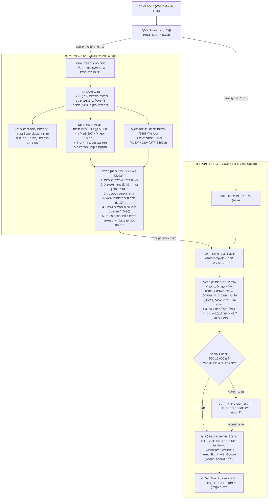

# איפיון מיקרו חלק ג': מסכי המשתמש, תזרימי UI/UX, קרטוגרפיה ונגישות (`UI/UX & Cartography Spec v1`)

> **מסמך:** `docs/06_ui_ux_and_cartography_spec.md` (שלב 2 — איפיון מיקרו מפורט)  
> **ממשקים משויכים:** [`docs/04_data_schema_v1.md`](./04_data_schema_v1.md) ו-[`docs/05_api_and_mcp_specification.md`](./05_api_and_mcp_specification.md)  
> **תקן נגישות מחייב:** `ת"י 5568` ברמת `WCAG 2.1 AA` (מותאם `RTL` ומובייל-תחילה)  
> **החלטות מוטמעות:** `D-01` עד `D-38` (כולל אימוץ רכיבי המעטפת מ"מפת הטף" לפי `D-36`, קרטוגרפיה של `Supercluster` מעל אינדקס סיכות ארצי דחוס ואיחוד סיכה רב-גילאית `daycare_year_summary` לפי `D-32` ו-`D-38`, תצוגת טווח/חציון והפרדת `Seed` מקונצנזוס לפי `D-31` ו-`D-38`, היסטוריית מחירים והשוואה יחסית לפי `D-30`, ודיווח הורים מבוסס `Google OIDC` + `Blind Upsert` רב-גילאי + `Blind Withdraw` + `Sanity Check` היברידי לפי `D-29`, `D-34` ו-`D-38`).

---

## 1. ארכיטקטורת הממשק ואימוץ רכיבי המעטפת מ"מפת הטף" (`D-33`, `D-36`)

בהתאם להחלטה **`D-36`** שסוכמה עם המוביל הטכנולוגי של "מפת הטף", ממשק המשתמש של "ילדי היקר" יאמץ וישכפל את דפוסי המעטפת המוכחים של "מפת הטף" (`tafmap.org.il`), תוך התאמתם לזירת המחירים הארצית:

1. **חלונית פתיחה והכוונה (`Onboarding Welcome Modal` — מוצגת בכניסה ראשונה וניתנת לפתיחה חוזרת מהתפריט):**
   - מסבירה ב-3 משפטים בהירים את מטרת הפרויקט (שקיפות יוקר החינוך בגיל הרך `0–6` והנגשת מרשמי הפיקוח בשיתוף הסדנא לידע ציבורי וועד ההורים הארצי).
   - מציגה **2 כפתורי פעולה ראשיים (`CTAs`)**:
     - 🔍 **"חיפוש והשוואת גנים ומחירים באזור שלי"** (מוביל לענף החיפוש עם מיקוד בשדה העיר/הכתובת).
     - ➕ **"דיווח אנונימי על מחיר הגן שלנו (60 שניות)"** (פותח את אשף דיווח ההורים).
2. **סרגל עליון ותפריט צד (`Header & Navigation Drawer` בסגנון "מפת הטף"):**
   - לוגו **"ילדי היקר"** + תגית **"הסדנא לידע ציבורי (ע"ר)"**.
   - כפתור בולט וקבוע בסרגל העליון: **`[ + הוספת מחיר גן ]`**.
   - תפריט צד (`Drawer`) הכולל:
     - **אודות הפרויקט ואיך המידע מאומת** (הסבר על 3 שכבות האמינות ושיטת ה-`Unlinkable Nullifier`).
     - **תנאי שימוש, מדיניות פרטיות וכתב ויתור (`Reliance Disclaimer`)** *(לפי הנוסח הסופי שינסח היועץ המשפטי של הסדנא בשלב 3)*.
     - **הצהרת נגישות (`ת"י 5568 AA`)** ופרטי רכז הנגישות של הסדנא.
     - **קישור לקוד הפתוח ב-GitHub** (`https://github.com/hasadna/dear_child`) ולתיעוד ה-**REST API & MCP**.
3. **פוטר ייחוס קבוע (`Attribution & Non-Endorsement Footer`):**
   - משפט הייחוס המלא (`data.gov.il`, משרד החינוך, העבודה, הרווחה, למ"ס, "מפת הטף", "מפתח התקציב", עיריית ת"א ו-`© OpenStreetMap contributors`), הבהרת אי-חסות ממשלתית, ורישיון המאגר הפתוח **`ODbL 1.0`**.

---

## 2. תרשים זרימת המסכים הראשי (`User Journey Map`)

---

## 3. ענף א': מסך החיפוש, הטבלה הנגישה והקרטוגרפיה (`Discovery & Cartography`)

### 3.1 פריסת המסך (`Desktop Split-View` מול `Mobile Toggle`)
1. **במחשב שולחני (`Desktop >= 1024px`):**
   - **סרגל פילטרים עליון דביק (`Sticky Filter Bar`)** עם השלמת כתובת/עיר, בוררי גיל ומסלול, תקציב ומתגי סינון מהירים.
   - **חצי ימני (`45%` מרוחב המסך — כיוון `RTL`):** תצוגת **הטבלה / כרטיסי הרשימה הנגישה** עם שורת סיכום באזור הנבחר (*"נמצאו 412 מסגרות בתל אביב-יפו · חציון מחיר פרטי בעיר: ₪5,400"*), מיון (`לפי מרחק`, `מחיר: מהנמוך לגבוה`, `מספר דיווחים`), וכפתור **`[ 📥 ייצוא לאקסל / CSV ]`**.
   - **חצי שמאלי (`55%` מרוחב המסך):** המפה האינטראקטיבית המסונכרנת דו-כיוונית עם הטבלה (ריחוף על שורה בטבלה מדגיש את סיכת הגן במפה, ולחיצה על סיכה פותחת את כרטיס הגן).
2. **במובייל (`Mobile < 1024px`):**
   - תצוגת ברירת המחדל מאפשרת מעבר חלק בלחיצה אחת דרך **כפתור צף תחתון (`Floating Pill Toggle`)**: **`[ 🗺️ מפה ]`** מול **`[ 📋 רשימה וטבלה (412) ]`**, כך שגם משתמשי קורא מסך וגם הורים שמעדיפים סריקה טבלאית מהירה מקבלים חוויה מלאה.

### 3.2 מפרט הקרטוגרפיה ותצוגת המפה (`D-32`, `D-38`)

המפה מבוססת על `MapLibre GL JS` / `Leaflet` מעל אריחי `OpenStreetMap` (בעלות `0 ₪` ועם ייחוס `© OpenStreetMap contributors`).
- **ארכיטקטורת טעינה ארצית מיידית (`Compact Pin Payload — D-38`):** כדי לתמוך ב-`~30,000` מסגרות ארציות בגילאי `0–6` ללא חיתוך תוצאות (`LIMIT 2000`) וללא השהיית רשת בכל תזוזת מפה, ה-Frontend טוען מ-`GET /api/v1/daycares?format=map_pins` אינדקס סיכות ארצי רזה ודחוס (`~400KB Gzipped`, מוחזק ב-Cache ל-5 דקות) ומזין אותו ל-`Supercluster` ב-WebWorker בדפדפן (זום, הזזה וסינון ב-`0ms`).
- **מניעת כפילות סיכות בגן רב-גילאי (`Multi-Age Pin Collapse — D-38`):** כאשר המשתמש צופה במפה ללא בחירת פילטר גיל ספציפי, כל גן מיוצג ע"י **סיכה מאוחדת אחת** (מתוך `public.daycare_year_summary`) המציגה את חציון כלל דיווחי היום המלא של הגן וסך הדיווחים הכולל, ובריחוף/בפתיחת הכרטיס מוצג הפירוט המלא לכל שכבת גיל (`0_1`, `1_2`, `2_3`). כאשר המשתמש בוחר פילטר גיל ספציפי, הסיכה מציגה את המחיר של אותה שכבת גיל בלבד (מתוך `public.daycare_price_aggregates`).

המפה כוללת 3 מנגנונים חזותיים:

#### א. אגרגציה בזום-אאוט (`Zoom-Out Supercluster` — רמת ארצי, עיר ושכונה, `Zoom <= 14`)
- כדי למנוע עומס ויזואלי של אלפי סיכות חופפות, ברמות זום רחוקות גנים סמוכים מתאחדים ל**בועות מקבץ (`Cluster Bubbles`)**.
- **מה כתוב בתוך הבועה?** שתי שורות ברורות:
  - שורה עליונה (בפונט מודגש): **חציון המחיר של הגנים בעלי מחיר במקבץ** (למשל **`₪5,400`**; ואם טרם דווחו מחירים במקבץ: **`טרם דווח מחיר`**).
  - שורה תחתונה: **מספר המסגרות הכולל במקבץ** (למשל **`38 גנים`**).
- **צביעת הבועה (מפת חום שכונתית):** הבועה נצבעת לפי מיקום חציון המקבץ ביחס לחציון הארצי/העירוני (ירוק = זול יחסית, כתום = סביב החציון, אדום = יקר יחסית, כחול = רוב מעונות סמל מסובסדים, אפור = ללא דיווחי מחיר).

#### ב. סיכות בזום-אין (`Price Pills` — רמת רחוב, `Zoom >= 15`)
ברמת רחוב כל גן מוצג כתווית מחיר קומפקטית (`Pill`) שלחיצה עליה פותחת את כרטיס הגן:

| מצב הדיווחים בגן (`D-31`) | טקסט הסיכה על המפה | עיצוב מסגרת הסיכה (חיווי אמינות ויזואלי) |
|---|---|---|
| **`N = 0` (טרם דווח מחיר)** | `[ + הוסף מחיר ]` (או שם הגן המקוצר) | רקע אפור בהיר, מסגרת דקה אפורה. |
| **`N = 1` (דיווח הורה בודד / ייבוא גיליון)** | `[ ₪5,400 ]` | מסגרת דקה מקווקוות (`1.5px dashed`) — מסמנת דיווח יחיד שטרם הוצלב. |
| **`N = 2` עם פער מעל `5%`** | `[ ~₪5,500 ]` *(הדיווח העדכני עם סימן `~`)* | מסגרת רגילה (`1.5px solid`) — בכותרת הכרטיס יוצג הטווח המלא `₪5,100–₪5,500`. |
| **`N >= 3` (קונצנזוס הורים מאומת)** | `[ ✓ ₪5,600 ]` *(החציון + אייקון `✓`)* | מסגרת עבה ומודגשת (`2.5px solid`) + אייקון `✓` ירוק. |
| **אזהרת אכיפה רשמית (`צו הפסקה / עיצום`)** | `[ ⚠️ ₪5,200 ]` (או `[ ⚠️ צו הפסקה ]`) | מסגרת אדומה בולטת עם אייקון `⚠️`. |

#### ג. מתג צביעת המפה בראש המפה (`Map Color Mode Switcher` — `D-32`)
בראש המפה מוצג מתג בחירה בן 3 מצבים המשנה את צבע הרקע של הסיכות:
1. **צביעה לפי רמת מחיר יחסית / סבסוד (ברירת מחדל):**
   - 🔵 **כחול (`#2563EB`):** מעון/משפחתון סמל מסובסד (תעריף מפוקח משרד העבודה) או צהרון `ניצנים` מפוקח.
   - 🟢 **ירוק (`#16A34A`):** גן פרטי שהמחיר שלו **נמוך ב-`10%` או יותר** מחציון העיר לאותו מסלול.
   - 🟡 **כתום/צהוב (`#D97706`):** גן פרטי שהמחיר שלו **סביב חציון העיר (`±10%`)**.
   - 🔴 **אדום-קורל (`#DC2626`):** גן פרטי שהמחיר שלו **גבוה ב-`10%` או יותר** מחציון העיר.
   - ⚪ **אפור (`#6B7280`):** מסגרת רשמית שטרם דווח עבורה מחיר.
2. **צביעה לפי סטטוס פיקוח ורישוי:**
   - 🟢 **ירוק:** רישיון הפעלה בתוקף / סמל מוכר.
   - 🟡 **צהוב-כחול:** בתהליך רישוי במשרד החינוך (הסדר רציפות).
   - 🟣 **סגול:** מופיע במאגר מוניציפלי רשמי (GIS עירוני).
   - 🔴 **אדום:** צו הפסקה מנהלי פעיל / עיצום כספי במרשם משרד החינוך.
3. **צביעה לפי מספר דיווחים (עומק כיסוי קהילתי):**
   - 🟢 **ירוק כהה:** `3+` דיווחי הורים (קונצנזוס מאומת).
   - 🟡 **צהוב:** `1–2` דיווחי הורים (דורש דיווחים נוספים לאימות).
   - ⚪ **אפור:** `0` דיווחים (קריאה לפעולה להורים לדווח!).

---

## 4. איפיון כרטיס הגן המלא (`Daycare Profile Card`)

לחיצה על שורת גן בטבלה או על סיכה במפה פותחת את כרטיס הגן המלא (המחולק ל-5 בלוקים קבועים וברורים):

### בלוק 1: כותרת, פרטים רשמיים ותגית סטטוס רישוי ואכיפה (`Tier 1 Official Header`)
- **שם המסגרת**, **כתובת מלאה**, **טלפון רשמי של המוסד** (מוצג בכרטיס הבודד בלבד!), **סמל מוסד משרד החינוך / סמל מעון משרד העבודה**, ו**שם התאגיד המפעיל** (ח.פ./ע"ר — או `"עוסק יחיד"` ללא ת"ז).
- **תגית סטטוס רישוי רשמית (עם הנוסח המוגן מתוך `regulatory_context_he` ותאריך הבדיקה האחרון):**
  - 🟢 `מקור רשמי · רישיון הפעלה בתוקף (משרד החינוך · נבדק: DD.MM.YYYY)`
  - 🔵 `מעון סמל מוכר לסבסוד ושכר לימוד מפוקח (משרד העבודה)`
  - 🟡 `מקור רשמי · בתהליך רישוי במשרד החינוך` *(כולל הסבר מרגיע להורים כי הוגשה בקשת רישוי/חידוש הנמצאת בבדיקת המשרד במסגרת הסדר רציפות הרישוי).*
  - 🔴 `התראת אכיפה רשמית במשרד החינוך` *(מוצג אך ורק אם קיים צו הפסקה פעיל ב-`GetMeonot` או עיצום כספי ב-`mirsham.xlsx`, עם ציטוט מדויק של עמודת `"מהות ההפרה"` הרשמית ותאריך הצו).*

### בלוק 2: מחיר חודשי משוקלל לפי גיל ומתכונת שעות (`D-31`)
בורר מהיר בראש הבלוק מאפשר מעבר בין שנות לימודים (`תשפ"ז 2026–2027` כברירת מחדל) ובין קבוצות הגיל הקיימות בגן:
- **כאשר `N = 1` (`price_display_mode = 'single'`):**
  - מוצג: **`₪5,400 לחודש`** (למחיר מחירון רגיל, ימי א'–ה' `07:30–16:30`, כולל שישי והזנה).
  - תגית אמינות: 🟠 **`דיווח הורה בודד (טרם אומת מול הורים נוספים)`** (או `מקור: גיליון הורים קהילתי · דורש אימות מחדש`).
- **כאשר `N = 2` והפער מעל `5%` (`price_display_mode = 'range_discrepancy'`):**
  - מוצג בכותרת הכרטיס **הטווח המלא**: **`₪5,100 – ₪5,600 לחודש`**.
  - תגית אמינות: 🟠 **`טווח מתוך 2 דיווחי הורים (קיים פער של מעל 5% בין הדיווחים — ראו פירוט למטה)`**.
- **כאשר `N >= 3` (`price_display_mode = 'median_consensus'`):**
  - מוצג **החציון** כמספר הראשי הגדול: **`₪5,600 לחודש (חציון)`**.
  - מתחתיו בשורה משנית שקופה: **`טווח הדיווחים: ₪5,400 – ₪5,800 · טווח בין-רבעוני (IQR): ₪5,500–₪5,700`**.
  - תגית אמינות: 🟢 **`✓ מידע הורים מאומת (קונצנזוס של 4 הורים)`**.

### בלוק 3: השוואת מחיר הגן לעומת הסביבה וגנים דומים (`Relative Benchmarking` — `D-30`)
מוצגים עד 3 סרגלי השוואה אופקיים וברורים (כל סרגל מוצג רק כאשר קבוצת הייחוס מונה לפחות **`N >= 3` גנים**):
1. **בהשוואה לשכונה / רדיוס 1 ק"מ (`N = 11 גנים`):** חציון האזור `₪5,750` -> הגן הזה **זול ב-`₪150` (`-2.6%`)** מהחציון ברדיוס 1 ק"מ.
2. **בהשוואה לכלל העיר (`תל אביב-יפו, N = 218 גנים פרטיים`):** חציון העיר `₪5,400` -> הגן הזה **יקר ב-`₪200` (`+3.7%`)** מחציון העיר.
3. **בהשוואה לגנים עם פרמטרים דומים בעיר ("תפוחים לתפוחים": `גילאי 1–2 · גן פרטי · יום מלא, N = 94 גנים`):** חציון דומים `₪5,500` -> הגן הזה **יקר ב-`₪100` (`+1.8%`)**.
4. **עוגן ייחוס ממשלתי:** תיבת מידע קבועה המציגה את **תעריף המקסימום המפוקח במעון סמל לאותו גיל (`₪2,515 לחודש`)** ואת הפער השנתי למשפחה בשוק הפרטי (`+₪37,020 לשנה`).

### בלוק 4: היסטוריית מחירי עבר ושינוי לאורך השנים (`Price History & YoY Trend` — `D-30`)
טבלה וגרף עמודות קומפקטי המציגים את התפתחות המחיר בגן לפי שנות לימודים:
- `תשפ"ה (2024–2025)`: **`₪4,950`** (בסיס)
- `תשפ"ו (2025–2026)`: **`₪5,250`** (`+₪300` / **`+6.1%`** לעומת תשפ"ה)
- `תשפ"ז (2026–2027)`: **`₪5,600`** (`+₪350` / **`+6.7%`** לעומת תשפ"ו · **התייקרות תלת-שנתית מצטברת: `+₪650` / `+13.1%`**)

### בלוק 5: טבלת פירוט הדיווחים הבודדים, כפתור `"מצאתם טעות?"` וכתב הוויתור (`D-34`, `D-38`)
- **טבלת השורות הבודדות:** מציגה לכל דיווח את: **שנת הלימודים בלבד** (למשל `תשפ"ז` — **ללא הצגת חודש הדיווח** למניעת ניחוש הקשרי של ההורה המדווח ע"י הנהלת הגן!), קבוצת גיל, מחיר מחירון חודשי, שעות א'–ה', פעילות ושעות בשישי, הזנה, גודל מסגרת (`7+` / `עד 6`), ממ"ד ומצלמות. עבור שורות היסטוריות שיובאו מפיילוט גיליון ת"א (`community_sheet_tlv_seed`) שבהן לא צוינו שעות או הזנה במקור, מוצג בשדה החסר הכיתוב השקוף **`"לא צוין בגיליון המקור"`** (ללא המצאת ערכי ברירת מחדל — `D-38`).
- **כפתורי פעולה בתחתית הכרטיס:**
  - **`[ + דווחו או עדכנו מחיר לגן זה ]`**
  - **`[ 🚩 מצאתם טעות בנתוני הגן? ]`** (פותח חלונית דיווח מובנית לבחירת סוג הטעות: מחיר שגוי/חריג, הגן נסגר, טעות בכתובת או בסטטוס הרישוי — נשמר ב-`app_private.correction_requests` לבדיקה מדורגת ללא הסתרה אוטומטית של דיווחים — `D-38`).
- **תיבת כתב ויתור והסתמכות (`Reliance Disclaimer`):** מוצגת בתחתית כל כרטיס גן בניסוח בולט וברור.

---

## 5. ענף ב': אשף דיווח מחיר ע"י הורה ב-60 שניות (`Crowdsourcing Flow` — `D-12`, `D-28`, `D-29`, `D-34`, `D-38`)

טופס הדיווח בנוי כחלונית ממוקדת בת 3 צעדים קצרים, ללא שום שדה טקסט חופשי (`D-08`):

### צעד 1: בחירת המסגרת הרשמית (`MVP1`)
- אם ההורה לחץ על `"דווחו מחיר"` מתוך כרטיס גן — המסגרת כבר נעולה ומוצגת בראש הטופס (וה-Frontend מקבל יחד איתה את `reference_median_nis` מפונקציית מפל הגיבוי `get_sanity_check_reference_median`).
- אם נכנס מהכפתור הראשי — שדה חיפוש חכם (`Autocomplete`) לפי עיר ושם הגן/הרחוב מתוך המסגרות הרשמיות ב-`public.daycares` (`D-28`), ומתחתיו קישור משני שקט: **`"דיווחתם בטעות על גן זה וברצונכם להסיר את הדיווח? לחצו לביטול דיווח (Blind Withdraw)"`** (`D-38`).

### צעד 2: מחיר המחירון, 4 צירי הנרמול ו-3 שאלות הבטיחות
1. **שנת לימודים (חובה):** כפתורי בחירה מהירה — **`תשפ"ז (2026–2027)`** (ברירת מחדל), `תשפ"ו (2025–2026)`, `תשפ"ה (2024–2025)` + כפתור אופציונלי `"+ הוספת מחיר ששילמתם בגן זה גם בשנה קודמת"` (`D-30`) או `"+ הוספת שכבת גיל נוספת באותו גן"` (להורה עם שני ילדים בשתי כיתות גיל במעון — `D-38`).
2. **מחיר מחירון חודשי רגיל בש"ח (חובה — `D-34`):**
   - תווית והנחיה מפורשת מעל השדה: **"מחיר מחירון חודשי רגיל בש"ח (ללא הנחות אחים, מלגות או הסדרים אישיים מיוחדים)"**.
   - ולידציה מיידית (`Sanity Check`): מספר שלם בטווח **`500` עד `15,000` ₪**.
3. **ציר נרמול 1 — קבוצת גיל ומסלול (חובה — `D-12`, `D-16`):**
   - קבוצת גיל: `תינוקות (0–1)` | `פעוטות (1–2)` | `פעוטות (2–3)` | `רב-גילי (0–3)` | `גני ילדים (3–6)`.
   - אם נבחר `3–6`, חובה לבחור מתג מסלול: **`גן פרטי / מוכש"ר (יום מלא)`** מול **`צהרון בגן עירייה`**.
4. **ציר נרמול 2 — שעות פעילות בימי א'–ה' (חובה):**
   - בורר שעת פתיחה (ברירת מחדל `07:30`, בקפיצות של 15 דקות) ושעת סיום (ברירת מחדל `16:30`).
5. **ציר נרמול 3 — ימי שישי (חובה — `D-13`):**
   - מתג: **`כולל ימי שישי`** (`כן` / `לא`).
   - כאשר נבחר **`כן`**, נפתחים שני בוררי שעות: **שעת פתיחה בשישי** (ברירת מחדל `07:30`) ו**שעת סיום בשישי** (ברירת מחדל `12:30`).
6. **ציר נרמול 4 — הזנה (חובה):**
   - מתג: **`האם המחיר כולל ארוחות / הזנה?`** (`כן` / `לא`).
7. **3 שאלות עובדתיות בלחיצה אחת (ללא הקלדה):**
   - **מספר ילדים במסגרת:**
     - אם הגיל הוא `0–3`: `[ 7 פעוטות ומעלה ]` | `[ עד 6 פעוטות ]` | `[ לא בטוח ]`.
     - אם הגיל הוא `3–6`: `[ 11 ילדים ומעלה ]` | `[ עד 10 ילדים ]` | `[ לא בטוח ]`.
   - **מיגון תקני:** `[ יש ממ"ד / מקלט תקני ]` | `[ אין ]` | `[ לא ידוע ]`.
   - **מצלמות (מוצג רק כאשר קבוצת הגיל היא `0–3`!):** `[ יש מצלמות כחוק ]` | `[ אין ]` | `[ לא ידוע ]`.

#### חלונית וידוא חריגים היברידית בסיום צעד 2 (`Hybrid Sanity Check Outlier Modal` — `D-34`, `D-38`):
כדי לא לצרוך את טוקן ה-`Cloudflare Turnstile` החד-פעמי לפני וידוא החריגה, הבדיקה מופעלת מיד בסיום צעד 2 (מול חציון הייחוס ממפל הגיבוי `get_sanity_check_reference_median`): אם המחיר חורג ביותר מ-`40%` מחציון הייחוס, קופצת חלונית אימות ברורה עוד לפני המעבר לצעד 3 (ובנוסף נאכפת בשנית בשרת עם תמיכה בעוגיית `yh_auth_session`):
> **"רגע, רק מוודאים שלא נפלה טעות הקלדה 😊"**  
> *"הזנת מחיר של **₪1,800 לחודש** למסלול גן פרטי יום מלא (חציון הייחוס באזורך הוא **₪5,400**). האם זהו אכן מחיר המחירון החודשי המלא של המסגרת (ללא הנחה אישית או סבסוד)?"*  
> **`[ כן, המחיר מדויק — המשך לשליחה ]`** | **`[ חזרה לתיקון המחיר ]`**

### צעד 3: הצהרת ההורה, הודעת פרטיות (`סעיף 11`) ואימות בלחיצה אחת (`Google OIDC`)
1. **תיבת סימון חובה (`Checkbox` — `D-34`, `סעיף 62 לפקודת הנזיקין`):**
   - `[V]` *"אני מאשר/ת כי הנתונים נמסרים בתום לב מניסיוני האישי או מהצעת מחיר שקיבלתי מהמסגרת לשנת הלימודים המצוינת; **המחיר המדווח הוא מחיר המחירון הכללי של המסגרת (ולא הסדר הנחה אישי), ואין מניעה חוזית של סודיות החלה עליי למסור מידע זה**; ידוע לי שהנתונים יוצגו בממשקי המידע הפתוחים ללא פרטיי האישיים."*
2. **הודעת שקיפות ופרטיות קצרה (`סעיף 11` לחוק הגנת הפרטיות + `Cookies` — `D-29`, `D-34`):**
   - תיבת מידע קומפקטית וברורה מתחת לתיבת הסימון המסבירה:
     - המאגר מנוהל ע"י הסדנא לידע ציבורי (ע"ר) (`privacy@hasadna.org.il`).
     - מסירת המידע וולונטרית, אך מחייבת אימות חד-פעמי למניעת זיופים והצבעות כפולות.
     - בלחיצה על `"התחברות עם Google ושליחה"`, אנו מבקשים מגוגל מזהה טכני בלבד (`Scope: openid` — **ללא קבלת כתובת המייל או השם שלך!**), גוזרים ממנו קוד חד-כיווני ייחודי לגן זה בלבד שנמחק בתום שנת הלימודים (כך שאין שום אפשרות לקשר בין דיווחים על מספר גנים או לבדוק אם כתובת מייל דיווחה), ומשתמשים בעוגיית אבטחה זמנית והכרחית בלבד (`Strictly Necessary Cookie` ל-15 דקות).
3. **רכיב `Cloudflare Turnstile` + כפתור `Sign in with Google ושליחת הדיווח`:**
   - לחיצה אחת משלימה את האימות מול גוגל ושולחת את הדיווח ל-`POST /api/v1/reports`.
4. **מסך סיום אחיד (`Blind Upsert Confirmation`):**
   - מציג תמיד את ההודעה: **"תודה! הדיווח נקלט במערכת ויסייע להורים נוספים."** (ללא שום חיווי אם החשבון כבר דיווח בעבר על גן זה — `D-34`).

---

## 6. דרישות נגישות מחייבות (`ת"י 5568 / WCAG 2.1 AA`)

1. **חלופה טבלאית נגישה מלאה למפה (`D-02`):** כל פעולת סינון, מיון וצפייה בכרטיס גן זמינה ב-100% מתוך **הטבלה הנגישה** (`<table>` סמנטית עם `<thead>`, `<th scope="col">` וניווט מקלדת מלא `Tab` / `Enter` / `Escape`) וכן באמצעות ייצוא ל-Excel/CSV, כך שמשתמשי קורא מסך (`NVDA`, `JAWS`, `VoiceOver`) אינם תלויים ברכיב המפה הגיאוגרפי.
2. **אי-תלות בצבע בלבד (`Use of Color — WCAG 1.4.1`):**
   - סיכות המפה ותגיות הסטטוס לעולם אינן נבדלות בצבע בלבד: לצד הצבע מופיעים תמיד **טקסט המחיר**, **סמליל מובחן (`✓` לקונצנזוס, `~` לטווח, `⚠️` לאכיפה, `🛡️` לסמל מסובסד)** ועובי/סגנון מסגרת שונה (`dashed` מול `solid`).
3. **ניגודיות, כיווניות (`RTL`) וטפסים נגישים:**
   - יחס ניגודיות של לפחות `4.5:1` לכל טקסט ו-`3:1` לרכיבי UI גרפיים.
   - לכל שדה בטופס הדיווח משויך `<label for="...">` מפורש, הודעות שגיאה ו-`Sanity Check` מוכרזות ב-`aria-live="polite"`, וחלוניות מודאליות (`Onboarding`, כרטיס גן, טופס דיווח) כוללות `Focus Trap` תקני וסגירה במקש `Escape`.

