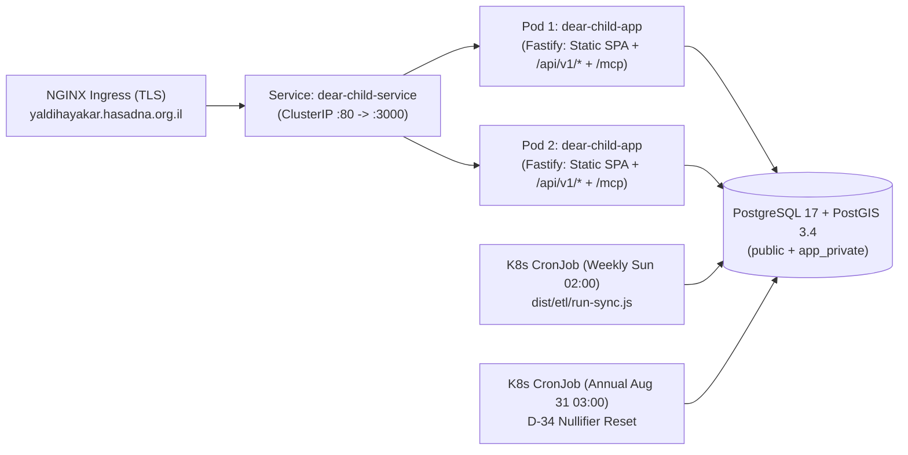

<div dir="rtl">

# מדריך פריסה ותפעול בקלאסטר הסדנא (`hasadna-k8s`) — פרויקט "ילדי היקר"

מסמך זה מרכז עבור **איש ה-DevOps של הסדנא לידע ציבורי** את כל ההגדרות, משתני הסביבה ב-`HashiCorp Vault`, דרישות המשאבים ופקודות ההקמה לצורך פריסת פרויקט **"ילדי היקר"** (`hasadna/dear_child`) בקלאסטר `hasadna-k8s` תחת `ArgoCD`.

---

## 1. טופולוגיית הקונטיינרים והארכיטקטורה (`D-26`, `D-38`)

בהתאם להחלטה `D-38`, האפליקציה כולה ארוזה ב**תמונת Docker רב-שלבית יחידה** (`ghcr.io/hasadna/dear_child:latest`), הנבנית אוטומטית ב-GitHub Actions ([`.github/workflows/ci-cd.yml`](../.github/workflows/ci-cd.yml)) בכל דחיפה ל-`main`:

<div dir="ltr">



</div>

### מאפייני התמונה המאוחדת ([`Dockerfile`](../Dockerfile)):
- **משתמש הרצה:** `node` (`UID/GID 1000`, `runAsNonRoot: true`).
- **פורט האזנה:** `3000` (מגיש את ה-Frontend הסטטי מ-`/app/frontend/dist`, את ה-REST API תחת `/api/v1/*`, את שרת ה-MCP תחת `/mcp`, ואת בדיקת החיים ב-`/api/v1/health`).
- **תמיכה ב-Multi-Pod (`replicas: 2`):** מפתח הצפנת העוגיות (`yh_auth_session`) נגזר באופן דטרמיניסטי מתוך `SECRET_PEPPER` באמצעות `HKDF-SHA256`, כך שלא נדרש `Sticky Sessions` ב-Ingress.

---

## 2. ארבע הפעולות הנדרשות מאיש ה-DevOps להקמה (Checklist)

### שלב א': הקמת מסד נתונים `PostgreSQL 17 + PostGIS 3.4`
יש להקצות מסד נתונים בשם `dear_child` (קונטיינר `postgis/postgis:17-3.4-alpine` או שירות מנוהל התומך ב-`postgis` ו-`pg_trgm`) ולהגדיר בו את 3 משתמשי הגישה (`Roles`) המופרדים לפי [`docs/04_data_schema_v1.md`](./04_data_schema_v1.md):
1. `app_public_ro` — קריאה בלבד מ-`public` (עבור ה-REST API הציבורי ושרת ה-MCP).
2. `app_backend_write` — קריאה מ-`public` והרצת פונקציות כתיבה עיוורת (`Blind Upsert` / `Blind Withdraw`) ב-`app_private`.
3. `app_etl` — בעל ההרשאות להרצת המיגרציות (`migrate.js`) וצינור ה-ETL השבועי (`run-sync.js`).

> **הערה:** בהרצה הראשונה של ה-`PreSync Job` ([`docs/k8s/jobs-migrate-and-etl.yaml`](./k8s/jobs-migrate-and-etl.yaml)), הסקריפט `node dist/db/migrate.js` יוצר אוטומטית את ההרחבות (`postgis`, `pg_trgm`, `pgcrypto`), הסכמות (`public`, `app_private`), הטבלאות, ה-Views ומילוני הערים והתעריפים המפוקחים.

---

### שלב ב': הזנת הסודות ב-`HashiCorp Vault`
נתיב ה-Vault המוגדר במניפסט [`docs/k8s/deployment.yaml`](./k8s/deployment.yaml) הוא:
`secret/data/hasadna/dear-child`

| שם המפתח ב-Vault | תיאור והנחיית יצירה | חובה? |
|---|---|---|
| `DATABASE_PUBLIC_RO_URL` | `postgresql://app_public_ro:<PASS>@<DB_HOST>:5432/dear_child` | חובה |
| `DATABASE_BACKEND_WRITE_URL` | `postgresql://app_backend_write:<PASS>@<DB_HOST>:5432/dear_child` | חובה |
| `DATABASE_ETL_URL` | `postgresql://app_etl:<PASS>@<DB_HOST>:5432/dear_child` | חובה |
| `SECRET_PEPPER` | מפתח אקראי בן 256 ביט (`openssl rand -hex 32`) לגזירת `dedup_token` ועוגיית `HKDF`. **אסור לשמור ב-DB!** | חובה |
| `QUOTA_PEPPER_SEPARATE` | מפתח אקראי נפרד בן 256 ביט (`openssl rand -hex 32`) לטבלת מכסות הדיווחים (`auth_rate_limits`). | חובה |
| `GOOGLE_CLIENT_ID` | מזהה לקוח `OAuth 2.0 Web Client` ב-Google Cloud Console (הרשאת `Scope: openid` בלבד, ללא `email`). | חובה |
| `TURNSTILE_SECRET_KEY` | מפתח השרת (`Secret Key`) מלוח הבקרה של `Cloudflare Turnstile`. | חובה |

פקודת עזר ליצירת שני מפתחות ה-Pepper ולהזנתם ל-Vault:

<div dir="ltr">

```bash
vault kv put secret/hasadna/dear-child \
  DATABASE_PUBLIC_RO_URL="postgresql://app_public_ro:..." \
  DATABASE_BACKEND_WRITE_URL="postgresql://app_backend_write:..." \
  DATABASE_ETL_URL="postgresql://app_etl:..." \
  SECRET_PEPPER="$(openssl rand -hex 32)" \
  QUOTA_PEPPER_SEPARATE="$(openssl rand -hex 32)" \
  GOOGLE_CLIENT_ID="YOUR_GOOGLE_CLIENT_ID.apps.googleusercontent.com" \
  TURNSTILE_SECRET_KEY="YOUR_CLOUDFLARE_TURNSTILE_SECRET"
```

</div>

---

### שלב ג': חיבור האפליקציה ל-`ArgoCD`
כל מניפסטי ה-Kubernetes מוכנים בתיקייה [`docs/k8s/`](./k8s/) עם `kustomization.yaml`.  
כדי לרשום את האפליקציה ב-ArgoCD בקלאסטר:

<div dir="ltr">

```bash
kubectl apply -f docs/k8s/argocd-application.yaml
```

</div>

סדר הריצה האוטומטי ב-ArgoCD:
1. **`PreSync Hook Job` (`dear-child-db-migrate-and-seed`):** מריץ את 5 מיגרציות ה-SQL וטוען את מילון הערים ותעריפי הסמל המפוקחים.
2. **`Deployment` (`dear-child-app`):** מעלה 2 רפליקות של השרת המאוחד וממתין לבדיקת `/api/v1/health`.
3. **`Service & Ingress` (`dear-child-service`, `dear-child-ingress`):** חושף את השירות ב-HTTPS עם תעודת `letsencrypt-prod`.
4. **`CronJobs`:** מתזמן את סנכרון ה-ETL השבועי (ימי ראשון ב-`02:00`) ואת איפוס ה-`dedup_token` השנתי (31 באוגוסט ב-`03:00`).

---

### שלב ד': הרצת סנכרון ה-ETL הראשוני והגדרת ה-DNS
1. **רשומת DNS:** הפניית `A` / `CNAME` עבור הדומיין שנבחר (ברירת המחדל במניפסט: `yaldihayakar.hasadna.org.il`) אל כתובת ה-Ingress של `hasadna-k8s`.
2. **טעינת נתונים ראשונית (מיד לאחר עליית ה-Deployment הראשון):**

<div dir="ltr">

```bash
kubectl create job --from=cronjob/dear-child-weekly-official-etl dear-child-initial-etl -n dear-child
```

</div>

---

## 3. דרישות משאבים ותקציב חומרה (`Resource Footprint`)

| רכיב | CPU Request / Limit | Memory Request / Limit | נפח דיסק מוערך |
|---|---|---|---|
| `dear-child-app` (`2 Replicas`) | `150m` / `750m` (לכל Pod) | `256Mi` / `512Mi` (לכל Pod) | Stateless (`0 GB`) |
| `dear-child-weekly-official-etl` (`CronJob`) | `200m` / `1000m` (למשך ~3 דקות בשבוע) | `384Mi` / `768Mi` | Stateless (`0 GB`) |
| `PostgreSQL 17 + PostGIS` | `250m` / `1000m` | `512Mi` / `1Gi` | `5Gi` PVC (המאגר הארצי המלא צורך `< 350 MB`) |

---

## 4. כללי אבטחת מידע ופרטיות תפעוליים (`תקנות אבטחת מידע — רמה בסיסית`, `D-24`, `D-34`)

1. **פחות מ-10 מורשי גישה ל-`app_private`:** יש לוודא כי מספר בעלי ההרשאה הישירה למסד הנתונים ב-Production ול-Namespace `dear-child` אינו עולה על 9 אנשים (למניעת סיווג המאגר ברמת אבטחה בינונית).
2. **אי-שמירת לוגי IP של מדווחים:** במניפסט [`docs/k8s/service-and-ingress.yaml`](./k8s/service-and-ingress.yaml) מוגדרת אנוטציית `nginx.ingress.kubernetes.io/enable-access-log: "false"` למניעת קישור בין כתובת IP למועד שליחת דיווח מחיר.
3. **רוטציה שנתית של `SECRET_PEPPER` ב-31 באוגוסט (`D-34`):** בתום כל שנת לימודים, במקביל לריצת ה-`CronJob` השנתי (`dear-child-annual-privacy-nullifier-reset`) שמאפס את עמודת `dedup_token` ל-`NULL`, מומלץ לחולל ב-Vault ערך חדש עבור `SECRET_PEPPER` לקראת שנת הלימודים החדשה.
4. **ניהול בקרת פניות `"מצאתם טעות?"` דרך ה-CLI (`D-38`):** מורשי הגישה יכולים לבדוק ולטפל בפניות מובנות ישירות מהקונטיינר ללא צורך בפאנל ניהול וובי חשוף:

<div dir="ltr">

```bash
# צפייה בתור הפניות הממתינות לבקרה
kubectl exec -it deploy/dear-child-app -n dear-child -- node dist/cli/manage-corrections.js list

# אישור או דחיית פנייה לפי מזהה
kubectl exec -it deploy/dear-child-app -n dear-child -- node dist/cli/manage-corrections.js resolve <CORRECTION_UUID> approved "Verified against official registry"
```

</div>

</div>
