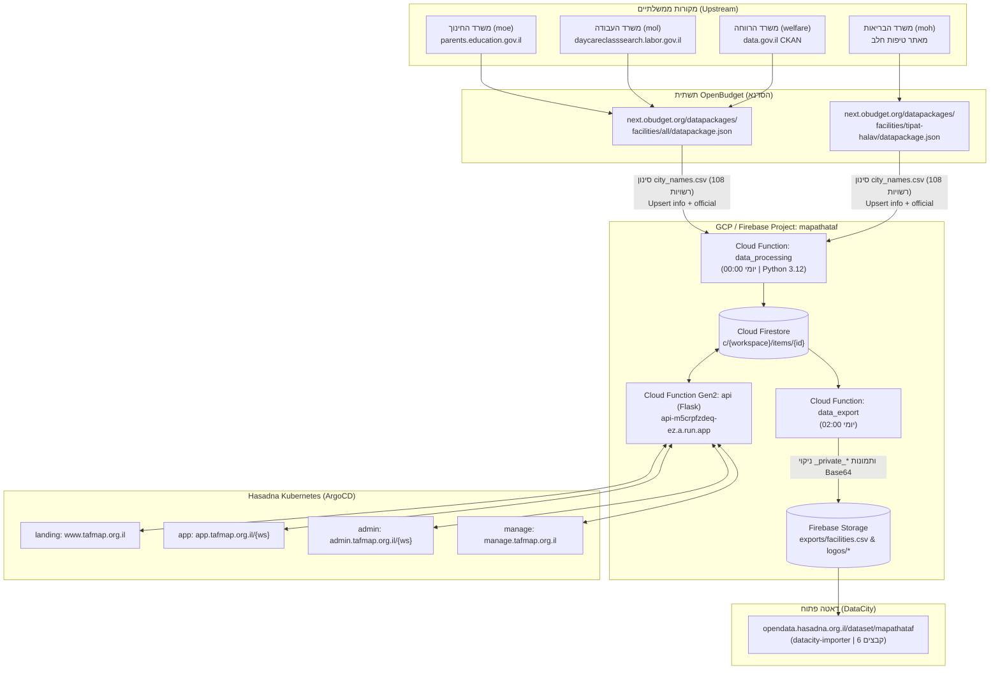
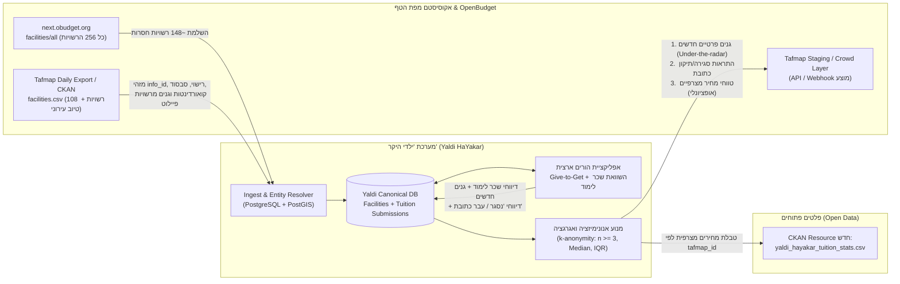

# מחקר עומק טכנולוגי ודאטה: "מפת הטף" (`Mapathataf` / `Tafmap`) וממשק `יצרן <> צרכן` לפרויקט "ילדי היקר"

> **תאריך מחקר:** 29.10.2026  
> **מוביל טכנולוגי של "מפת הטף":** המוביל הטכנולוגי של "מפת הטף" (`WhileTrue Industries` / הסדנא לידע ציבורי)  
> **מנהל פרויקט ומוצר (הסדנא / DataCity):** מנהל הפרויקט וממונה הגנת הפרטיות בסדנא  
> **תשתית ו-DevOps הסדנא (`hasadna-k8s`):** איש ה-DevOps של הסדנא  
> **דגימות וסכמות מקומיות:** שמורות בתיקייה `research/samples/tafmap/`

---

## תקציר מנהלים — ממצאי מפתח עבור "ילדי היקר"

1. **"מפת הטף" היא תשתית המיפוי העשירה ביותר בישראל לגילאי לידה עד 3 (`0–3`), אך אין בה ולו שדה אחד של מחיר או שכר לימוד:** בדיקה מלאה של קוד השרת, ה-API החי וטבלת ה-Open Data (`9,478` רשומות × `242` עמודות) מאשרת כי יש במערכת **אפס (`0`) שדות מובנים למחיר/שכר לימוד** ואפס מנגנוני דיווח המונים ממוכנים (דיווחי הורים מתבצעים כיום דרך שני טפסי JotForm חיצוניים המטופלים ידנית).
2. **איתרנו את מאגרי הפרודקשן האמיתיים והפעילים של המערכת:** המאגר הפומבי המוכר `hasadna/mapathataf` קפא ברמת הקוד בנובמבר 2025 ומשמש כיום לניהול משימות ובאגים בלבד (`100` Issues). קוד הפרודקשן החי מפותח ונפרס מתוך הארגון `whiletrue-industries`:
   - **Frontend Monorepo:** `https://github.com/whiletrue-industries/mapathataf` (עודכן ב-`19.10.2026` — 4 אפליקציות `Angular 19` הנפרסות ב-GitOps ל-`hasadna/hasadna-k8s`).
   - **Backend & Daily ETL:** `https://github.com/whiletrue-industries/mapathataf-server` (עודכן ב-`18.09.2026` — `Firebase Cloud Functions` בפייתון 3.12 מעל `Cloud Firestore`, המוזן מדי לילה מחבילות דאטה ב-`next.obudget.org`).
3. **פער כיסוי גיאוגרפי מהותי שחשוב להכיר מראש:**
   - מתוך 256 רשויות מקומיות בישראל, תהליך ה-ETL של מפת הטף מכיל רשימת היתר קשיחה (`city_names.csv`) של **108 רשויות בלבד** (שאר היישובים בנתוני הממשלה נזרקים לקובץ שגיאות ב-ETL ואינם נכנסים למפת הטף!).
   - מתוך 108 הרשויות במערכת, רק **10 רשויות פיילוט פעילות** (בראשן רחובות, דימונה, רהט, חיפה ורשויות אשכול שורק דרומי) הזינו מידע עירוני או מסגרות פרטיות. ב-**98 הרשויות הנותרות** (כולל ירושלים עם `1,100` רשומות ותל אביב-יפו עם `533` רשומות) מוצג **מידע ממשלתי גולמי בלבד** ללא טיוב עירוני וללא גנים פרטיים שאינם ברישוי/סבסוד.
   - בנוסף, ל-**`959` רשומות (`10.12%`) אין קואורדינטות** והן מוסתרות לחלוטין מאפליקציית המפה להורים, וסינון ברירת המחדל באפליקציה מסתיר מהורים עוד אלפי מסגרות בסטטוס רישוי `"לא ידוע"` או `"לא הוגשה בקשה לרישוי"`.
4. **הפרדה מותגית ומוצרים משלימים (ולא מיזוג מונוליטי) היא המפתח להצלחה:** ניתוח ה-Issues (`#59`, `#83`, `#100`) חושף רגישות פוליטית ומשפטית גבוהה של עיריות להצגת גנים פרטיים ללא רישיון או דירוג/מחירי שוק תחת הלוגו הרשמי של הרשות. לכן, הארכיטקטורה המומלצת ל-MVP היא **אפליקציית "ילדי היקר" עצמאית במיתוג הסדנא / ארגוני הורים (Option B מעל תשתית K8s של הסדנא — Option C)**, הצורכת ממפת הטף ומ-`obudget` את שכבת המסגרות הארצית, ודוחפת חזרה שכבת מחירים מצרפית ותור גילוי של גנים פרטיים "מתחת לרדאר".

---

## 1. מהי "מפת הטף" (`Tafmap`) — הקשר, צוות, שותפים וקהלי יעד

### 1.1 הרקע הרגולטורי והבעיה שהפרויקט פותר
בעקבות **הרפורמה בגיל הרך** בישראל (העברת האחריות על מעונות היום לגילאי לידה עד 3 למשרד החינוך והאצלת סמכויות מיפוי, ליווי, פיקוח והדרכה פדגוגית לרשויות המקומיות), נוצר צורך בשני מישורים מקבילים:
1. **להורים לפעוטות (גילאי 0–3):** היעדר כתובת אחת (`One-Stop-Shop`) המרכזת את כלל המענים בעיר — **מסגרות חינוך** (מעונות סמל מסובסדים, מעונות פרטיים ברישוי, משפחתונים), **בריאות והתפתחות** (טיפות חלב, מרכזים להתפתחות הילד, ייעוץ והדרכה) ו**פנאי וקהילה** ("גן עם אמא", חוגים, מרכזי גיל רך).
2. **למנהלות מחלקות הגיל הרך ברשויות המקומיות:** המידע הממשלתי מפוצל בין **ארבעה משרדי ממשלה שונים** (חינוך, עבודה, רווחה ובריאות) שאינם מסונכרנים ביניהם, מלא בכפילויות ובכתובות שגויות, וחסר לחלוטין את הידע המקומי של הרשות (מסגרות פרטיות קטנות, השתתפות בהדרכה פדגוגית עירונית, קיום מרחב מוגן תקני, הזנה וקיבולת פנויה).

### 1.2 היסטוריית הפרויקט, צוות ושותפים אסטרטגיים
- **הגוף המוביל:** **הסדנא לידע ציבורי** במסגרת רשת **DataCity** (רשת הדאטה הפתוח ברשויות המקומיות).
- **צוות הליבה:**
  - **מנהל הפרויקט וממונה הגנת הפרטיות בסדנא:** ניהול המוצר, הקשר עם הרשויות והגנת הפרטיות (`privacy@hasadna.org.il`).
  - **המוביל הטכנולוגי של "מפת הטף" (`WhileTrue Industries`):** ארכיטקט ומפתח ראשי (Frontend, Backend, ETL ואינטגרציית `obudget`).
  - **מאפיינת ומעצבת ה-UX של "מפת הטף":** איפיון חוויית משתמש ועיצוב ממשק (`Figma: Hasadna <> daata`).
  - **איש ה-DevOps של הסדנא:** ניהול תשתית ה-Kubernetes של הסדנא (`hasadna-k8s` / ArgoCD) וקטלוג הדאטה הפתוח (CKAN).
- **שותפים ומממנים רשמיים (מתוך `about.md` ונכסי המערכת):**
  - **קרן יד הנדיב (`Yad Hanadiv`):** שותפות אסטרטגית ומימון מעמיק של תחום הגיל הרך.
  - **מערך הדיגיטל הלאומי:** תמיכה בטרנספורמציה דיגיטלית בשלטון המקומי.
  - **עיריית רחובות:** שותפת הפיתוח הראשונה (`Design Partner`) להשקת גרסת הבטא בקיץ–סתיו 2025.
  - **רשויות ואשכולות נוספים בפיילוט הפעיל (2025–2026):** **אשכול שורק דרומי** (9 רשויות הפועלות במסגרת תוכנית *"עיר (אזור) בשינוי"* של **עמותת ציונות 2000** ו-**Frisbe**), **עיריית דימונה**, **עיריית רהט** ו**עיריית חיפה**.

### 1.3 שלושת קהלי היעד במערכת

| קהל יעד | ממשק במערכת | יכולות מרכזיות |
|---|---|---|
| **1. הורים לילדים בגילאי 0–3** | `https://app.tafmap.org.il/<workspace>` | חיפוש גיאוגרפי על מפה וברשימה, סינון לפי גיל, סטטוס רישוי, סבסוד משרד העבודה, הדרכה פדגוגית ותת-סוג מענה, שאלון הכוונה (`?onboarding`), מדריך בחירת מסגרת ומידע עירוני. |
| **2. מובילות הגיל הרך ברשות המקומית** | `https://admin.tafmap.org.il/<workspace>?key=...` | דשבורד BI ניהולי (הושק בספטמבר 2026), עריכת וטיוב מסגרות ממשלתיות, הוספת מסגרות פרטיות/קהילתיות ידנית, תיקון Geocoding, ניהול שדות פנימיים חסויים (`_private_*`), שליחת לינקים לבעלי גנים וייצוא לאקסל. |
| **3. בעלי ומנהלי מסגרות פרטיות/מעונות** | `https://admin.tafmap.org.il/<workspace>/<id>?item-key=...` | עריכה עצמית (`Self-Service`) באמצעות "לינק קסם" ייחודי לכל גן: עדכון תיאור חופשי, שעות וימי פעילות, זרם חינוכי, מספר כיתות וילדים, הזנה, מיגון, פרטי קשר והעלאת עד 5 תמונות של הגן. |

---

## 2. ארכיטקטורה טכנית מקצה לקצה

### 2.1 מפת מאגרי הקוד (גילוי ארכיטקטוני חשוב)
במסמכי ההאקתון צוין המאגר `https://github.com/hasadna/mapathataf`, אך בדיקת היסטוריית ה-Git וקבצי ה-GitOps של `hasadna-k8s` חשפה כי המערכת חיה בפועל בשלושה מאגרים משלימים:

| מאגר (Repository) | סטטוס ועדכון אחרון | תפקיד בפועל |
|---|---|---|
| `hasadna/mapathataf` | קוד קפא ב-`09.11.2025` (`83` קומיטים); **Issues פעילים** עד מאי 2026 (`100` Issues/PRs) | שימש כמאגר הראשוני של הפרונטאנד וכיום משמש כלוח ניהול המוצר, ה-QA והבאגים מול צוות הסדנא. |
| `whiletrue-industries/mapathataf` | **פרודקשן חי** — עודכן ב-`19.10.2026` | מונוריפו ה-Frontend העדכני (`Angular 19.2`), כולל אפליקציית ה-Super-Admin (`manage`) ודשבורד ה-BI העירוני החדש ב-`admin`. |
| `whiletrue-industries/mapathataf-server` | **פרודקשן חי** — עודכן ב-`18.09.2026` (`31` קבצים, פומבי) | כל קוד ה-Backend, ה-REST API (`Flask`), משימות ה-ETL הליליות, ייצוא ה-CSV ל-CKAN ומיפויי היישובים (`city_names.csv`, `eshkol.csv`). |
| `hasadna/hasadna-k8s` (`apps/mapathataf/`) | **פרודקשן חי** — מתעדכן אוטומטית בכל Push | הגדרות ה-Helm / ArgoCD הפורסות את 4 אימג'י ה-Docker מ-`ghcr.io/whiletrue-industries/mapathataf-*` לקלאסטר של הסדנא. |

### 2.2 תרשים ארכיטקטורה וזרימת נתונים מלאה

### 2.3 שכבת ה-Frontend (`Angular 19.2` Monorepo + SSR)
המונוריפו ב-`whiletrue-industries/mapathataf` בנוי ב-`Angular 19.2` עם `Express SSR` (פורט `4000`) וספרייה משותפת `projects/shared` (המכילה את מודל הנתונים `item.ts`, מנוע איחוד השכבות `resolveItem`, ושירות `ApiService`). המיפוי מבוסס על **`Mapbox GL JS v3.12`** עם תוסף `mapbox-gl-rtl-text` לתמיכה בעברית וחיפוש כתובות של `Mapbox Searchbox API` התוחם תוצאות לפי ה-`bounds` של הרשות.

ארבע האפליקציות במונוריפו:
1. **`landing` (`www.tafmap.org.il`):** עמוד שיווקי לרשויות ולהורים, קרוסלת לוגואים דינמית מנקודת הקצה `GET /logos`, טופס הצטרפות לרשויות (`Fillout`) וקישור למאגר הפתוח ב-CKAN.
2. **`app` (`app.tafmap.org.il/<workspaceId>`):** אפליקציית ההורים — מפה אינטראקטיבית, מגירת תוצאות דו-מצבית (`באיזור המפה` / `בכל הרשות`), כרטיס מסגרת מפורט (`item-sheet`), אשף הכוונה אופציונלי (`?onboarding`), ודפי תוכן ב-Markdown (`about.md`, `choosing-an-educational-framework.md`, ודף עירוני מותאם מתוך `metadata.city_page`).
3. **`admin` (`admin.tafmap.org.il/<workspaceId>`):**
   - **דשבורד BI עירוני (`/<ws>`):** הושק בספטמבר 2026 ומציג מדדי KPI לרשות — פילוח מסגרות לפי רישוי, הדרכה פדגוגית, סוג בעלות, סבסוד ומיגון (`מרחב מוגן`), קיבולת ומקומות פנויים במעונות מסובסדים, טבלת שכונות והתראות "מסגרות הדורשות תשומת לב".
   - **טבלת ניהול (`/<ws>/items`) וטופס עריכה דו-מצבי (`/<ws>/<itemId>`):** נפתח במצב רשות (`mode === 'admin'`) או במצב בעל מסגרת (`mode === 'user'` עם `?item-key=`).
4. **`manage` (`manage.tafmap.org.il`):** ממשק Super-Admin מאובטח ב-`Firebase Auth` (התחברות Google מול רשימת מורשים במסמך `settings/superadmins` ב-Firestore) להקמת רשויות ואשכולות (`city_links`), ניהול דגלי `active`/`favorite`, העלאת לוגו לרשות, הגדרת גבולות גזרה (`bounds`) ורשימת שכונות.

### 2.4 שכבת ה-Backend, מסד הנתונים ומודל ההרשאות (`mapathataf-server`)
השרת רץ על פרויקט GCP/Firebase בשם `mapathataf`:
- **מסד נתונים (`Cloud Firestore`):** חוקי האבטחה (`firestore.rules`) חוסמים גישת לקוח ישירה לחלוטין (`allow read, write: if false;`). כל הגישה עוברת דרך שרת ה-Flask ב-Cloud Functions (`https://api-m5crpfzdeq-ez.a.run.app`, אזור `europe-west4`, 512MB RAM). השרת מחזיר כותרת `Cache-Control: no-cache, no-store, must-revalidate` בכל תשובה.
- **מבנה הקולקציות ב-Firestore:**
  - `c/{workspace_slug}` — מסמך הגדרות רשות: `key` (מפתח UUID לניהול רשותי), `active` (בוליאני), `favorite` (בוליאני — קובע הופעה ב-`/logos`), ו-`metadata` (`city`, `logo_url`, `bounds`, `neighborhoods[]`, `links[]`, `onboarding`, `city_page`, ועבור אשכולות אזוריים `city_links[]` המאגד מספר רשויות תחת מפה אחת, כגון `sorek-dromi`).
  - `c/{workspace_slug}/items/{item_id}` — מסמך מסגרת. עבור רשומות ממשלתיות, `item_id` מחושב דטרמיניסטית כ-8 התווים הראשונים של גיבוב MD5 על המזהה הקנוני: `md5(_id)[:8]` (למשל `_id = "moe-11769"` או `"mol-4152"`). עבור מסגרות שהוספו ידנית ע"י הרשות (`info.source = "admin"`), נוצר מזהה אקראי בן 12 תווים מסוף UUID.
  - **כלל יצירת ה-`workspace_slug` משם היישוב בעברית:** `slugify(city.replace('א','a').replace('ע','a').replace('ו','o'))` בתעתיק עיצורים לטיני (לכן: רחובות -> `rkhobot`, דימונה -> `dymonh`, חיפה -> `khyph`, תל אביב-יפו -> `tl-abyb-ypo`).

#### מודל ההרשאות הארבע-שכבתי ב-API (`functions/api/__init__.py`)

| רמת הרשאה | קבוע בקוד | מנגנון הזדהות | הרשאות קריאה וכתיבה |
|---|---|---|---|
| **Level 5** | `PRIVILEGE_SUPERADMIN` | `Authorization: Bearer <Firebase_ID_Token>` (מול `settings/superadmins`) | גישה מלאה לכלל נקודות הקצה `/manage/*` ולכל הרשויות. |
| **Level 4** | `PRIVILEGE_ADMIN` | `Authorization: <workspace.key>` (UUID ברמת הרשות) | רואה שדות `_private_*`, מסגרות מוסתרות (`app_publication: false`) ומחוקות (`_private_deleted: true`). כותב לתת-האובייקט `item.admin`. בעדכון `geocode_address` מפעיל Geocoding צד-שרת מול **Google Maps API** (כולל תמיכה ב-Plus Codes). |
| **Level 3** | `PRIVILEGE_PRIVATE_KEY` | פרמטר `?item-key=<item.key>` (UUID ייחודי למסגרת) | בעל מסגרת: כותב אך ורק לתת-האובייקט `item.user` (כולל עד 5 תמונות המוקטנות בדפדפן ל-`600×600 JPEG` ונשמרות כ-Base64 Data URL ישר בתוך מסמך ה-Firestore!). אינו רואה הערות רשות פרטיות. |
| **Level 0** | `PRIVILEGE_PUBLIC` | ללא הזדהות (פומבי) | `GET /logos`, `GET /<ws>`, `GET /<ws>/items?page_size=100000`, `GET /<ws>/<id>`. מסיר אוטומטית כל שדה המתחיל ב-`_private_` ומסנן החוצה מסגרות עם `_private_deleted == true` או `app_publication === false`. *(הערה טכנית: ברירת המחדל של `page_size` ללא פרמטר היא `10` בלבד!)* |

### 2.5 צינור הנתונים הלילי (ETL & Open Data Sync)
1. **איסוף ואיחוד משרדי הממשלה ב-`next.obudget.org`:**
   - החבילה `https://next.obudget.org/datapackages/facilities/all/datapackage.json` שואבת ומצליבה שלושה מקורות:
     - **משרד החינוך (`moe`):** ממשק האקסל של פורטל הורים (`parents.education.gov.il`). רשומות אלו מכילות גם עמודת `סמל זרוע העבודה`, המשמשת כמפתח הזר לאיחוד אוטומטי בין רשומת משרד החינוך לרשומת משרד העבודה!
     - **משרד העבודה (`mol`):** ה-API של איתור מעונות ומשפחתונים מסובסדים (`daycareclasssearch.labor.gov.il/api/FramesSearch/GetFramesList`, סוגי מסגרת `1..3`).
     - **משרד הרווחה (`welfare`):** מאגר מסגרות הרווחה ב-`data.gov.il` (משאב `de069ddf-bcbc-4754-bda0-84873a353f7b`), מסונן לסוגים `מעון יום`, `מעון רב תכליתי`, `מועדונית`, `מרכז הורים ילדים` עם `From_Age <= 6`.
   - החבילה `https://next.obudget.org/datapackages/facilities/tipat-halav/datapackage.json` שואבת את תחנות **טיפת חלב של משרד הבריאות (`moh`)** הפעילות (`status_code == 1`).
2. **קליטה לילית ל-Firestore (`00:00` שעון ישראל — `data_processing`):**
   - מנרמלת את שם היישוב מול `city_names.csv` (**108 רשויות בלבד**, כולל מיפוי מושבים וקיבוצים למועצות אזוריות נבחרות כגון באר טוביה, ברנר, גן רווה וגדרות). כל יישוב שאינו בקובץ נרשם ל-`errors.txt` ומדולג.
   - מעדכנת את המסמך ב-Firestore עם `merge=['info', 'official']` — כך שכל עריכות הרשות (`admin`), עריכות בעל הגן (`user`) והמפתח הפרטי (`key`) **נשמרים ואינם נדרסים**. *(חסרון קיים: אם מעון נמחק לחלוטין מקובץ משרד החינוך, הרשומה הישנה אינה נמחקת אוטומטית מ-Firestore — ראו Issue `#93`)*.
3. **ייצוא לילי ופרסום ל-CKAN (`02:00` שעון ישראל — `data_export` -> `datacity-importer`):**
   - משטח את כלל המסגרות הפומביות מכל הרשויות (למעט אשכולות וירטואליים כדי למנוע כפילויות) לקובץ `https://storage.googleapis.com/mapathataf.firebasestorage.app/exports/facilities.csv`, תוך השמטת שדות `_private_*` ותמונות Base64 (`data:...`).
   - הקובץ נשאב לקטלוג הדאטה הפתוח של הסדנא (`https://opendata.hasadna.org.il/dataset/mapathataf`, רישיון **ODbL**), המכיל 6 משאבים: 3 ייצוגים זהים של הטבלה המלאה (`mapathataf.csv`, `CSV.xlsx`, `mapathataf_gov_muni.xlsx` — `9,478` שורות × `242` עמודות), לצד קובץ מקור ממשלתי גולמי מ-`obudget` (`mapatharat_edu_only.xlsx` — `8,399` שורות × `7` עמודות לפני סינון 108 הרשויות!) ו-2 קבצי `GeoJSON` (`7,368` פיצ'רים מאוכנים).

---

## 3. מודל הנתונים, כיסוי מסגרות ופערי מידע

### 3.1 מנגנון איחוד 4 השכבות (`resolveItem`)
כל מסגרת במפת הטף מיוצגת כאובייקט רב-שכבתי. בעת שליפת הנתונים באפליקציה (וכן בעת הפקת עמודות `resolved_*` בקובץ ה-CSV הפתוח), מופעלת לוגיקת קדימות דטרמיניסטית (`projects/shared/src/lib/item.ts` / `functions/export_data/__init__.py`):

$$\text{user (בעל המסגרת)} \longrightarrow \text{admin (הרשות המקומית)} \longrightarrow \text{info (איחוד ETL וגיאוקודינג)} \longrightarrow \text{official[ ] (משרדי הממשלה)}$$

- **קדימות כתובת לתצוגה:** `display_address` (כתובת תצוגה שערכה הרשות) -> `formatted_address` (כתובת מנורמלת מגוגל) -> `address` (הכתובת הגולמית מהממשלה).
- **הסתרת שדות מהורים באפליקציה הפומבית (`app`):** מעבר לשדות המתחילים ב-`_private_` שמסוננים כבר בשרת (כגון `_private_safe_room`, `_private_feeding`, `_private_notes`, `_private_admin_name`, `_private_license_help`), הקוד ב-`item-props.ts` מגדיר שדות נוספים כ-`internal: true` ולכן **אינם מוצגים להורים במפה**, למרות שהם כן מופיעים ב-API וב-CSV הפתוח: `children_count` (מספר ילדים), `classes_count` (מספר כיתות), `education_stream` (זרם חינוכי) ו-`neighborhood` (שכונה).

### 3.2 השוואת סכמת ה-API החי מול סכמת ה-CSV הפתוח (`242` עמודות)
ב-API החי (`GET /<ws>/items`), כל פריט חוזר כעצם JSON מקונן בעל המפתחות `id`, `info`, `official[]` (מערך של עד מספר רשומות ממשלתיות מאוחדות), `admin` ו-`user`. בקובץ `mapathataf.csv` (`9,478` שורות נכון ל-`19.10.2026`), המבנה משוטח ל-**242 עמודות** המחולקות ל-17 קבוצות קידומת:

| קידומת עמודות ב-CSV | מס' עמודות | מקור ב-Firestore / משמעות | דוגמאות לשדות מרכזיים |
|---|---|---|---|
| `workspace`, `workspace_name`, `id` | `3` | מפתח הרשות ומזהה המסמך (`8` או `12` תווים) | `rkhobot`, `רחובות`, `f741f7f0` |
| `resolved_*` | `25` | התוצאה הסופית לאחר הפעלת קדימות 4 השכבות | `resolved_name`, `resolved_lat`, `resolved_lng`, `resolved_facility_kind`, `resolved_license_status_code`, `resolved_subsidized` |
| `admin_*` | `21` | שכבת הטיוב העירונית (`item.admin`, ללא `_private_*`) | `admin_owner_kind`, `admin_mentoring_type`, `admin_licensing_not_needed`, `admin_children_count`, `admin_neighborhood` |
| `owner_*` | `14` | שכבת הדיווח העצמי של בעל המסגרת (`item.user`) | `owner_about_text`, `owner_operating_hours`, `owner_operating_days`, `owner_classes_count`, `owner_phone_number` |
| `info_*` | `14` | שכבת האיחוד וה-Geocoding של ה-ETL (`item.info`) | `info_id` (`moe-11769`), `info_source`, `info_geocode_source`, `info_geocode_suspicious`, `info_mol_symbol`, `info_moe_symbol` |
| `official_moe_*`, `moe2_*`, `moe3_*` | `42` (`14×3`) | עד 3 רשומות משרד החינוך למסגרת (כיתות/סמלים באותו אתר) | `official_moe_symbol`, `official_moe_license_status`, `official_moe_inspector_name`, `official_moe_sector`, `official_moe_school_year` |
| `official_mol_*`, `mol2_*`, `mol3_*` | `58` | עד 3 רשומות משרד העבודה (מעונות ומשפחתונים מסובסדים) + דגל `more_records` | `official_mol_symbol`, `official_mol_facility_type` (`מעון`/`משפחתון`), `official_mol_organization_name`, `official_mol_infants_capacity` / `vacancies` |
| `official_welfare_*`, `welfare2_*`, `welfare3_*` | `45` | עד 3 רשומות משרד הרווחה | `official_welfare_symbol`, `official_welfare_facility_type`, `official_welfare_age_group`, `official_welfare_capacity`, `official_welfare_head_name` |
| `official_moh_*` | `20` | רשומת תחנת טיפת חלב של משרד הבריאות | `official_moh_station_code`, `official_moh_owner` (משרד הבריאות / קופ"ח / עירייה), `official_moh_opening_hours_*`, `official_moh_accessibility` |

### 3.3 התפלגויות מדויקות על כלל המאגר הארצי (`N = 9,478` רשומות)

#### א. פילוח לפי סוג ותת-סוג מענה (`resolved_facility_kind` / `sub_kind`)

| סוג מענה (`facility_kind`) | כמות | אחוז | תתי-סוגים מאוכלסים (`facility_sub_kind`) |
|---|---|---|---|
| **מסגרות חינוך (`education`)** | `8,955` | `94.48%` | ללא תת-סוג (נשלט ע"י רישוי, סבסוד ובעלות) |
| **בריאות והתפתחות (`health`)** | `428` | `4.52%` | `טיפת חלב` (`404`), `הדרכה וייעוץ` (`11`), ללא תת-סוג (`13`) |
| **טרם סווג (`not-set`)** | `57` | `0.60%` | רשומות חדשות שהוספו ע"י רשות וטרם קוטלגו |
| **פנאי וקהילה (`community`)** | `38` | `0.40%` | `גן עם אמא` (`9`), `חוגים` (`7`), `אחר` (`7`), `מרכז לגיל רך` (`3`), ללא תת-סוג (`12`) |

#### ב. מטריצת חפיפת מקורות המידע (`Source Overlap Matrix`)

| שילוב מקורות ברשומה | כמות רשומות | אחוז | משמעות מעשית עבור "ילדי היקר" |
|---|---|---|---|
| **`moe` בלבד (משרד החינוך)** | `3,254` | `34.33%` | מעונות פרטיים/רשתות עם7+ פעוטות המחויבים בחוק הפיקוח (ברישיון, בתהליך רישוי, או שטרם הגישו בקשה), **ללא סבסוד משרד העבודה**. |
| **`mol` בלבד (משרד העבודה)** | `2,332` | `24.60%` | ברובם הגדול **משפחתונים מסובסדים** (`2,129` משפחתונים של עד 5 ילדים שאינם דורשים רישיון מעון ממשרד החינוך) + מעונות סמל שטרם הוצלבו. |
| **`welfare` בלבד (משרד הרווחה)** | `1,847` | `19.49%` | מעונות יום שיקומיים/רווחה (`1,257`), מועדוניות (`660`), מרכזי הורים-ילדים (`89`) ומעונות רב-תכליתיים (`66`) לגילאי 0–6. **כולל רעש משמעותי של מסגרות לגילאי 3–6+ שאינן רלוונטיות לגילאי 0–3** (ראו Issues `#52`, `#104`). |
| **`moe + mol` (חינוך + עבודה)** | `1,277` | `13.47%` | **מעונות סמל מסובסדים ומפוקחים** (ויצ"ו, נעמ"ת, אמונה, החברה למתנ"סים וכו') — מחזיקים גם ברישיון משרד החינוך וגם בסמל סבסוד של משרד העבודה. |
| **`moh` בלבד (משרד הבריאות)** | `404` | `4.26%` | תחנות טיפת חלב פעילות (משרד הבריאות `222`, כללית `68`, מכבי `36`, עיריית ירושלים `33`, עיריית ת"א `15`, לאומית `15`, מאוחדת `13`). |
| **`moe + mol + welfare`** | `215` | `2.27%` | מעונות סמל גדולים הקולטים גם פעוטות בהשמת רווחה. |
| **`admin_only` (הוספה ידנית ע"י הרשות)** | `139` | `1.47%` | מסגרות פרטיות "מתחת לרדאר" (משפחתונים פרטיים <7 ילדים), מעני קהילה ומרכזי גיל רך שקיימים **רק ב-10 רשויות הפיילוט**. |
| **`mol + welfare` / `moe + welfare`** | `10` | `0.11%` | חפיפות חלקיות בין משרד הרווחה לעבודה (`6`) או לחינוך (`4`). |

#### ג. רישוי, סבסוד ובעלות — ואיך מיוצגים גנים מפוקחים מול עירוניים מול פרטיים/ביתיים
1. **סטטוס רישוי (`resolved_license_status_code`) ומלכודת הסינון באפליקציה:**
   - `none` (`"לא ידוע"`): **`4,700` רשומות (`49.59%`)** — כולל את כל המשפחתונים של משרד העבודה, מסגרות הרווחה, טיפות החלב ומסגרות שנוספו ע"י רשויות ללא סיווג רישוי.
   - `in_progress` (`"בתהליך רישוי"`): **`2,681` רשומות (`28.29%`)**.
   - `valid` (`"רישיון בתוקף"`): **`1,525` רשומות (`16.09%`)**.
   - `did_not_apply` (`"לא הוגשה בקשה לרישוי"`): **`544` רשומות (`5.74%`)** — מסגרות שמשרד החינוך מכיר בקיומן אך לא הגישו בקשת רישוי.
   - `not_needed` (`"מתחת ל-7 ילדים ואינו דורש רישוי"`): **`28` רשומות בלבד (`0.30%`)** — דגל ידני (`admin.licensing_not_needed`) שהוזן רק ברשויות הפיילוט.
   - **ממצא קריטי בקוד (`filters.service.ts`):** כאשר הורה מסנן באפליקציית מפת הטף לפי `"מסגרות חינוך"`, סינון הרישוי הדיפולטיבי מוגדר ל-`['valid', 'in_progress', 'not_needed']` בלבד! המשמעות היא שכל המסגרות בסטטוס `did_not_apply` ו-`none` (ובכללן אלפי משפחתונים מסובסדים של משרד העבודה אם לא הוצלבו עם משרד החינוך!) **מוסתרות מההורה כברירת מחדל** אלא אם הוא משנה ידנית את המסננים.
2. **סבסוד (`resolved_subsidized`):** **`3,830` מסגרות (`40.41%`)** מסומנות כמסובסדות (נקבע אוטומטית לפי קיום רשומת `mol`: `2,129` משפחתונים ו-`1,701` מעונות יום, כאשר במעונות משרד העבודה יש גם נתוני קיבולת ומקומות פנויים לתינוקות/פעוטות/בוגרים!). **`5,648` מסגרות (`59.59%`)** אינן מסובסדות (שוק חופשי / רווחה / בריאות).
3. **סוג בעלות (`resolved_owner_kind` ואייקוני המפה):**
   - בקוד המקור קיימים אייקוני עיצוב ל-3 טיפוסי מסגרות (`facility-home.svg`, `facility-muni.svg`, `facility-national.svg`), ובסכמה קיים השדה `owner_kind` עם 3 ערכים: `'private'` (`פרטי`), `'national'` (`רשת ארצית` כגון ויצ"ו/נעמ"ת) ו-`'municipal'` (`רשת עירונית`).
   - **ואולם, שדה `owner_kind` אינו מחושב אוטומטית מנתוני הממשלה!** הוא מאוכלס אך ורק ידנית ע"י רשויות הפיילוט: `private` (`92`), `national` (`62`), `municipal` (`39`) — וב-**`9,285` רשומות (`97.96%` מהארץ) הוא ריק (`NULL`)**. בממשק הניהול (`admin`), כל מסגרת ללא `symbol` ממשלתי מתויגת ויזואלית כתגית `"פרטי"`.

### 3.4 פער הכיסוי הגיאוגרפי והרשותי
בניגוד לרושם הראשוני שמדובר במאגר ארצי אחיד, הכיסוי במפת הטף מתחלק ל-**שלוש מדרגות שונות בתכלית**:

| מדרגת כיסוי | מס' רשויות | פירוט והיקף רשומות | רמת שלמות המידע |
|---|---|---|---|
| **מדרגה 1: רשויות פיילוט פעילות** | **10 רשויות** (+ אשכול אזורי מאחד `sorek-dromi`) | **רחובות** (`140` רשומות ב-CSV / `143` ב-API החי, `133` עודכנו ע"י העירייה, `24` ע"י בעלי גנים, `36` נוספו ידנית), **דימונה** (`78` סה"כ, `66` עודכנו, `40` בעלי גנים, `38` נוספו), **קריית מלאכי** (`49` סה"כ, `40` עודכנו, `14` נוספו), **באר טוביה** (`44` סה"כ, `21` עודכנו, `20` נוספו), **רהט** (`77` סה"כ, `12` עודכנו, `23` נוספו), **גדרה** (`21`, `10` עודכנו), **מזכרת בתיה** (`12`, `9` עודכנו), **קריית עקרון** (`13`, `6` עודכנו), **בני עייש** (`7`, `6` עודכנו), **חיפה** (`167`, תחילת הטמעה עם `2` עדכונים). *(באשכול שורק דרומי נכללות גם גדרות `6`, גן רווה `5` וברנר `2` עם דאטה ממשלתי).* | **גבוהה מאוד** ברחובות, דימונה ושורק דרומי: כולל מסגרות פרטיות קטנות, הדרכה פדגוגית, מיגון, שכונות ותוכן מבעלי הגנים. |
| **מדרגה 2: רשויות ב-`city_names.csv` ללא הטמעה עירונית** | **98 רשויות** | אתרי מפה חיים ופעילים (למשל `app.tafmap.org.il/tl-abyb-ypo`), אך עם **`0` עדכוני רשות ו-`0` גנים שנוספו ידנית**. הרשויות הגדולות ביותר: ירושלים (`1,100`), תל אביב-יפו (`533`), בית שמש (`396`), בני ברק (`328`), אשדוד (`282`), פתח תקווה (`258`), נתניה (`213`), חולון (`200`), באר שבע (`198`), ראשון לציון (`186`). | **ממשלתית בלבד:** חסרים לחלוטין כל המשפחתונים והגנים הפרטיים הקטנים (<7 ילדים) שאינם מדווחים למשרד החינוך/העבודה. |
| **מדרגה 3: רשויות ומועצות אזוריות מחוץ ל-`city_names.csv`** | **~148 רשויות** | אינן קיימות כלל ב-Firestore, ב-API או ב-`mapathataf.csv`! השוואה למשאב הגולמי `mapatharat_edu_only.xlsx` מראה אלפי רשומות ממשלתיות ביישובים ובמועצות אזוריות שנופלות בשלב הסינון של `city_names.csv`. | **0% כיסוי במפת הטף** — אך **זמינות במלואן** במקור ה-Upstream של הסדנא (`next.obudget.org/datapackages/facilities/all`)! |

**פערי גיאוקודינג וכפילויות בין-עירוניות שנמצאו בביקורת הנתונים:**
- **רשומות ללא קואורדינטות:** ל-`959` מתוך `9,478` הרשומות (`10.12%`) אין `resolved_lat`/`lng`. מכיוון ש-`ApiService` בפרונטאנד מסנן החוצה כל פריט ללא קואורדינטות (`item.resolved.lng && item.resolved.lat`), **כעשירית מהמסגרות במאגר בלתי נראות להורים באפליקציה**.
- **מקורות ה-Geocoding (`info_geocode_source`):** `govmap` (`3,703` — `39.1%`), `source` קואורדינטות ITM ממשלתיות (`1,770` — `18.7%`), `google` (`1,297` — `13.7%`), ללא מקור/ידני (`2,708` — `28.6%`). השדה `info_geocode_suspicious` מתריע על `93` רשומות חשודות (`79` בחריגת עיר ו-`14` במספר בית).
- **מזהים כפולים בין ערים:** במאגר יש `9,478` שורות אך `9,423` מזהי `id` ייחודיים — כלומר **`55` מסגרות מופיעות פעמיים בשתי ערים שונות** עקב אי-התאמות יישוב/גיאוקודינג במקורות הממשלתיים.

### 3.5 בדיקת נתוני מחיר/שכר לימוד ודיווחי המונים
- **שכר לימוד / מחירים:** סריקה ממצה של כלל `242` העמודות וקוד השרת מאשרת כי **אין אף שדה למחיר חודשי, דמי רישום, עלות הזנה או תוספות תשלום**. חיפוש טקסטואלי בכל שדות הטקסט החופשי (`owner_about_text`, `admin_*`) מצא רק `16` אזכורים אגביים בטקסט חופשי (בעיקר `"השתתפות בתשלום סמלי"` בסדנאות `"גן עם אמא"` או `"אופציה עד 16:30 בתוספת תשלום"`).
- **דיווח המונים (`Crowdsourcing`):** אין במערכת שום API או מסד נתונים לקליטת דיווחי הורים. קיימים רק שני קישורים לטפסי **JotForm** חיצוניים:
  1. `"מצאת טעות בנתונים?"` (`jotform.com/form/251761121414042`, עם מילוי מקדים של שם המסגרת, כתובת ועיר ב-Query String).
  2. `"הוספת מידע למפת הטף"` (`form.jotform.com/252952688671472`).
  פניות אלו מנותבות ידנית במייל (וב-Issue `#96` צוות המוצר אף מתלבט כיצד לנתב את מיילי ה-JotForm לכל רשות מקומית בנפרד).

---

## 4. תובנות מניתוח 100 ה-GitHub Issues ומפת הדרכים (`#8`–`#107`)

ניתוח מלא של 100 ה-Issues במאגר `hasadna/mapathataf` (`48` פתוחים, `52` סגורים — הסיכום המלא והמנוקה ממפתחות שמור ב-`research/samples/tafmap/gh_issues_summary.json`) חושף את האתגרים האמיתיים מהשטח שמעצבים את ארכיטקטורת האינטגרציה שלנו:

1. **רגישות מוניציפלית גבוהה להצגת מסגרות ללא רישיון ולחשש מאפליה (`#59`, `#83`, `#91`, `#100`):**
   - עיריות חוששות מאחריות משפטית וציבורית אם יציגו תחת הלוגו הרשמי שלהן גנים פרטיים שפועלים בניגוד לחוק הפיקוח (`#59` — הוביל להסתרת מסגרות ללא רישוי בסינון ברירת המחדל).
   - ב-Issue `#83` דווח כי סדר ההצגה הקבוע של גנים ברשימה מעורר חשד אצל בעלי גנים והורים להעדפה/שוחד מצד העירייה! הפתרון שהוכנס לקוד (`api.service.ts`) הוא ערבוב אקראי של הרשימה בכל טעינה (`data.sort(() => Math.random() - 0.5)`).
   - ב-Issue `#100` מתועד קושי מהותי בגיוס בעלות משפחתונים וגנים פרטיים למלא פרטים בעצמן (חסמי אוריינות דיגיטלית, שפה, שימוש בסמארטפון בלבד וחשדנות כלפי הרשות/המדינה). **מסקנה ל"ילדי היקר":** איסוף מידע מהורים (Bottom-Up) הוא הדרך היחידה למפות ביעילות את השוק הפרטי "מתחת לרדאר".
2. **בעיות איכות דאטה, גיאוקודינג ומחזור חיי מסגרת (`#39`, `#40`, `#68`, `#77`, `#81`, `#93`, `#94`, `#98`, `#101`, `#107`):**
   - התנגשויות שמות רחובות בין יישובים ששולחות גן מקיבוץ המעפיל לרחובות (`#68`) או מנתיבות לדימונה (`#101`).
   - כפילויות סמלים במשרד החינוך לאותו גן פיזי (`#81`), כתובות ללא מספר בית או דו-לשוניות (`#77`), ופערים מול האתר החי של זרוע העבודה (`#98`).
   - **בעיית מחיקת/סגירת גנים (`#93` — מקרה "גן ק.ט.ר"):** כשמסגרת נעלמת מקובץ משרד החינוך, ה-ETL אינו מוחק אותה מ-Firestore כדי לא לאבד מידע עירוני, ונוצרות "רשומות רפאים" של גנים שנסגרו. דיווחי הורים ב"ילדי היקר" ("הגן נסגר / עבר כתובת") יכולים לפתור בדיוק את נקודת העיוורון הזו!
3. **רעש נתוני משרד הרווחה (`#52`, `#104`, `#105`):**
   - קובץ הרווחה כולל מסגרות לגילאי `לידה עד 6` (כולל מועדוניות בית-ספריות/גני חובה). מנהלות גיל רך ביקשו (`#104`) שמסגרות רווחה יוגדרו כברירת מחדל כלא-מפורסמות עד לבדיקה ידנית. ב"ילדי היקר" עלינו לסנן החוצה מסגרות רווחה מסוג `מועדונית` ו-`מרכז הורים ילדים` בשלב הקליטה הראשוני.
4. **חזון המפה הארצית ואינטגרציות רוחב בסדנא (`#76`, `#88`, `#55`, `#95`):**
   - **Issue `#76` ("מפת הטף — ארצי") ו-Issue `#88` ("מפת הטף של התמ"ת"):** צוות מפת הטף עצמו מעוניין בגרסה **ארצית רזה במיתוג הסדנא לידע ציבורי** (ללא תלות בהטמעה עירונית של כל רשות בנפרד). זהו חיבור אסטרטגי טבעי מאין כמוהו ל"ילדי היקר"!
   - בנוסף מתוכנן סנכרון דו-כיווני עם פרויקט **"כל שירות"** של הסדנא (`#55`, `#95`) למעני בריאות, רווחה וקהילה.
5. **הערת אבטחת מידע שנחשפה בביקורת (לעדכון המוביל הטכנולוגי של "מפת הטף"):**
   - במספר Issues פומביים ב-`hasadna/mapathataf` הודבקו צילומי מסך וקישורים ישירים ל-`admin.tafmap.org.il/<ws>?key=...` הכוללים את **מפתח הניהול החי של הרשות** בטקסט גלוי ב-URL (בקובץ הסיכום שלנו ב-`research/samples/tafmap/gh_issues_summary.json` צינזרנו את כולם ל-`key=<REDACTED>`). מומלץ להמליץ לצוות הפיתוח לבצע רוטציה למפתחות שנחשפו ולהשלים את המעבר להזדהות Google Auth גם למנהלות רשויות (Issue `#92`).

---

## 5. ארכיטקטורת אינטגרציה `יצרן <> צרכן` (`Producer <> Consumer`) עם "ילדי היקר"

### 5.1 תרשים זרימת המידע הדו-כיוונית המוצעת

### 5.2 חוזה הצריכה (`Consumer` — מה "ילדי היקר" מושך ממפת הטף)
כדי ש"ילדי היקר" יעבוד בכל רחבי הארץ מהיום הראשון (ולא רק ב-108 הרשויות שב-`city_names.csv`), עליו לצרוך **שני מקורות משלימים מדי לילה** (לאחר ריצת `02:00` של מפת הטף):
1. **מקור ראשי — `facilities.csv` של מפת הטף** (`storage.googleapis.com/mapathataf.firebasestorage.app/exports/facilities.csv`):
   - מספק את כלל מסגרות החינוך (`resolved_facility_kind == 'education'`) ב-108 הרשויות, **כולל 139 המסגרות הפרטיות שהוספו ידנית ע"י רשויות הפיילוט**, תיקוני ה-Geocoding העירוניים, חלוקה לשכונות (`admin_neighborhood`), סטטוס הדרכה פדגוגית וסוג בעלות.
   - **סינון מומלץ בעת הקליטה:** לדלג על `resolved_facility_kind in ('health', 'community')`, ובמסגרות שמקורן `welfare` בלבד לסנן החוצה `מועדונית` ו-`מרכז הורים ילדים`.
2. **מקור משלים — `next.obudget.org/datapackages/facilities/all/datapackage.json`:**
   - משלים אוטומטית את כל מעונות משרד החינוך ומשפחתוני/מעונות משרד העבודה ב-**~148 הרשויות והמועצות האזוריות** שאינן מופיעות ב-`city_names.csv` של מפת הטף!
   - מאחר שמפת הטף בעצמה גוזרת את `id` כ-`md5(_id)[:8]` מתוך אותו `_id` של `obudget` (כגון `moe-11769` או `mol-4152`), **"ילדי היקר" יכול לחשב בדיוק את אותו מזהה דטרמיניסטי** גם עבור יישובים שטרם הוכנסו למפת הטף, וכאשר מפת הטף תתרחב אליהם בעתיד — המזהים יתאימו ב-100% ללא צורך במיגרציה!

#### טבלת מיפוי שדות קנונית (כולל תאימות לאפליקציית ההאקתון `gan-ster`)

| ישות / שדה ב"ילדי היקר" | שדה מקביל ב-Tafmap (`facilities.csv`) | הערות וכללי מיפוי |
|---|---|---|
| `tafmap_doc_id` | `id` (`8` תווי MD5 או `12` תווי admin) | מפתח זר ישיר לכתובת המסגרת: `app.tafmap.org.il/{workspace}/{id}` |
| `canonical_gov_id` | `info_id` (`moe-...` / `mol-...` / `welfare-...`) | המזהה היציב ביותר לאורך זמן (חוצה רשויות גם במקרה של תיקון שיוך עיר). |
| `moe_symbol` / `mol_symbol` | `info_moe_symbol` / `info_mol_symbol` (ועד `moe3`/`mol3`) | מפתחות דטרמיניסטיים להצלבה מול מחירוני סבסוד ממשלתיים. |
| `age_group` (שכבת גיל) | `resolved_age_group` (`birth_to_1`, `1_to_2`, `2_to_3`, `3_to_6`) | **מיפוי 1:1 לקודי ההאקתון (`gan-ster`):** • `infants_1_6` ↔ `birth_to_1` (תינוקות: לידה עד שנה) • `toddlers_1_9` ↔ `1_to_2` (פעוטות: שנה עד שנתיים) • `preschool_1_11` ↔ `2_to_3` (גנון: שנתיים עד שלוש) |
| `regulation_tier` (סיווג רגולטורי להשוואת מחירים הוגנת!) | שילוב `resolved_subsidized` + `resolved_license_status_code` + `official_mol_facility_type` | מאפשר להפריד בהשוואת המחירים להורים בין: 1. **מעון סמל מסובסד** (`resolved_subsidized == True` & `מעון` — מחיר מפוקח לפי דרגה) 2. **משפחתון מסובסד** (`resolved_subsidized == True` & `משפחתון`) 3. **גן/מעון פרטי מפוקח** (`subsidized == False` & `license in ['valid','in_progress']`) 4. **גן/משפחתון פרטי שוק חופשי** (`subsidized == False` & `license in ['not_needed','none','did_not_apply']`) |
| `location` (קואורדינטות) | `resolved_lat`, `resolved_lng` + `info_geocode_suspicious` | לרשומות ללא קואורדינטות (`10.1%`) או עם דגל `suspicious` נבצע Geocoding משלים לפי סמלי רחוב/יישוב של הלמ"ס ונחזיר את התיקון למפת הטף. |

### 5.3 חוזה הייצור (`Producer` — מה "ילדי היקר" מייצר ודוחף חזרה למפת הטף ול-CKAN)

"ילדי היקר" מייצר שלושה תוצרי דאטה יקרי ערך שחסרים כיום לחלוטין במפת הטף:

1. **שכבת שכר לימוד מצרפית ומאומתת (`Tuition Aggregations`):**
   - **ברמת הדיווח הבודד (נשמר ב-DB של "ילדי היקר" בלבד ולא נחשף גולמית להגנת פרטיות):** שנת לימודים (`תשפ"ז` / `2026-2027`), שכבת גיל (`birth_to_1` / `1_to_2` / `2_to_3`), שכר לימוד חודשי בסיסי (בש"ח), שעות פעילות הכלולות במחיר (למשל `07:30–16:00` מול יום קצר עד `13:00` או הארכה עד `17:00`), כולל ימי שישי (`כן/לא`), כולל הזנה/חיתולים (`כן/לא`), דמי רישום שנתיים/ביטוח/חוגים, והאם המחיר הוא מחיר מלא או מחיר לאחר דרגת סבסוד.
   - **ברמת הפלט המצרפי החוזר למפת הטף ול-CKAN (`k-anonymity`):**
     - **ברמת המסגרת הבודדת (`per-facility`):** מיוצא אך ורק כאשר הצטברו לפחות **`n >= 3` דיווחים בלתי-תלויים** לאותה מסגרת ושנת לימודים (למניעת זיהוי הורה מדווח בגן קטן ולמניעת הטיה מדיווח בודד/נקמני): `median_monthly_ils`, `p25_monthly_ils`, `p75_monthly_ils`, `report_count`, `confidence_tier`, `last_verified_at`.
     - **ברמת השכונה / הרשות (`per-neighborhood / city benchmark`):** חציון וטווח בין-רבעוני לפי שכבת גיל וסוג מסגרת — נתון שיכול להשתלב ישירות **בדשבורד ה-BI העירוני החדש (`admin.tafmap.org.il/<ws>`)** עבור מנהלות הגיל הרך ברשויות!
2. **גילוי מסגרות פרטיות "מתחת לרדאר" (`Under-the-Radar Facility Discovery`):**
   - בכל פעם שהורה מדווח ב"ילדי היקר" על גן פרטי או משפחתון שאינו קיים במאגר הממשלתי (הרוב המוחלט של המסגרות הפרטיות ב-98 הערים שאינן בפיילוט, ובכללן תל אביב, ירושלים, רמת גן וכו'), ולאחר שהמסגרת עוברת סף אימות מינימלי (למשל `>= 2` דיווחי הורים בלתי-תלויים מאותו אזור או אימות כתובת תקין), נשלחת רשומה מובנית לתור אימות (`Staging Queue`) במפת הטף — **במקום טופס ה-JotForm הידני הקיים כיום!**
3. **אותות חיים ותיקוני שטח (`Field Operational Signals`):**
   - דיווחי הורים מובנים על: `"המסגרת נסגרה"` (פותר את בעיית רשומות הרפאים של Issue `#93`!), `"המסגרת עברה כתובת"`, תיקון מיקום סיכה על המפה (עבור `10.1%` הרשומות חסרות הקואורדינטות), ושעות פעילות בפועל.

### 5.4 אסטרטגיית איחוד ישויות ומניעת כפילויות (`Entity Resolution & Deduplication`)
אחד האתגרים הקשים במיזוג נתוני ממשלה עם חוכמת המונים הוא שאותו גן מכונה במשרד החינוך `"מעון עמותת שמש צהובה"` או על שם הבעלים הרשום, בעוד ההורים מכנים אותו `"הגן של [שם פרטי]"`. אנו מציעים משפך איחוד רב-שלבי (המשכלל את מנגנון `"רגע — התכוונתם לגן הזה?"` שנבנה ב-`gan-ster`):

1. **שלב 1 — מפתח דטרמיניסטי (אוטומטי ב-100%):** התאמה לפי `tafmap_doc_id`, `info_id`, סמל משרד החינוך (`moe_symbol`), סמל מעון משרד העבודה (`mol_symbol`) או טלפון מנורמל ל-`E.164` כאשר הטלפון ייחודי לכתובת.
2. **שלב 2 — חסימה מרחבית וכתובת קנונית (`Spatial & CBS Street Blocking`):**
   - שימוש בסמלי יישוב ורחוב של הלמ"ס (כמו ב-`gan-ster`) + אינדקס מרחבי `PostGIS` לשליפת כל המסגרות ברדיוס **50 עד 150 מטר** מהכתובת שהזין ההורה.
   - אם קיימת מסגרת באותו בניין מדויק (`street_code + house_number`), היא מקבלת ציון בסיס גיאוגרפי גבוה גם אם השם שונה!
3. **שלב 3 — נרמול טקסט עברי ודמיון מחרוזות (`Hebrew Name Normalization`):**
   - הסרת תחיליות גנריות (`מעון`, `מעון יום`, `פעוטון`, `משפחתון`, `גן`, `הגן של`, `בית תינוקות`, `רשת`, `בע"מ`, `ע"ר`), ניקוי גרשיים/מקפים והשוואת דמיון (`pg_trgm` Trigram + `Jaro-Winkler`) מול: `resolved_name`, `official_moe_name`, `official_mol_organization_name` ו-`official_welfare_head_name` (לעיתים קרובות שם המנהלת מופיע בשדה מנהל ולא בשם המעון!).
4. **שלב 4 — מכונת מצבים תלת-דרגתית והימנעות מכפילויות:**
   - **ציון גבוה (`>= 0.85`) או בחירה מפורשת של ההורה ב-UI (`"רגע — התכוונתם לגן הזה?"`):** קישור ישיר ל-`facility_id` הקיים.
   - **ציון ביניים (`0.55 – 0.84`):** שמירת הדיווח תחת ישות מועמדת (`status = 'pending_merge'`) עם הדגל `possible_parent_facility_id` לתור אישור מהיר.
   - **ציון נמוך (`< 0.55` — מסגרת חדשה מהשטח):** יצירת ישות מסגרת חדשה עם `yaldi_uuid` ומקור `source = 'crowd_discovered'`. אם בהמשך העירייה או ה-ETL הממשלתי מוסיפים את הגן למפת הטף, תהליך ה-Nightly Matcher מצליב כתובת+שם ומבצע **איחוד רטרואקטיבי (`Alias Mapping`)** שמעביר את כל היסטוריית המחירים למזהה הקנוני החדש ללא אובדן מידע.

### 5.5 השוואת 3 חלופות ארכיטקטוניות (Options A, B, C)

| קריטריון השוואה | **Option A: איחוד מלא לתוך מפת הטף** *(מודול מחירים בתוך ה-Angular Monorepo ושכבת `crowd` ב-Firestore)* | **Option B: אפליקציית "ילדי היקר" עצמאית + סנכרון API / ETL & CKAN** *(פרונט ובקאנד ייעודיים + ממשק דו-כיווני)* | **Option C: מסד נתונים ארצי משותף ב-`hasadna-k8s` (`PostgreSQL/PostGIS`)** *(שכבת ליבה משותפת בסדנא המזינה את שתי האפליקציות)* |
|---|---|---|---|
| **חיכוך מוצרי ופוליטי מול עיריות** | **גבוה מאוד (חסם קריטי!):** עיריות רגישות להצגת גנים ללא רישיון (`#59`) ולטענות אפליה (`#83`), ויתנגדו להצגת מחירי שוק לא-מאומתים תחת לוגו העירייה. | **אפסי:** הפרדה מותגית ומשפטית נקייה — מפת הטף נשארת כלי רשמי של הרשות, ו"ילדי היקר" פועל תחת הסדנא / ארגוני הורים עם חופש מלא להציג את כלל השוק. | **אפסי:** כל אפליקציה חושפת רק את העמודות והישויות המתאימות למנדט שלה (העירייה רואה אגרגציות ב-BI, ההורים רואים הכל ב"ילדי היקר"). |
| **כיסוי גיאוגרפי ארצי** | מוגבל כיום ל-108 רשויות מופרדות ל-Workspaces עירוניים (טרם נבנתה מפה ארצית `#76`). | **ארצי מלא (100% — כל 256 הרשויות)** מהיום הראשון ע"י שילוב `facilities.csv` + `obudget`. | **ארצי מלא (100%)** — פותר על הדרך גם את Issue `#76` ("מפת הטף — ארצי") עבור צוות מפת הטף! |
| **התאמת מסד הנתונים** | **חלשה לאנליטיקה:** `Firestore` הוא מסמכי (NoSQL), ללא שאילתות מרחביות מורכבות (`PostGIS`), ללא היסטוריית מחירים רב-שנתית נוחה וללא `GROUP BY` / חציונים ב-DB. | **מצוינת:** שימוש ב-`PostgreSQL + PostGIS` אידיאלי לחיפוש רדיוס, `pg_trgm` למניעת כפילויות, חישובי חציונים/אחוזונים לאורך שנים ו-Audit Log. | **מצוינת ואחידה:** מסד `PostgreSQL + PostGIS` מנוהל בקלאסטר הסדנא כ-`Single Source of Truth`. |
| **מהירות פיתוח ל-MVP ותלות בצוותים** | איטי יותר — דורש פיתוח ב-`Angular 19` ותלות ב-Code Review ופריסות של המוביל הטכנולוגי של "מפת הטף" ב-`whiletrue-industries`. | **המהיר ביותר ל-MVP:** מאפשר להמשיך בסטאק `React / TypeScript` המוכר מההאקתון ללא צוואר בקבוק, תוך צריכה מיידית של ה-CSV הלילי הקיים. | **בינוני:** דורש תיאום ראשוני עם המוביל הטכנולוגי של "מפת הטף" ואיש ה-DevOps של הסדנא להגדרת הסכמה המשותפת ב-`hasadna-k8s`. |
| **עלויות ותחזוקה שוטפת** | אירוח Firebase קיים (`whiletrue` + K8s לפרונט). | אירוח על קלאסטר ה-Kubernetes הקיים של הסדנא (`hasadna-k8s`) בעלות שולית אפסית. | אירוח מאוחד על `hasadna-k8s` של הסדנא — היעיל ביותר לטווח ארוך. |

#### ההמלצה הארכיטקטונית (ננעלה ב-`23.11.2026` — `D-36`): **מערכת עצמאית על `hasadna-k8s` הצורכת את הדאטה המעובד מ"מפת הטף"**
> **החלטה סופית (`D-36`):** בהתייעצות עם המוביל הטכנולוגי של "מפת הטף" הוכרעה **חלופה א'** מתוך `D-33` (התואמת ל-`Option B` בטבלה לעיל): הקמת "ילדי היקר" כ**מערכת עצמאית** על `hasadna-k8s` הצורכת את הדאטה המעובד מ"מפת הטף" (`facilities.csv` / `obudget`) ומאמצת/משכפלת ממנה רכיבי UI ו-Onboarding — ללא איחוד קוד או תלות ב-`Angular`/`Firestore`.
1. **בשלב ה-MVP (חודשים 1–3 — `Option B` על תשתית הסדנא):**
   - להקים את **"ילדי היקר" כאפליקציה עצמאית** (פרונט ארצי מהיר ממוקד `Give-to-Get` והשוואת מחירים + בקאנד `PostgreSQL/PostGIS`) הנפרסת באמצעות ArgoCD על קלאסטר הקוברנטיס של הסדנא (**`hasadna-k8s`** — בתיאום עם איש ה-DevOps של הסדנא, בדיוק כמו שאר פרויקטי הסדנא וללא תלות בחשבון Supabase חינמי שעלול להימחק כפי שקרה לתוצר ההאקתון!).
   - **ממשק הצריכה (`Consumer`):** משיכת `exports/facilities.csv` + `next.obudget.org/datapackages/facilities/all` מדי לילה ב-`02:30`, תוך שמירה קפדנית על מזהי `info_id` ו-`md5(_id)[:8]` של מפת הטף.
   - **ממשק הייצור (`Producer`):** פרסום אוטומטי של משאב דאטה פתוח ב-CKAN (`yaldi_hayakar_tuition_stats.csv` + `yaldi_hayakar_discovered_facilities.csv`) המצומד למזהי מפת הטף, בתוספת שליחת Webhook / קריאת API לתור אימות במפת הטף עבור גנים חדשים ותיקוני שטח.
2. **בשלב ההתבגרות (`Option C` — סינרגיה מלאה עם Issue `#76`):**
   - שילוב ווידג'ט / שדה `"טווח שכר לימוד מדווח באזור (מתוך פרויקט ילדי היקר)"` ישירות בתוך **דשבורד ה-BI העירוני** של מפת הטף (`admin.tafmap.org.il`) ובתוך **מפת הטף הארצית במיתוג הסדנא (`#76`)**, תוך שמירה על מפת הטף העירונית הרשמית נקייה ממחלוקות משפטיות מול הרשויות.

---

## 6. שאלות ממוקדות לפגישת ההתייעצות עם המוביל הטכנולוגי של "מפת הטף" ואיש ה-DevOps של הסדנא

### 6.1 שאלות למוביל הטכנולוגי של "מפת הטף" (ארכיטקט ומפתח "מפת הטף" ו-`obudget`)
1. **כיסוי ארצי ו-`city_names.csv`:** ראינו ש-`data_processing` במפת הטף מסנן ל-108 רשויות בלבד מתוך `city_names.csv`, בעוד שבחבילת המקור ב-`next.obudget.org/datapackages/facilities/all` קיימות כלל הרשויות בארץ. האם המגבלה ל-108 רשויות נובעת משיקולי נפח/עלות ב-Firestore או מיפוי מועצות אזוריות, והאם נכון ש"ילדי היקר" ימשוך במקביל מ-`facilities.csv` (עבור הטיוב העירוני) ומ-`obudget` (עבור ~148 הרשויות הנותרות) תוך שימוש באותו חישוב `md5(_id)[:8]`?
2. **קליטת מידע חוזר ממנגנון ההמונים (`Producer -> Tafmap`):** באיזה אופן הכי נוח לך שמפת הטף תקבל מאיתנו גנים פרטיים חדשים שנתגלו ע"י הורים ("מתחת לרדאר") והתראות על גנים שנסגרו (Issue `#93`)?
   - חלופה 1: תת-אובייקט חמישי במסמך ה-Firestore (`item.crowd`, לצד `user`/`admin`/`info`/`official`) שמוצג למנהלת הרשות בדשבורד כתור הצעות לאישור (`"מסגרות הדורשות תשומת לב"`).
   - חלופה 2: קריאה יומית של `data_processing` מתוך קובץ CSV/Datapackage פומבי ש"ילדי היקר" יפרסם ב-CKAN (בדומה לאופן שבו אתה כבר קורא מ-`obudget`).
3. **סינרגיה עם Issue `#76` ("מפת הטף — ארצי"):** ראינו ב-Backlog את התכנון למפת טף ארצית רזה במיתוג הסדנא. האם כדאי למצב את "ילדי היקר" כזרוע הארצית להורים (שכוללת גם מחירים וגם חיפוש ארצי מלא ללא הצנזורה העירונית של מסגרות בסטטוס רישוי `none`/`did_not_apply`), עם קישור עמוק (`Deep Link`) למפת הטף העירונית ב-10 רשויות הפיילוט?
4. **מדיניות הרשויות לגבי הצגת מחירים:** מתוך ההיכרות שלך ושל מנהל הפרויקט בסדנא עם מנהלות הגיל הרך ברחובות, דימונה ושורק דרומי — האם הן ירצו לראות את נתוני שכר הלימוד המצרפיים שאספנו בתוך **דשבורד ה-BI העירוני (`admin`)** שלהן, והאם יש רגישות להצגת טווחי מחיר להורים באפליקציית העירייה?
5. **אבטחת מפתחות רשות (`?key=`):** במסגרת הסקירה של ה-Issues הפומביים ב-`hasadna/mapathataf` זיהינו מספר צילומי מסך ולינקים שחשפו `key=` חי של רשויות ב-URL (צינזרנו אותם אצלנו). כדאי לסובב (`rotate`) את המפתחות הללו ב-`/manage`.

### 6.2 סטטוס תשתית מול איש ה-DevOps של הסדנא (`hasadna-k8s` & CKAN)
> **עדכון `23.11.2026` (`D-26` + בדיקת `hasadna/hasadna-k8s` ו-`open-bus-map-search`):**
> - **מה שכבר אושר ואומת:** (1) המערכת וה-DB ירוצו בקונטיינרים על `hasadna-k8s`, ואפשר להרים בקונטיינר ה-DB את `PostGIS` ו-`pg_trgm`; (2) תבנית ה-CI/CD וה-ArgoCD אומתה ישירות מול `hasadna/hasadna-k8s` (`docs/argocd.md`) ומול `hasadna/open-bus-map-search` (`.github/workflows/cd.yml` בונה ל-`ghcr.io` ומעדכן אוטומטית את `values-hasadna-auto-updated.yaml` דרך `HASADNA_K8S_DEPLOY_KEY`); (3) קיים בקלאסטר ניהול סודות ב-**Vault** (`apps/vault`, המזריק לסודות K8s בתחביר `vault:path:key` להפרדת `SECRET_PEPPER` מה-DB) וכן אופרטור **`cloudnative-pg`** (`apps/cloudnative-pg`).
> - **מה שממתין לתשובת איש ה-DevOps של הסדנא:** (1) האם להקים את ה-PostgreSQL דרך `cloudnative-pg` או כקונטיינר ייעודי, ואיך מזינים/מקבלים גישה לסודות ב-`Vault`; (2) איזה דומיין יוקצה; (3) האם יש חשבון `Cloudflare` קיים לסדנא לטובת `Cloudflare Turnstile`.
1. **אירוח קבוע ב-`hasadna-k8s` (למניעת תקרית ה-Supabase של ההאקתון):** אפליקציית ההאקתון (`gan-ster`) קרסה כי פרויקט ה-Supabase החינמי של הצוות הוקפא/נמחק. מה ה-Template הסטנדרטי והמועדף עליך כיום לפרויקט חדש בסדנא על `hasadna-k8s` — קונטיינר API (`FastAPI` / `Node`) + Frontend + מסד `PostgreSQL` מנוהל בקלאסטר עם תוספי `PostGIS` ו-`pg_trgm`?
2. **תהליך CI/CD ו-GitOps:** ראינו שמפת הטף בונה אימג'ים ל-`ghcr.io` ומבצעת קומיט אוטומטי ל-`apps/<project>/values-hasadna-auto-updated.yaml` ב-`hasadna-k8s` עבור ArgoCD. האם נקים מאגר `hasadna/yaldi-hayakar` עם אותו Workflow בדיוק, ואיזה דומיין מומלץ להקצות (למשל `yaldi.hasadna.org.il` או דומיין ייעודי)?
3. **פרסום אוטומטי ל-CKAN (`opendata.hasadna.org.il`):** כיצד מוגדר ה-`datacity-importer` שמושך מדי לילה את `exports/facilities.csv` של מפת הטף ל-CKAN? נשמח לחבר באותו אופן בדיוק Endpoint ייצוא לילי של "ילדי היקר" שיעדכן אוטומטית Dataset פתוח של מחירי מעונות וגנים בישראל ברישיון ODbL.
4. **הגנה מפני ספאם וניצול לרעה (`Rate Limiting & Turnstile`):** מאחר שדיווחי שכר לימוד מבוססים על טופס פומבי ללא חובת הזדהות כבדה (כדי למנוע חסם דיווח מהורים), האם יש בסדנא תשתית משותפת של **Cloudflare Turnstile / WAF** לפני ה-Ingress של הקלאסטר למניעת הצפת בוטים והזרקת מחירים מזויפים?

---

## 7. נספח — אינדקס קבצי הדגימה והסכמות שנשמרו במחקר

כל קבצי העזר הקלים והמתועדים נשמרו בתיקייה `research/samples/tafmap/` (סה"כ `~510 KB`, לאחר מחיקת קבצי המקור הכבדים):
- `mapathataf_schema_stats.json` (`120 KB`) — מילון סכמה מלא של כל `242` העמודות (טיפוסי נתונים, אחוזי אכלוס, ערכים ייחודיים ודוגמאות) + סטטיסטיקות התפלגות מלאות לכל `108` ה-Workspaces.
- `mapathataf_sample250.csv` (`254 KB`) — דגימה מייצגת של `250` מסגרות מכלל הרשויות וסוגי המענים בפורמט ה-CSV השטוח של CKAN.
- `api_workspace_rkhobot.json` (`8 KB`) — תשובת ה-API החיה של הגדרות רשות הפיילוט רחובות (`GET /rkhobot`).
- `api_items_rkhobot_sample.json` (`44 KB`) — דגימה של `20` מסגרות חיות מה-API של רחובות (`GET /rkhobot/items`), המדגימה את המבנה המקונן בן 4 השכבות (`info`, `official[]`, `admin`, `user`).
- `ckan_package.json` (`18 KB`) — מטא-דאטה מלא של חבילת הדאטה הפתוח ב-`opendata.hasadna.org.il/dataset/mapathataf`.
- `gh_repo.json` (`19 KB`) ו-`gh_issues_summary.json` (`47 KB`) — מטא-דאטה ותקציר מנוקה ממפתחות (`key=<REDACTED>`) של כלל `100` ה-Issues וה-PRs במאגר `hasadna/mapathataf`.

